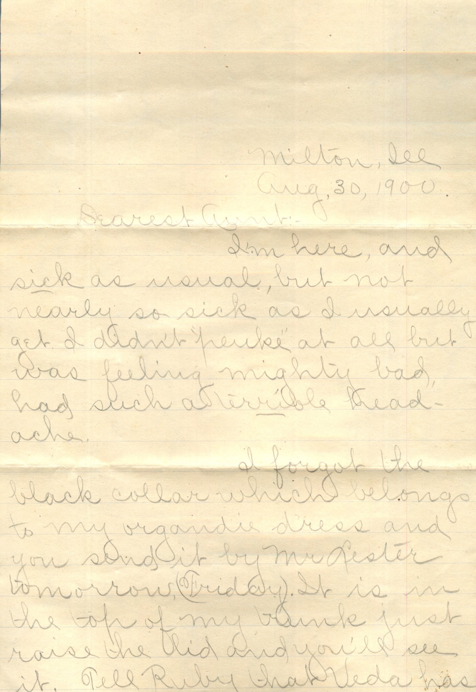
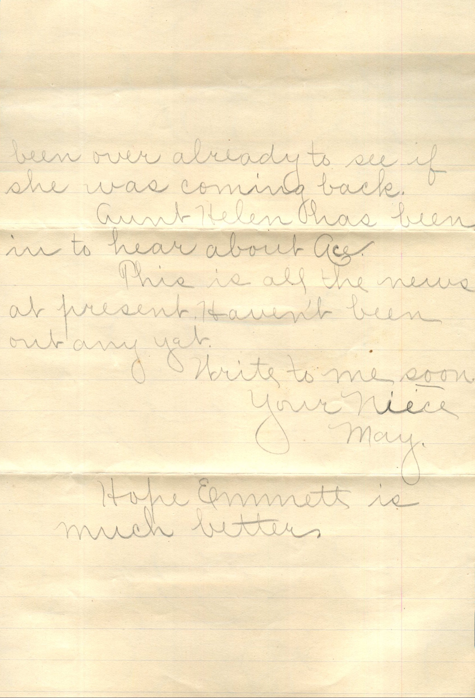
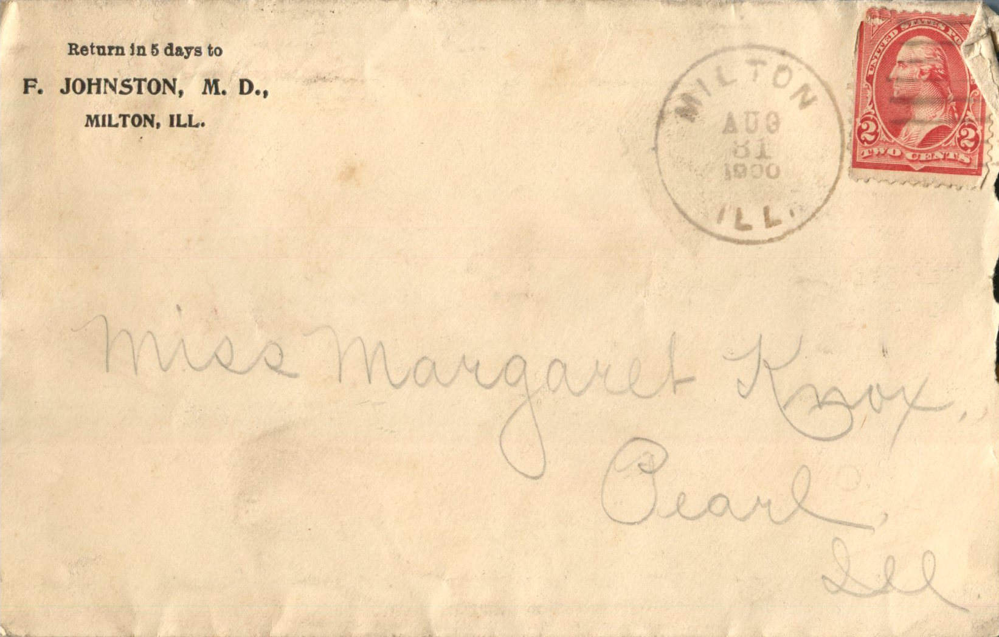
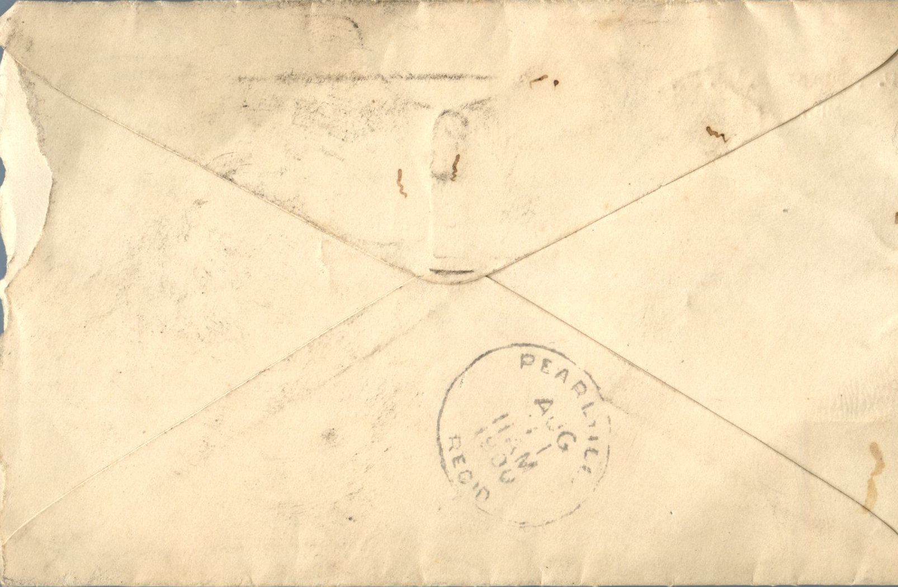

   

From: May, To: Margaret Knox  
Mailed From: Milton, Ill on August 81, 1900

Miss Margaret Knox  
Pearl, Ill

Return in 5 days to  
F. Johnston, M, D.,  
Milton, Ill.

Milton, Ill.  
Aug, 30, 1900  
Dearest Aunt,  
I’m here and sick as usual, but not nearly so sick as I usually get. I didn’t “puke” at all but was feeling mighty bad , had such a terrible headache.  
I forgot the black collar which belongs to my organdy dress and you send it by Mr. Lester tomorrow (Friday). It is in the top of my bunk just raise the lid and you’ll see it. Tell Ruby that Veda has been over already to see if she was coming back.  
Aunt Helen has been in to hear about Ace.  
This is all the news at present. Haven’t been out any yet.  
Write to me soon,  
Your Niece,  
May