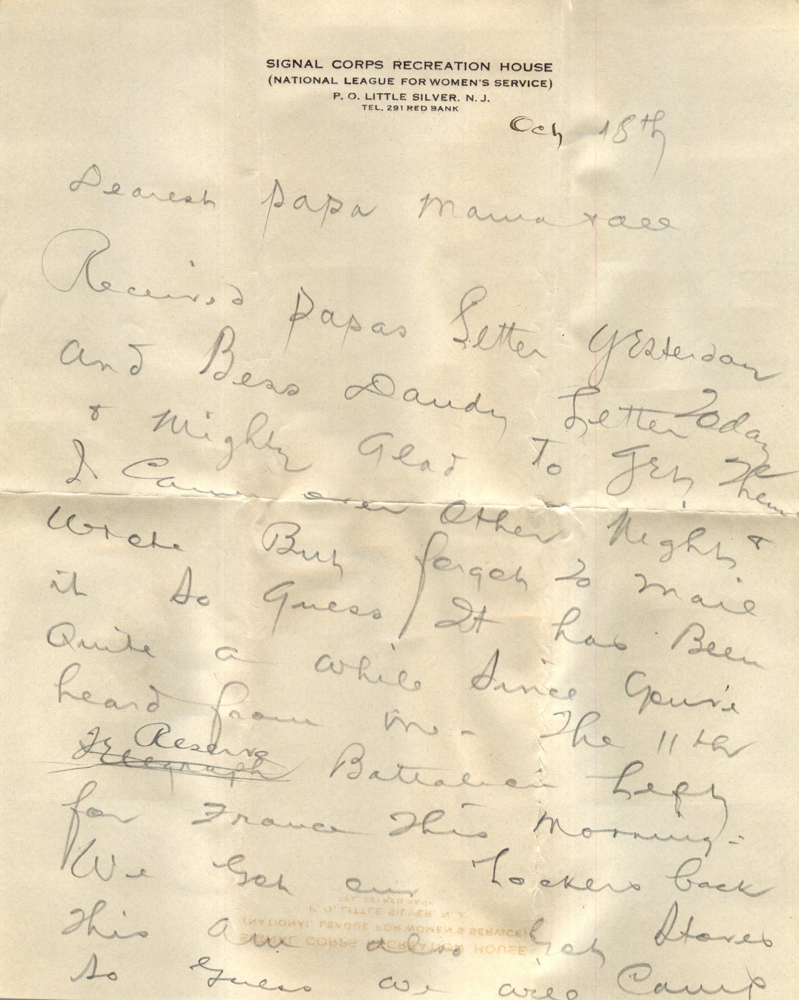
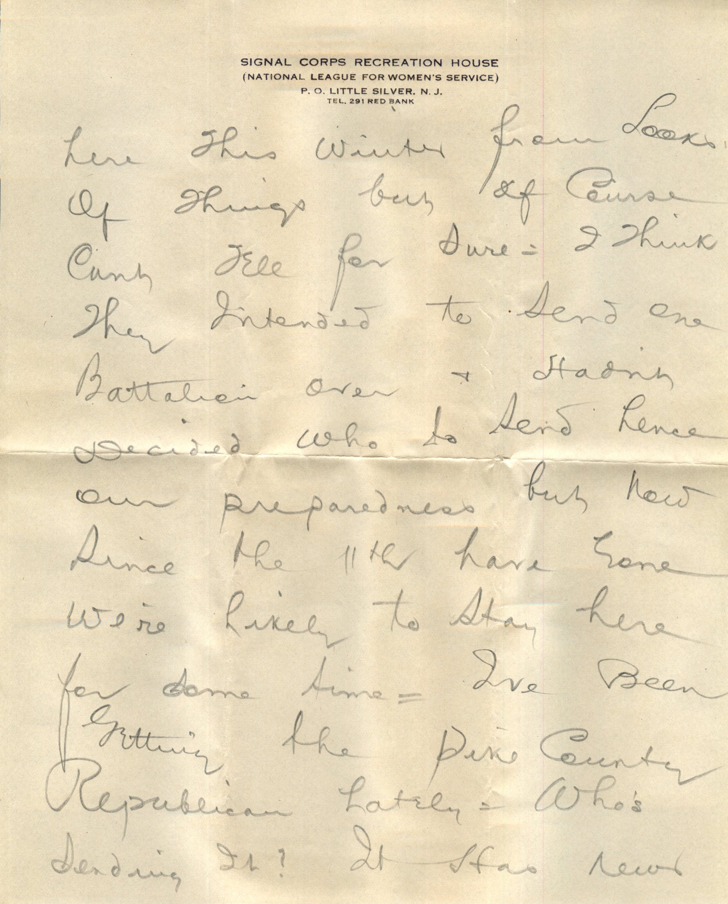
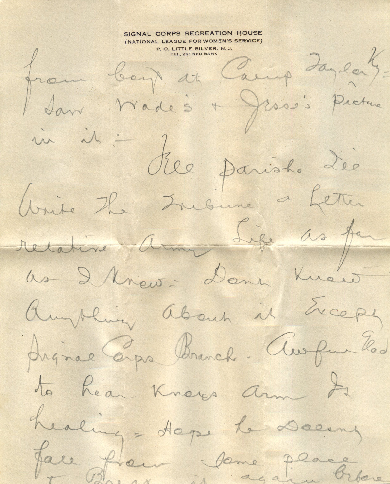
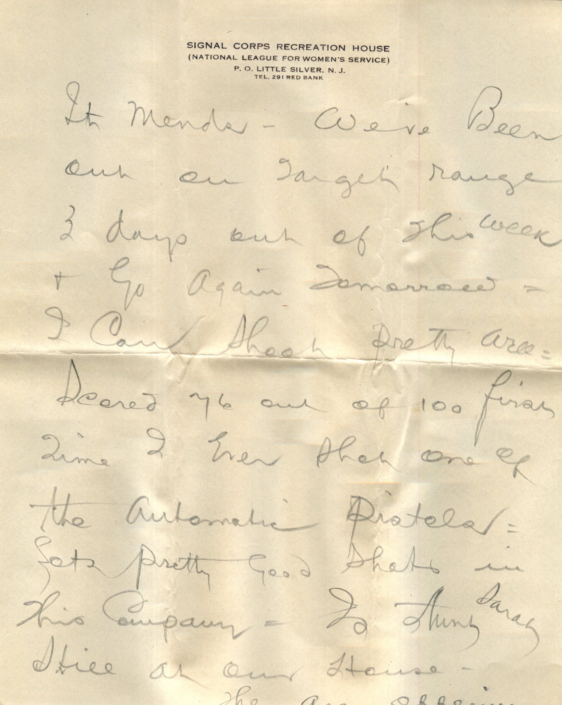
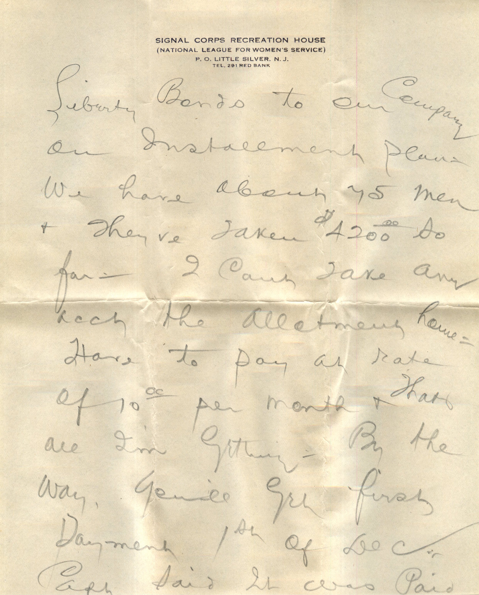
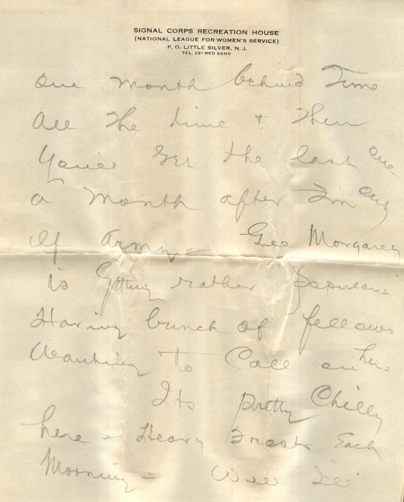
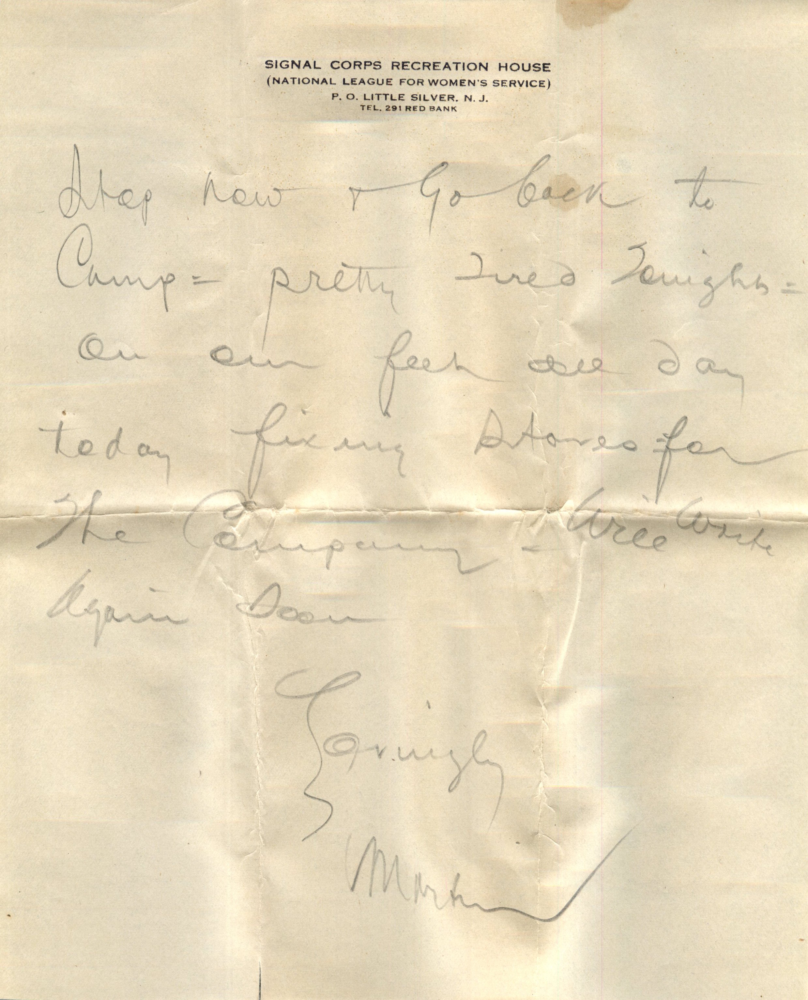

      

From: Martin Chandler, To: Elijah H. Chandler and Family  
Mailed From: Little Silver, New Jersey October 18

Oct 18th  
Dearest Papa, Mama, and all  
Received papas letter yesterday and Bess’ dandy letter today and mighty glad to get them. I came over other night and wrote but forgot to mail it so guess it has been quite a while since you’ve heard from me. The 11th Reserve battalion left for France this morning. We got our lockers back this am also got stoves so guess we will camp here this winter from looks of things but of course can’t tell for sure. I think they intended to send one battalion over and hadn’t decided who to send hence our preparedness but now since the 11th have gone we’re likely to stay here for some time. I’ve been getting the Pike Country Republican lately. Who’s sending it? It has news from boys at Camp Taylor. Saw Wade’s and Jesse’s picture in it.  
Tell Parish I’ll write the Tribune a letter relative Army Life as far as I knew. Don’t know anything about it except Signal Corps Branch. Awful glad to hear Knox’s arm is healing. Hope he doesn’t fall from some place and break it again before it mends. We’ve been out on target range 3 days out of this week and go again tomorrow. I can shoot pretty well. Scored 76 out of 100 first time. I even tho one of the automatic pistols. Lots pretty good shots in this company. Is Aunt Sarah still at our house?  
They are offering liberty bonds to our company on installment plans. We have about 75 men and they’re taken $4200.00 so far. I can’t take any account the allotment home. Have o pay at rates $10.00 per month and thats all I’m getting. By the way, you’ll get first payment 1st of December. Captain said it was paid one month behind June all the time and then you’ll get the last one a month after I’m out of army. Gee Margaret is getting rather popular. Having bunch of fellows wanting to call on her.  
It’s pretty chilly here. heavy frosts each morning. Well I’ll stop now and go back to camp. Pretty tired tonight. On our feet all day today fixing stoves for the company. Will write again soon.  
Lovingly,  
Martin