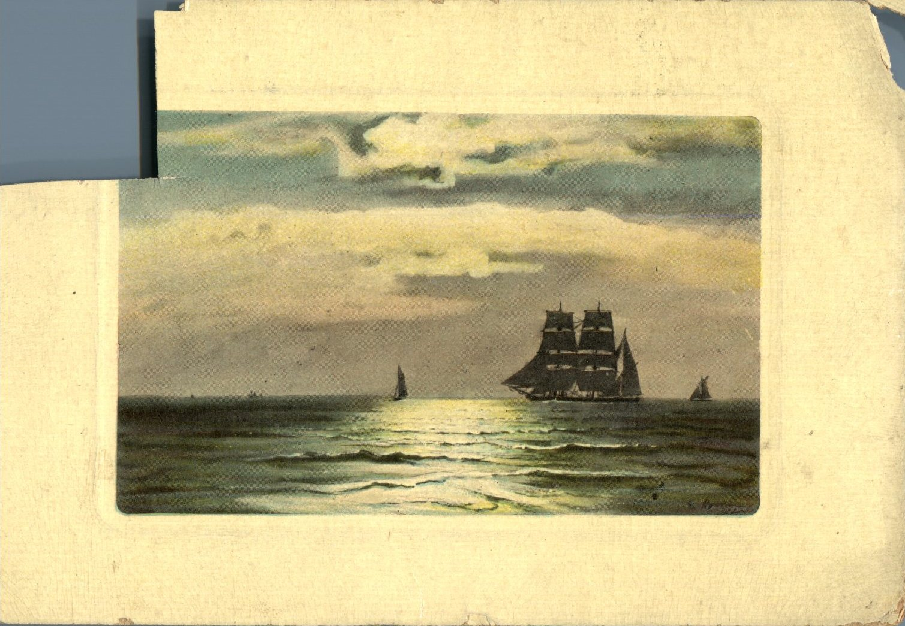
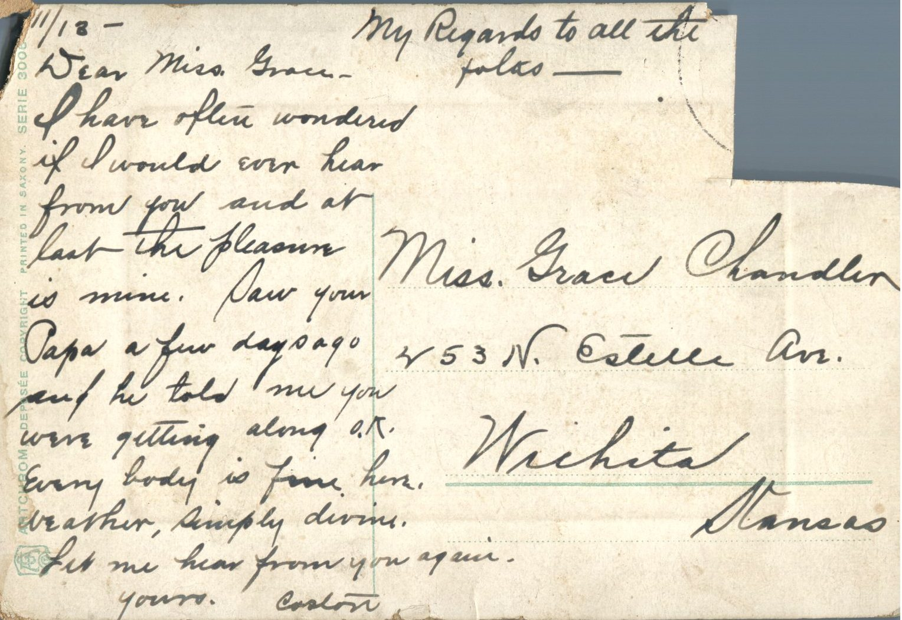

 

From: Caston, To: Grace Chandler

Miss. Grace Chandler  
453 N. Estelle Ave.  
Wichita, Kansas

11/13  
My best regards to all the folks  
Dear Miss Grace,  
I have often wondered if I would ever hear from you and at last the pleasure is mine. Saw your Papa a few days ago and he told me you were getting along O.K. Everybody is fine here. Weather, simply divine. Let me hear from you again.  
Yours,  
Caston