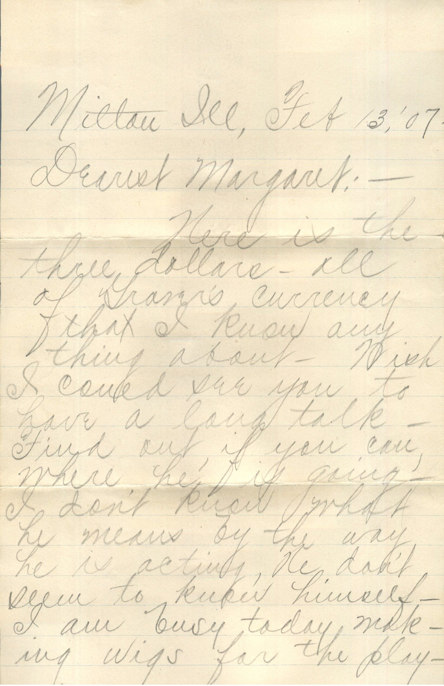
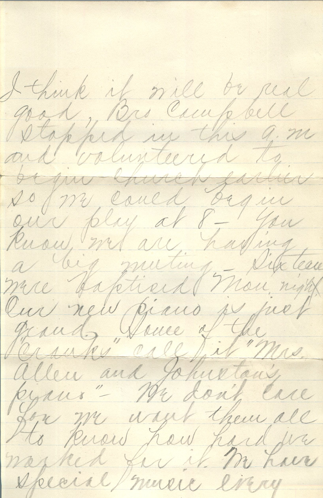
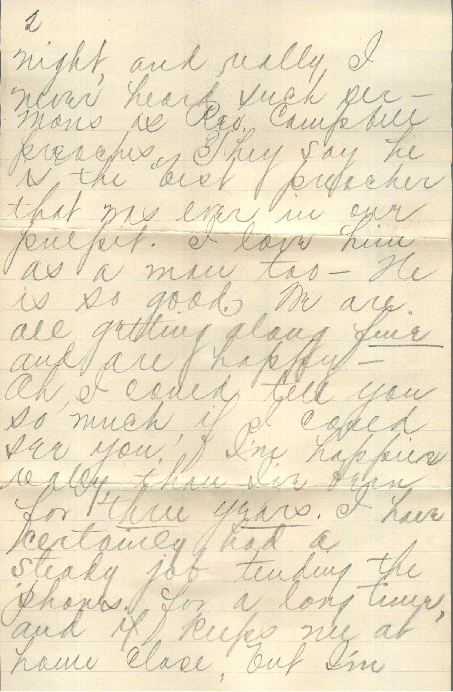
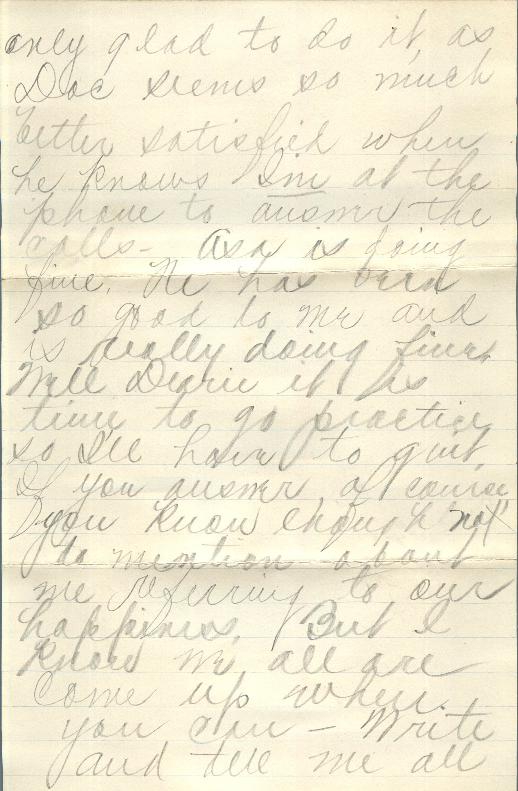
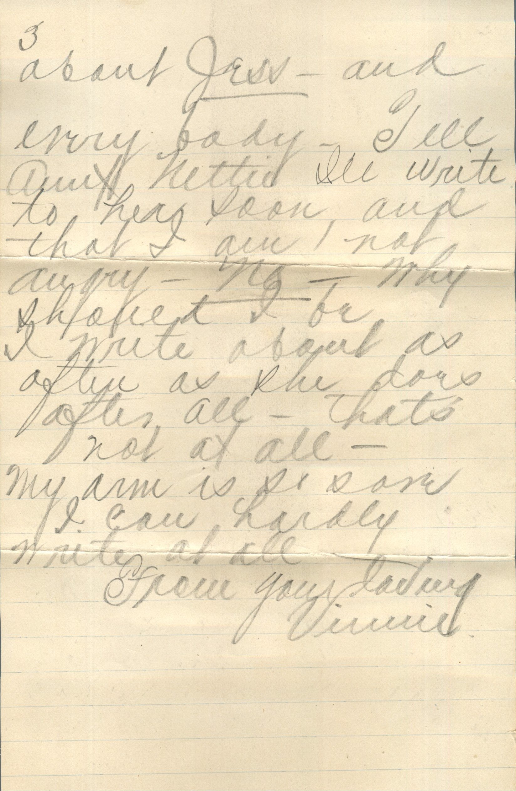
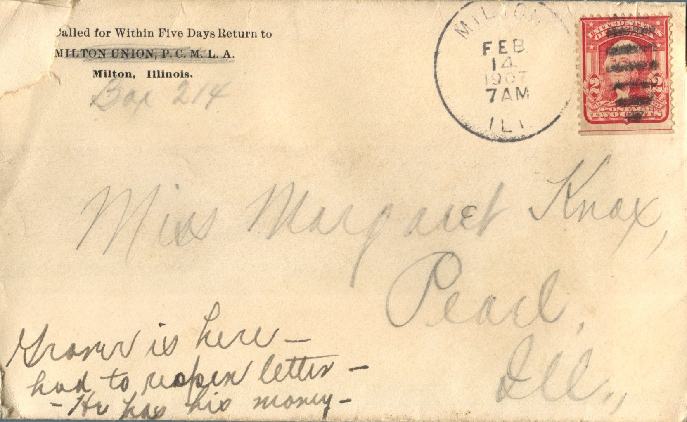
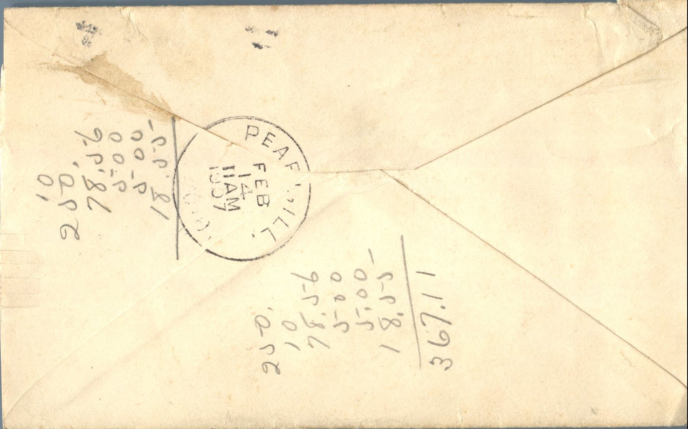

      

From: Vinnie, To: Margaret Knox  
Mailed From: Milton, Ill. on February 14, 1907

Miss Margaret Knox  
Pearl, Ill.  
Grover is here had to resend letter. He has his money.

Milton, Ill. Feb 13, ’07  
Dearest Margaret,  
Here is the three dollars – all of Grover’s currency that I know anything about. Wish I could see you to have a long talk. Find out, if you can, where he is going. I don’t know what he means by the way he is acting. He don’t seem to know himself. I am busy today making wigs for the play. I think it will be real good, Bro Campbell stopped in this a.m. and volunteered to begin church earlier so we could begin out play at 8. You know we are having a big meeting. Sixteen were baptized Mon. night. Our new piano is just grand. Some of the “cranks” call it “Mrs. Allen and Johnston’s piano.” We don’t care for we want them all to know how hard we worked for it. We have special music every night and really I never heard such sermons as Rev. Campbell preaches. They say he is the best preacher that was ever in our pulpit. I love him as a man too – He is so good. We are all getting along fine and are happy. Oh I could tell you so much, if I could see you. I’m happiest really than I’ve been for three years. I have certainly had a steady job tending the phones for a long time and at home class, but I’m only glad to do it, as Doc seems so much better satisfied when he knows I’m at the phone to answer the calls. Asa is doing fine. He has been so good to me and is really doing fine. Well Dearie it is time to go practice so I’ll have to quit. If you answer of course, you know enough not to mention about me referring to our happiness, but I know we all are come up when you can. Write and tell me all about Jess and everybody. Tell Aunt Nettie I’ll write to her soon and that I am not angry. No – why should I be – I write about as often as she does after all – thats not at all.  
My arm is so sore I can hardly write at all.  
From your friend,  
Vinnie