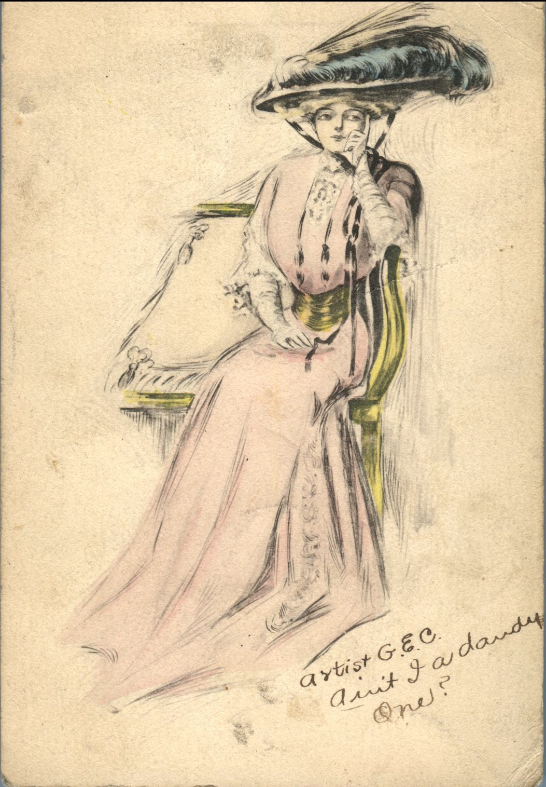
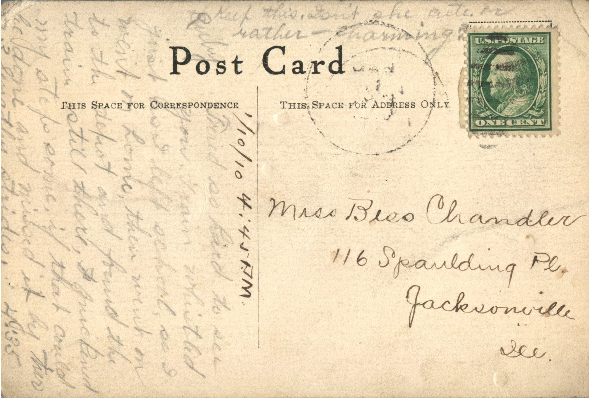

 

From: Ruby Chandler, To: Bess Chandler

Miss Bess Chandler  
116 Spaulding Pl.  
Jacksonville, Ill.

Written on the Front:  
Artist G.E.C.  
Ain’t I a dandy one?

1/10/10 – 4:45 p.m.  
Tried so hard to see you. Train whistled just as I left school, so I went on home, then went on to the depot and found the train still there. I quickened my steps some, if that could be done and missed it by two or three lengthy strides. 4:35  
Keep this. Don’t she look cute or rather – charming?  
Ruby