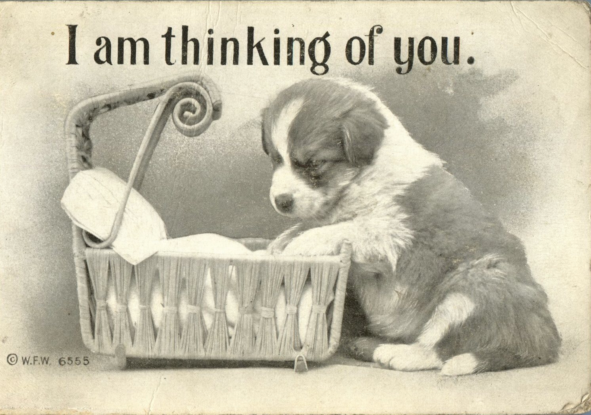
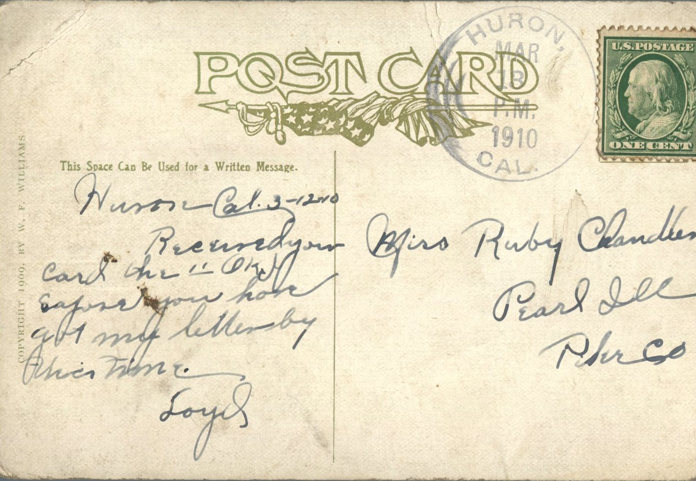

 

From: Loyd, To: Ruby Chandler  
Mailed From: Huron, California on March 13, 1910  
Postcard Info: Copyright 1909, By W.F. Williams

Miss Ruby Chandler  
Pearl, Illinois  
Pike Co.

Huron, Cal. 3-12-10  
Received your card the 11th or 12th. Suppose you have got my letter by union time.  
Loyd