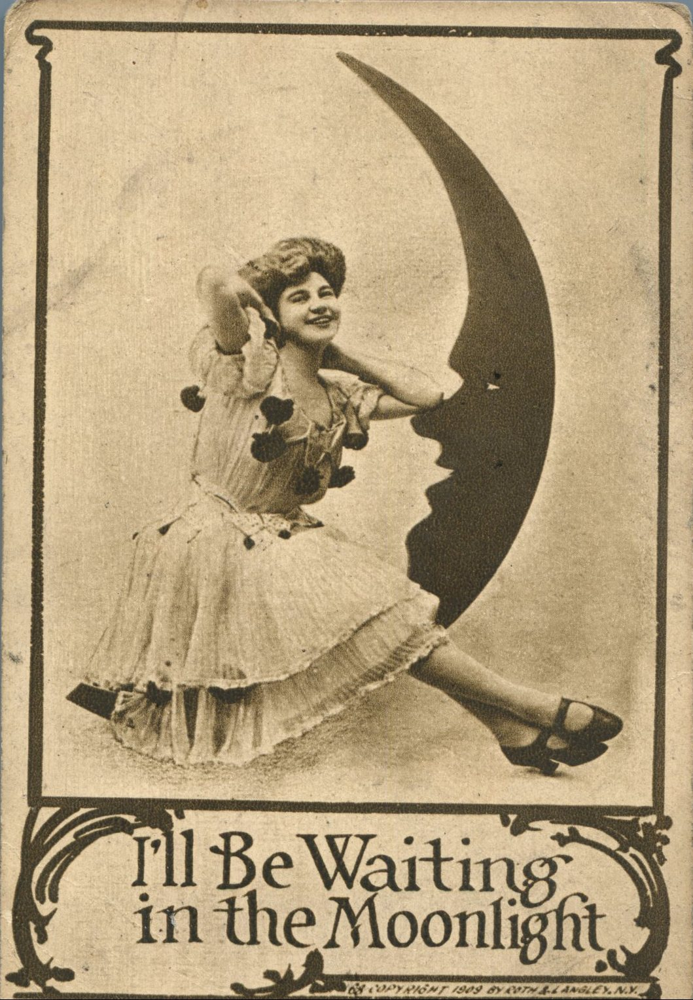
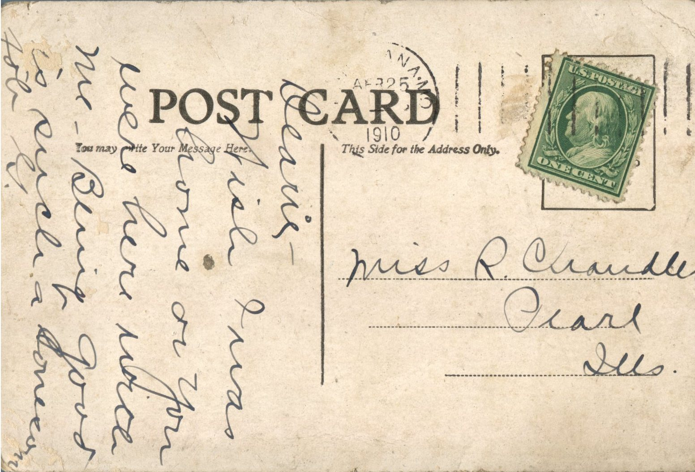

 

From: G., To: Ruby Chandler  
Mailed From: MO on April 25, 1910  
Picture Info: Copyright 1909 by Roth &amp; Langley, N.Y.

Miss R. Chandler  
Pearl, Illinois

Dearie,  
Wish I was home or you were here with me. Being good is such a lonesome job.  
G.