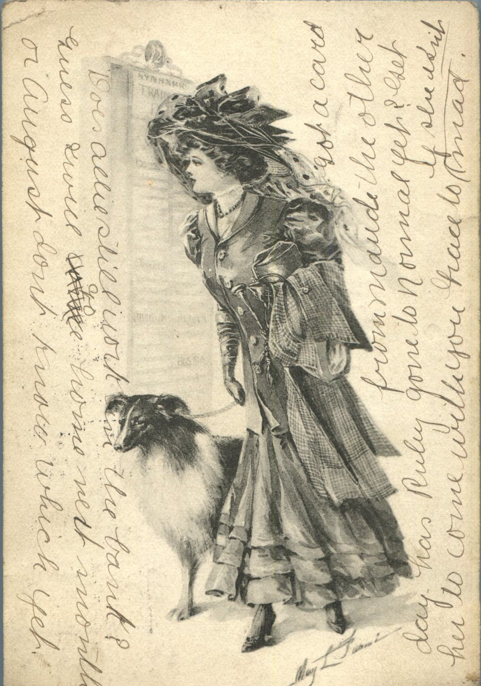
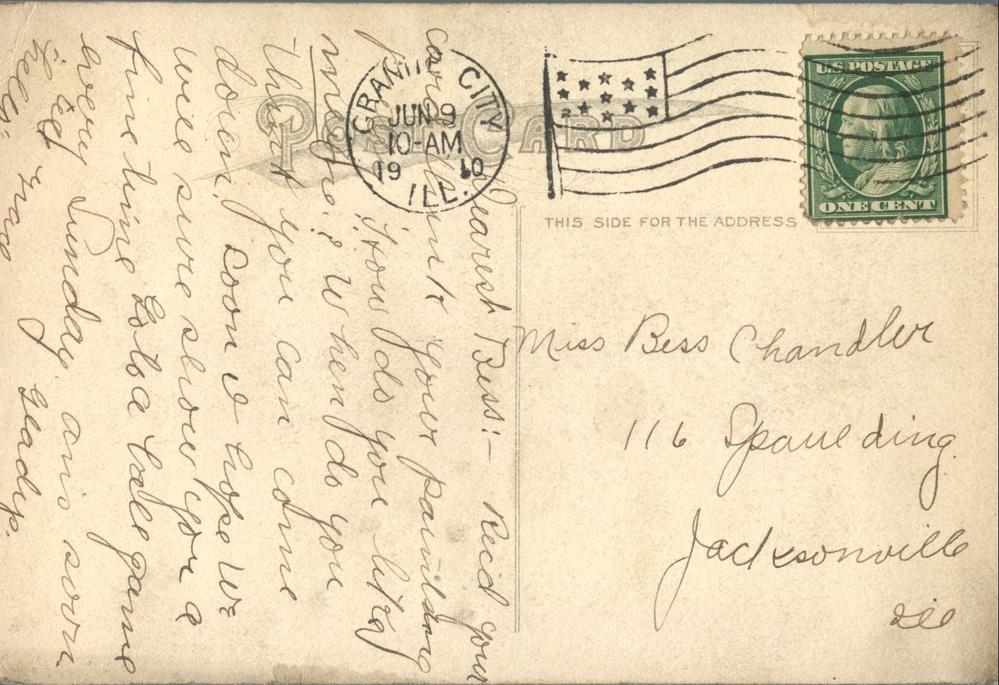

 From: Gladys, To: Bess Chandler  
Mailed From: Granite City, Illinois on June 9, 1910

Miss Bess Chandler  
116 Spaulding  
Jacksonville, Ill.

Dearest Bess,  
Received you card. Think your painting pretty. How did you like mine? When do you think you can come down? Soon I hope. We will sure show you a fine time, go to a ball game every Sunday. Ans. soon  
Gladys  
Tell Grace “hello.”

Written on the Front:  
Does Allie still work in the bank? Guess will go home next month or August don’t know which yet. Got a card from Maude the other day. Has Ruby gone to Normal yet? Get her to come with you, Grace too is she isn’t mad.