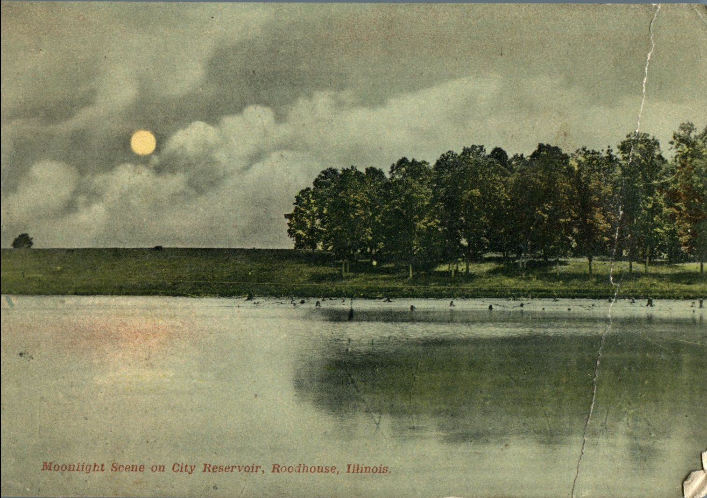
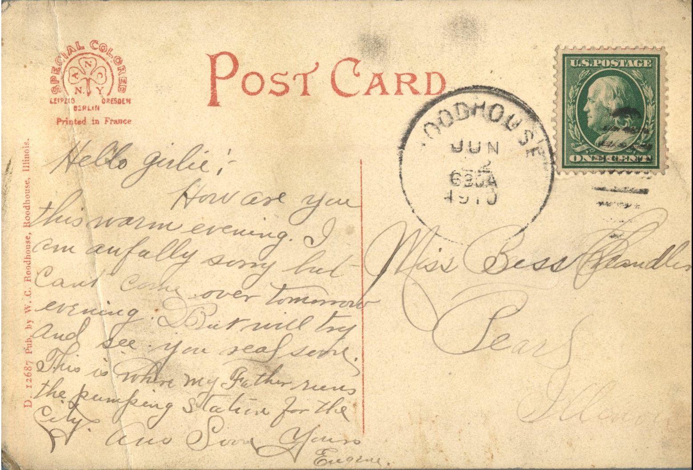

 

From: Eugene, To: Bess Chandler  
Mailed From: Roadhouse, Illinois on June 22, 1910  
Postcard Info: D. 12687 Pub. by W.C. Roadhouse, Roadhouse, Illinois  
Picture Info: Moonlight Scene on City Reservoir, Roadhouse, Illinois

Miss Bess Chandler  
Pearl, Illinois

Hello girlie,  
How are you this warm evening? I am awfully sorry but can’t come over tomorrow evening. But will try and see you real soon. This is where m father runs the pumping station for the city. Answer soon.  
Yours,  
Eugene