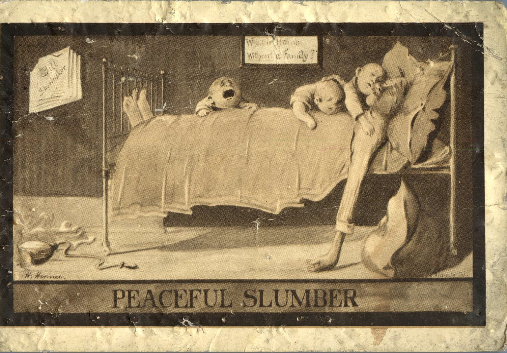
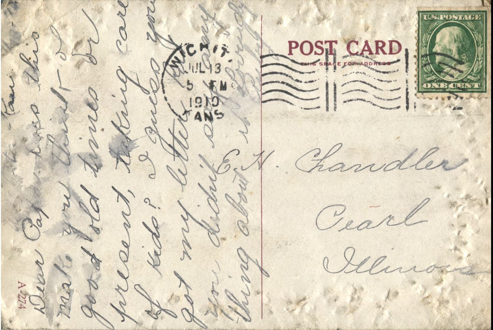

 From: Ruby Chandler, To: Elijah H. Chandler  
Mailed From: Wichita, Kansas on July 13, 1910

E.H. Chandler  
Pearl, Illinois

Wichita, Kansas  
Dear Papa,  
Does this make you think of good old times or present, taking care of kids? I guess you got my letter but you didn’t say anything about it.  
Lovingly,  
Ruby