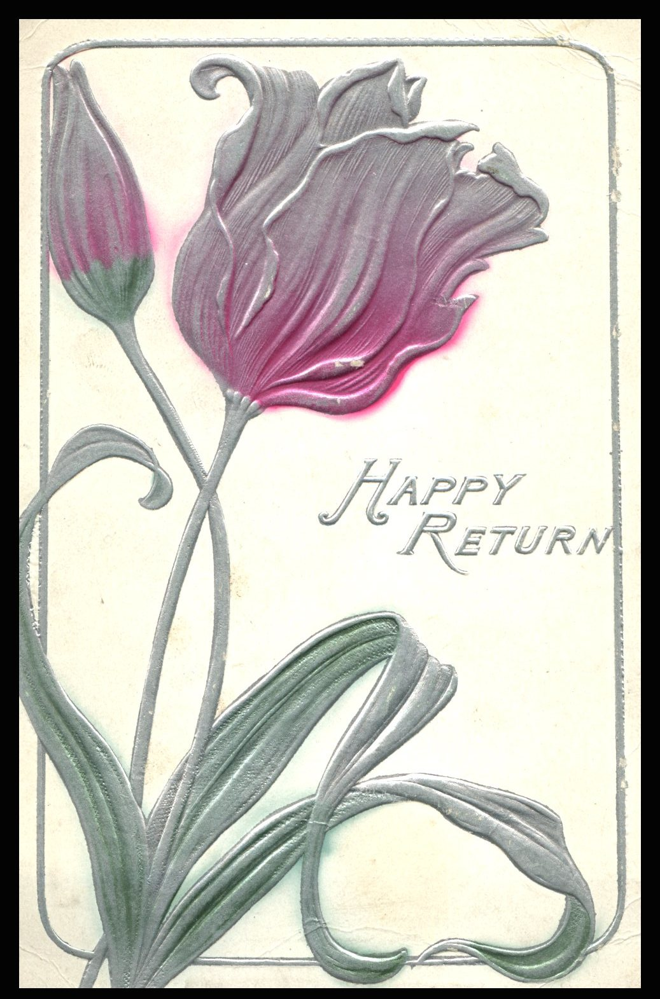
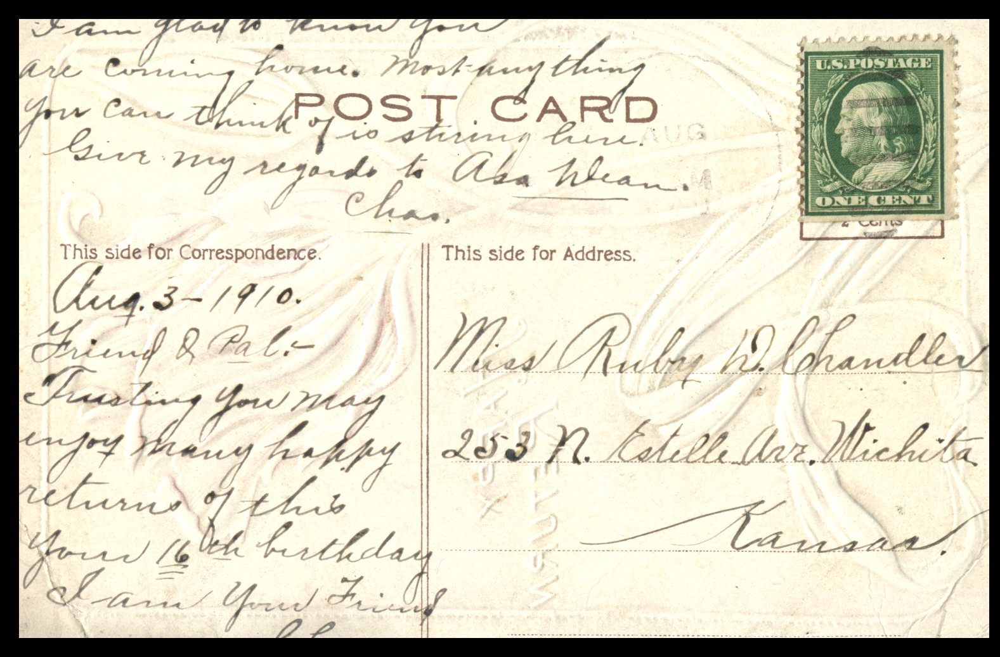

 From: Chas., To: Ruby D. Chandler

Miss Ruby D. Chandler  
253 N. Estelle Ave.  
Wichita, Kansas

August 3 – 1910  
Friend and Pal,  
Trusting you may enjoy many happy returns of this your 16th birthday.  
I am your friend,  
Chas.  
I am glad to know you are coming home. Most everything you can think of is stirring here. Give my regards to Aba Wean.  
Chas.