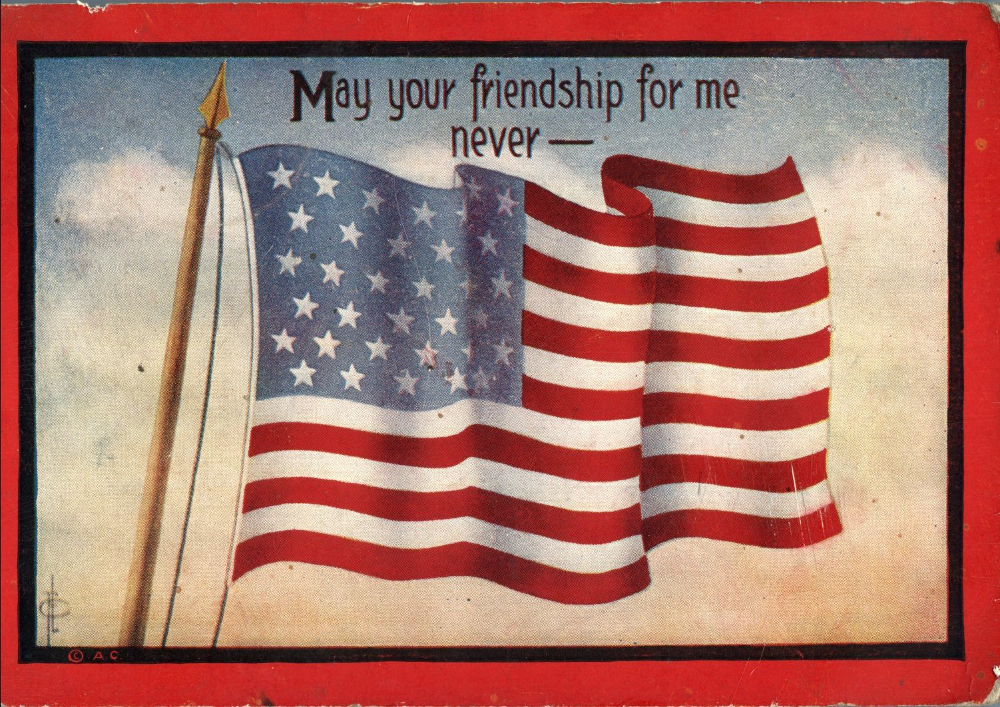
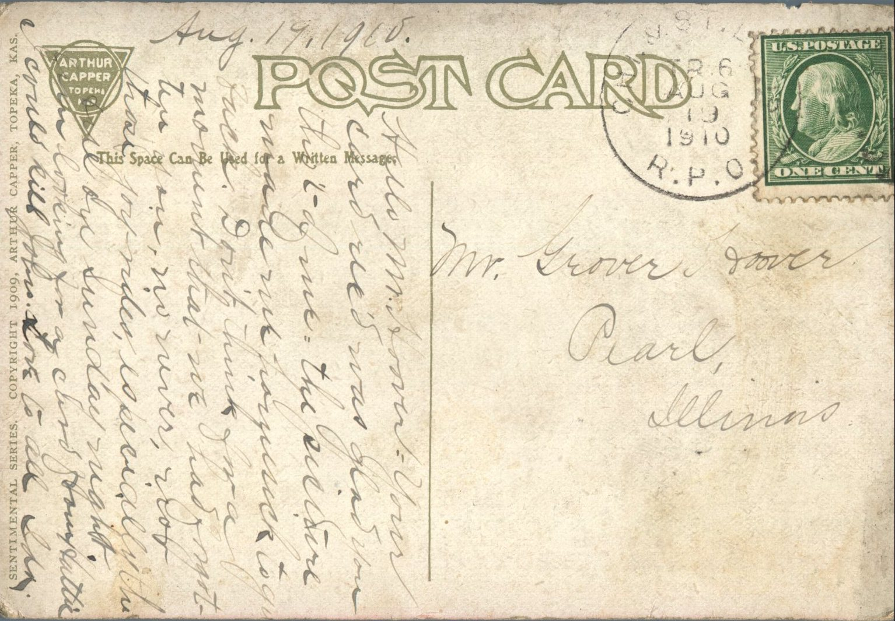

 

From: Ida, To: Grover Hoover  
Mailed From: St. Louis, MO on August 19, 1910  
Postcard Info: Sentimental Series. Copyright 1909, Arthur Capper, Topeka, Kas.

Mr. Grover Hoover  
Pearl, Illinois

August 19, 1910  
Hello Mr. Hoover,  
Your card received. Was glad you thought of me. Th picture made me homesick to go back. Don’t think for a moment that we had forgotten you, no never, not those joy rides, especially the one on Sunday night. Am looking for a card from Hattie. I could kill John. Love to all,  
Ida