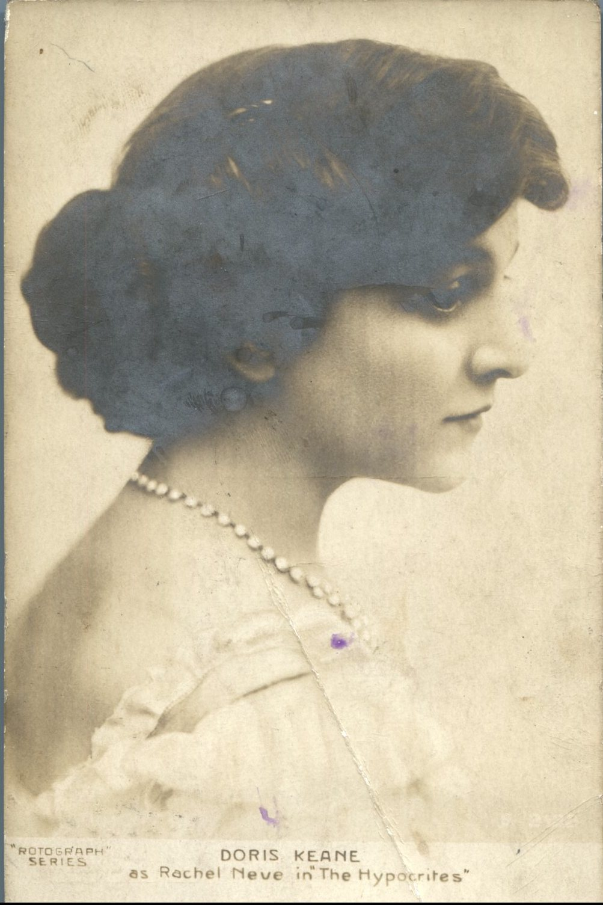
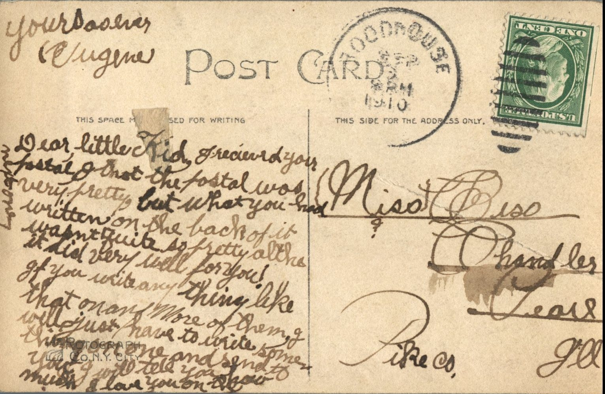

 

From: Eugene, To: Bess Chandler  
Mailed From: Roadhouse, Illinois on September 3, 1910  
Picture Info: Doris Keane as Rachel Neve in “The Hypocrites” Rotograph Series

Miss Bess Chandler  
Pearl, Illinois  
Pike, County

Dear little kid,  
I received your postal. I thought the postal was very pretty but what you had written on the back of it wasn’t quite so pretty although it did very well for you! If you write anything like that on one more of them, I will just have to write some thing on one and send to you. I will tell you how much I love you on the letter.  
Yours always,  
Eugune