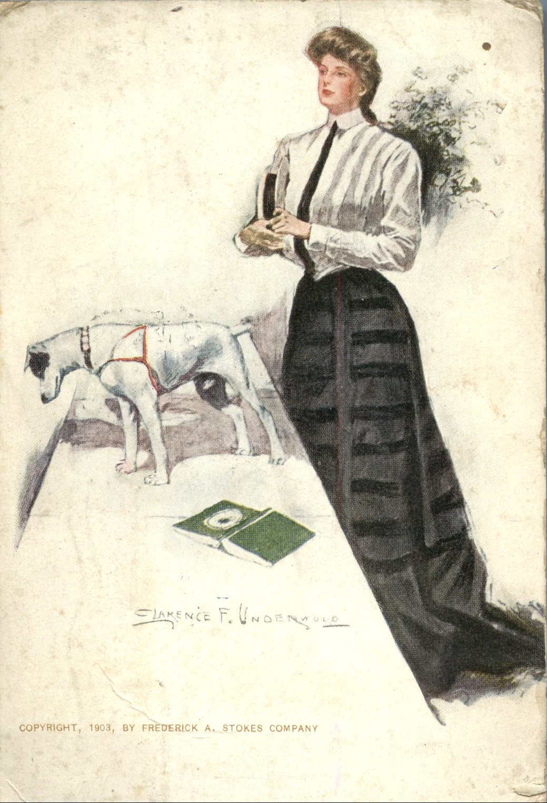
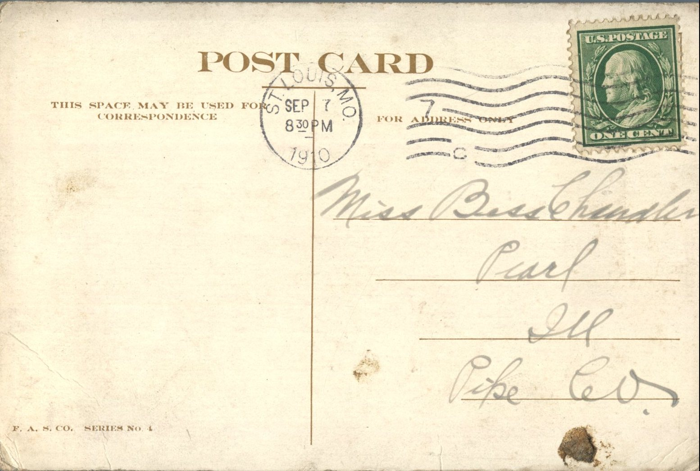

 From: Unknown, To: Bess Chandler  
Mailed From: St. Louis, MO on September 7, 1910  
Postcard Info: F.A.S.Co. Series No. 4  
Picture Info: Copyright, 1903 by Frederick A. Stokes Company

Miss Bess Chandler  
Pearl, Illinois  
Pike Co.