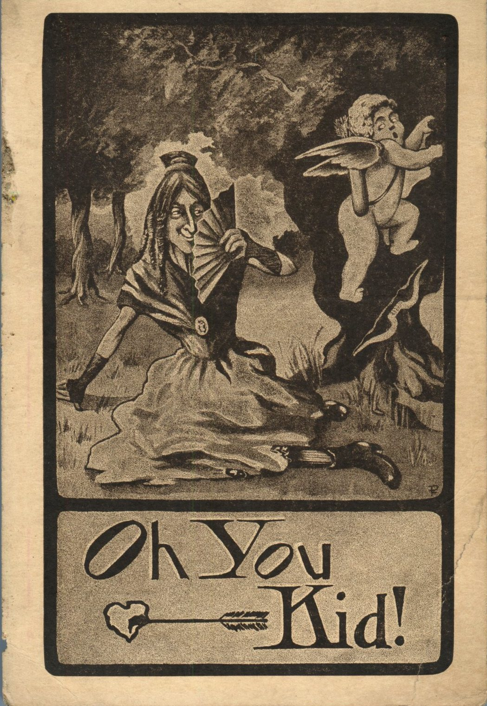
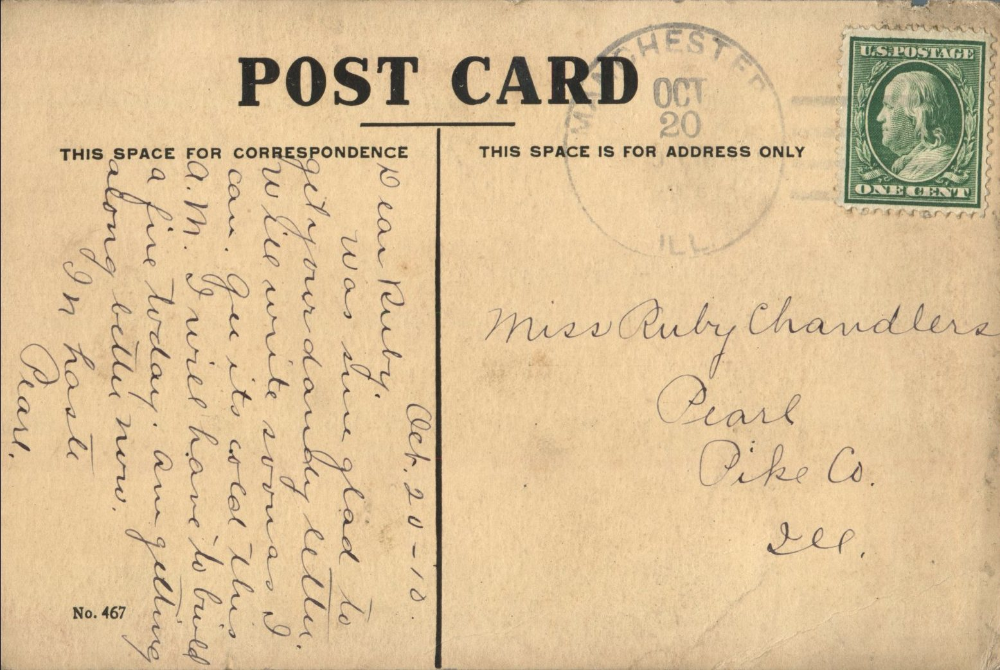

 From: Pearl Ellis, To: Ruby Chandler  
Mailed From: Manchester, Illinois on October 20, 1910

Miss Ruby Chandler  
Pearl, Illinois  
Pike Co.

Oct. 20 – 10  
Dear Ruby,  
Was sure glad to get your dandy letter. Will write soon as I can. Gee it’s cold this a.m. I will have to build a fire today. Am getting along better now.  
In haste,  
Pearl