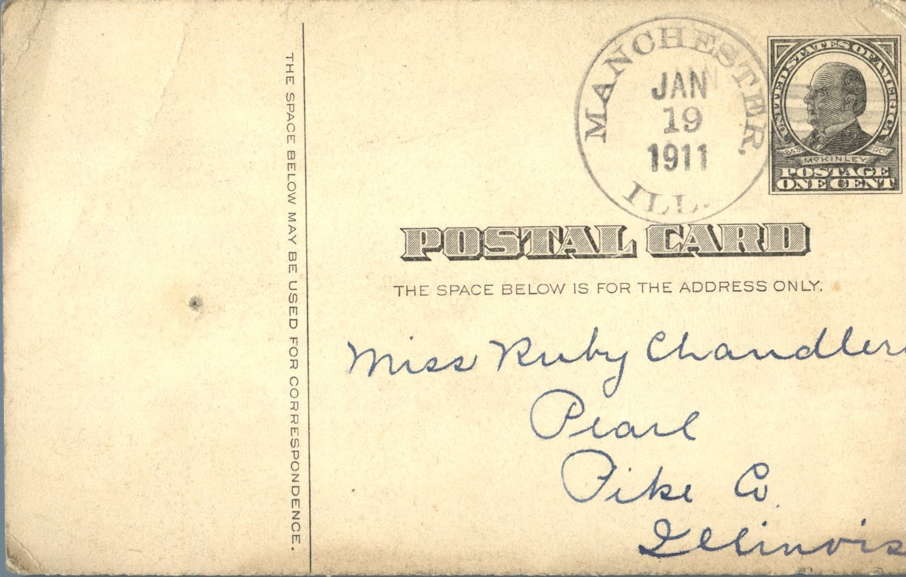
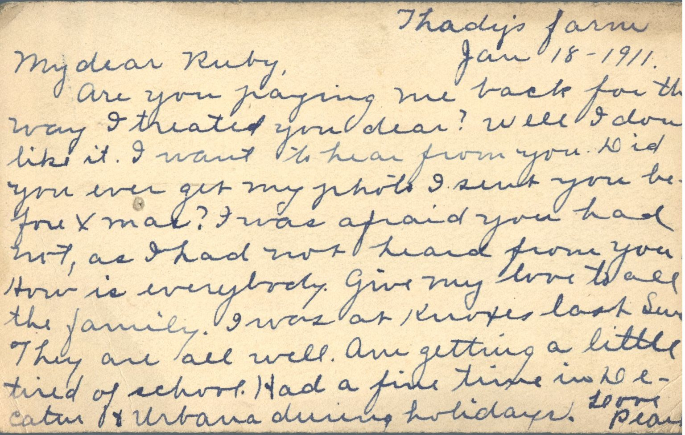

From: Pearl Ellis, To: Ruby Chandler  
Mailed From: Manchester, Illinois on January 19, 1911

Miss Ruby Chandler  
Pearl, Illinois  
Pike County

Thady’s Farm  
Jan 18 – 1911  
My dear Ruby,  
Are you paying me back for the way I treated you dear? Well I don’t like it. I want to hear from you. Did you ever get my photo I sent to you before Christmas? I was afraid you had not, as I had not heard from you. How is everybody? Give my love to all the family. I was at Knox’s last Sunday. They are all well. Am getting a little tired of school. Had a fine time in Decater and Urbana during holidays.  
Love,  
Pearl