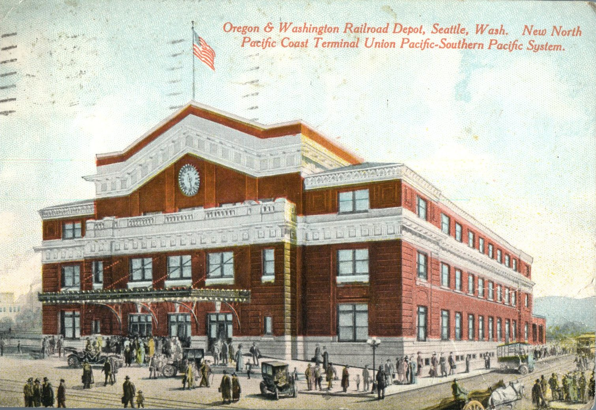
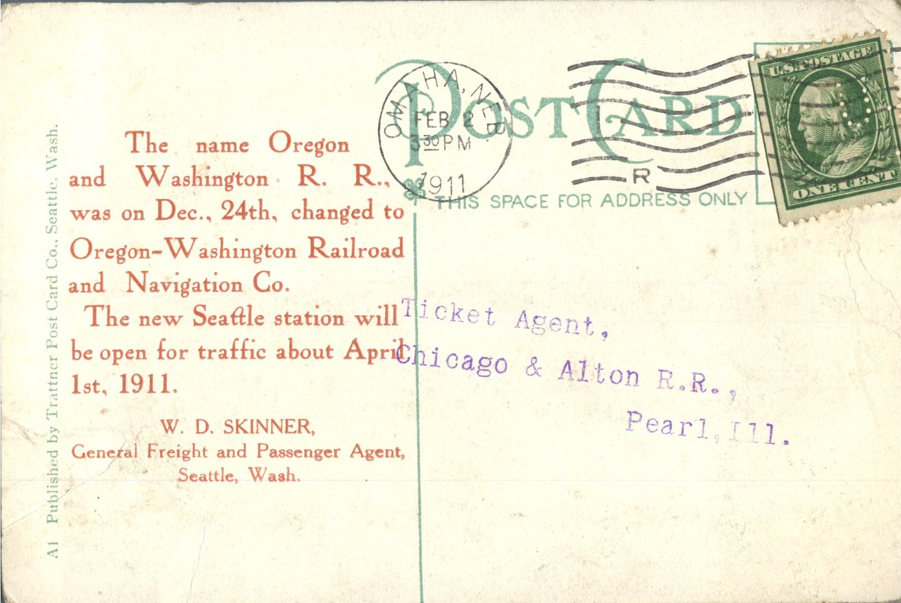

 From: W.D. Skinner, To: Ticket Agent  
Mailed From: Omaha, Nebraska on February 2, 1911  
Postcard Info: A1 Published by Trattner Post Card Co., Seattle, Wash.  
Picture Info: Oregon &amp; Washington Railroad Depot, Seattle, Wash. New North Pacific Coast Terminal Union pacific – Southern Pacific System.

Ticket Agent  
Chicago &amp; Alton R.R.,  
Pearl, Ill.

The name Oregon and Washington R.R., was on Dec., 24th, changed to Oregon-Washington Railroad and Navigation Co.  
The new Seattle station will be open for traffic about April 1, 1911  
W.D. Skinner  
General Freight and Passenger Agent,  
Seattle, Wash.