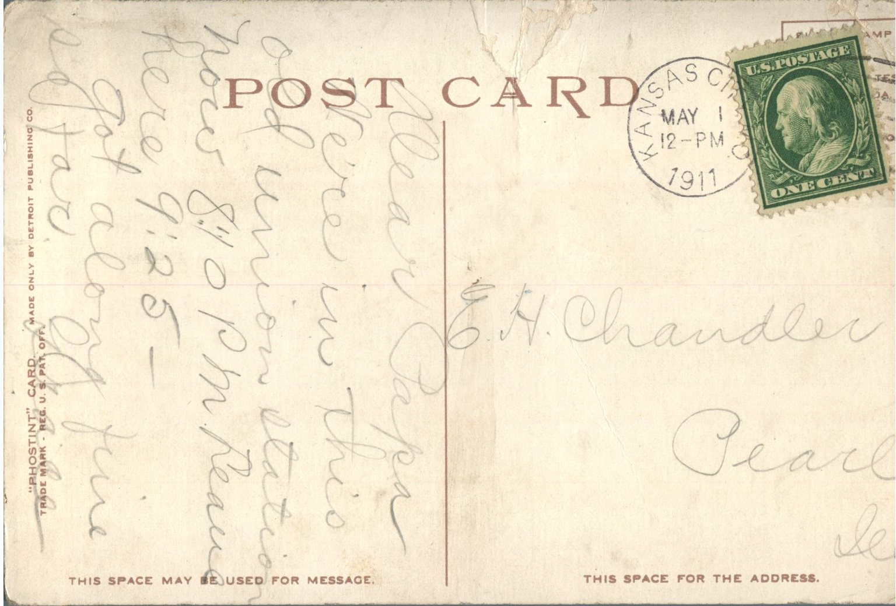

 

From: Grace Chandler, To: Elijah. H. Chandler  
Mailed From: Kansas City, Missouri on May 1, 1911  
Postcard Info: “Phostint” Card. Made only by Detroit Publishing Co. Trademark – Reg. U.S. Pat. Off.  
Picture Info: 12464 Union Station, Kansas City, Missouri

E.H. Chandler  
Pearl, Illinois

Dear Papa,  
We’re in this old Union Station. Now 8:10 pm. Leave here 9:25  
Got along fine so far  
Grace