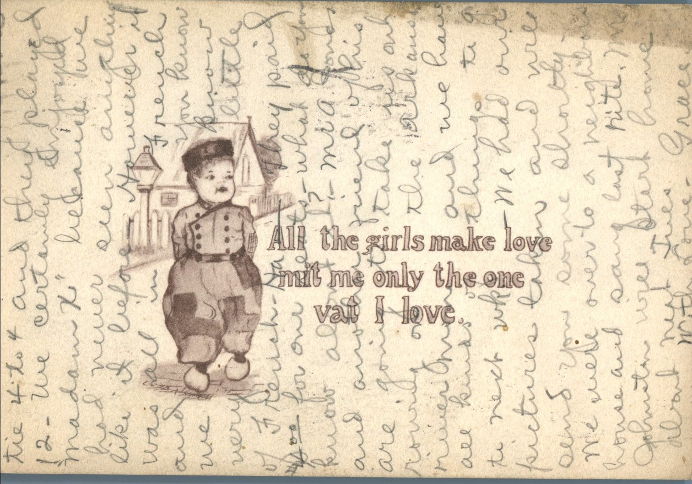
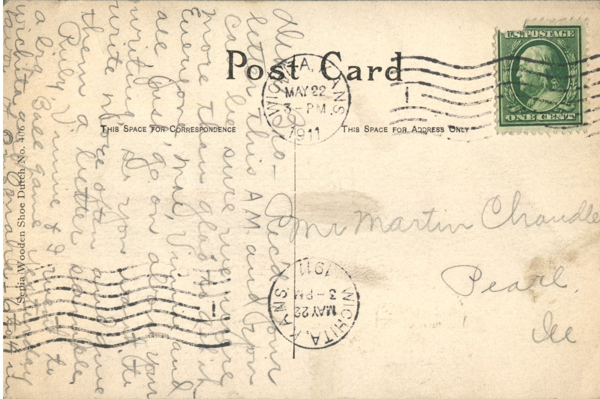

 

From: Grace Chandler, To: Martin Chandler  
Mailed From: Wichita, Kansas on May 22, 1911

Mr. Martin Chandler  
Pearl, Illinois

Dear Bro  
Received your letter this a.m. and you can be sure we were more than glad to get it. Everyone, Mae, Vinnie, and all just go on about your writing, so you want to write more often and give them a letter sample.  
Ruby, Vinnie, and I went to a big ball game yesterday. Wichita and Omaha. 6 to 4 in favor of Omaha. The ninth inning was a tie 4 to 4 and they played 12. We certainly enjoyed Madame X because we had never seen anything like it before. However, it was all in French and you know we know very little French. They paid $4.00 for our seats. What do you know about it? Mr. A. Jones and another friend of his are going to take us out rowing on the Arkansas river Monday and we have all kids of things to do the next week. We had our pictures taken and will send you some shortly. We were over to a neighbors house and sang last night. Mrs. Johnston will start home about next Tuesday.  
With Love,  
Grace