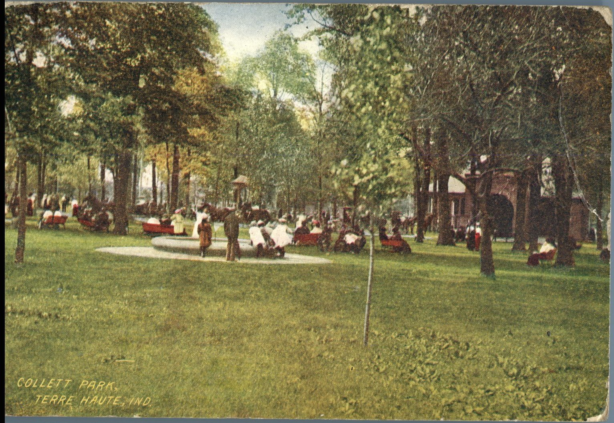
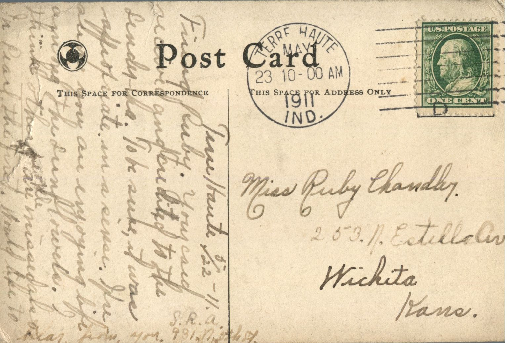

 

From: S.R.A., To: Ruby Chandler  
Postcard Info: Collett Park, Terre Haute, Ind.  
Mailed From: Terre Haute, Indiana on May 23, 1911

Miss Ruby Chandler  
253 N. Estille Ave.  
Wichita, Kansas

Terre Haute 5/22/11  
Friend Ruby,  
Your card received and credited to the sender. To be sure, it was appropriate in a sense. Hope and pray that you are enjoying life among the sunflowers. I think others are missed also in Pearl, the first. Would like to hear from you.  
S.R.A  
931 North Place