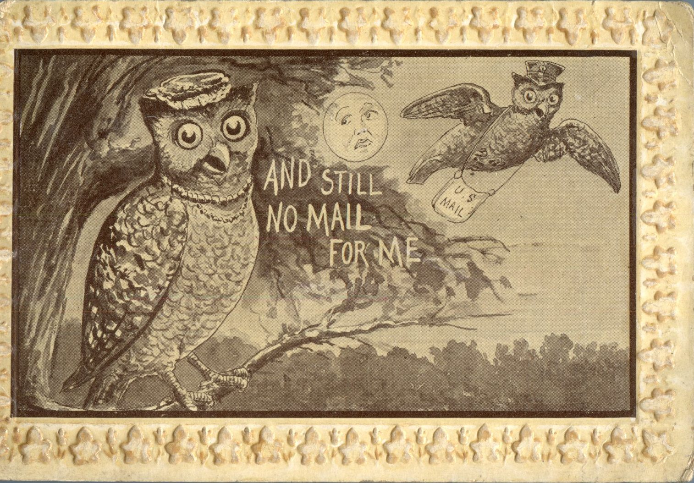
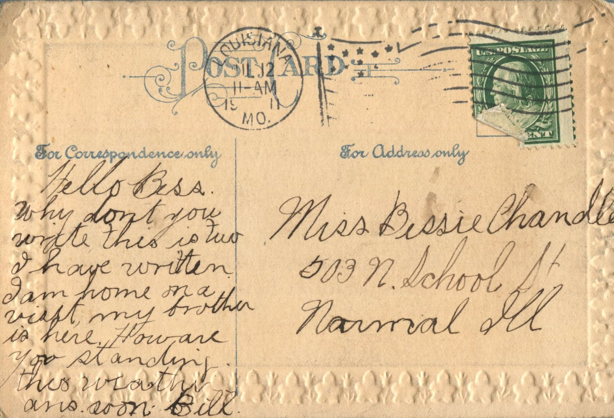

 

From: Bill, To: Bess Chandler  
Mailed From: Louisiana, Missouri on July 2, 1911

Miss Bessie Chandler  
503 N. School St,  
Normal, Illinois

Hello Bess,  
Why don’t you write? This is two I have written. I am home on a visit, my brother is here. How are you standing this weather? Answer soon.  
Bill