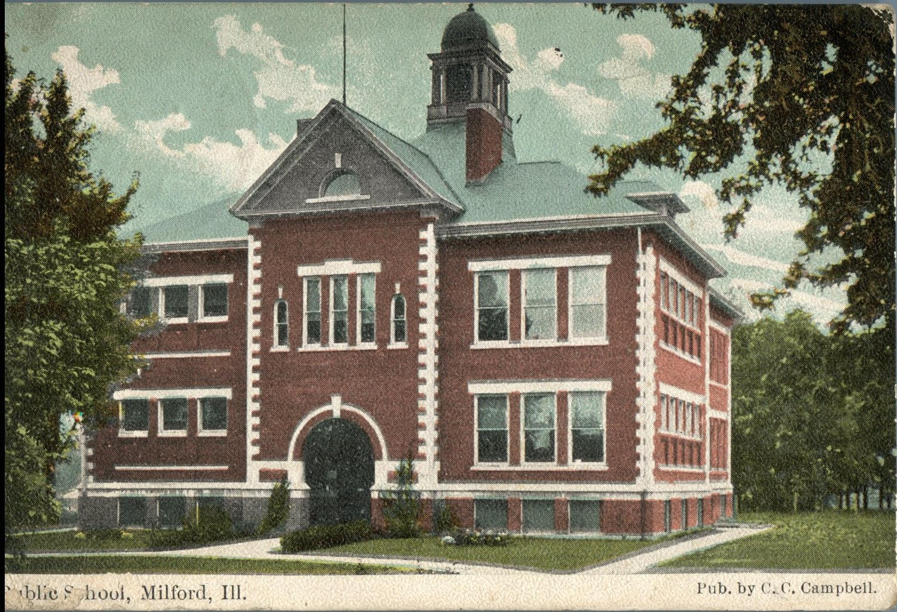
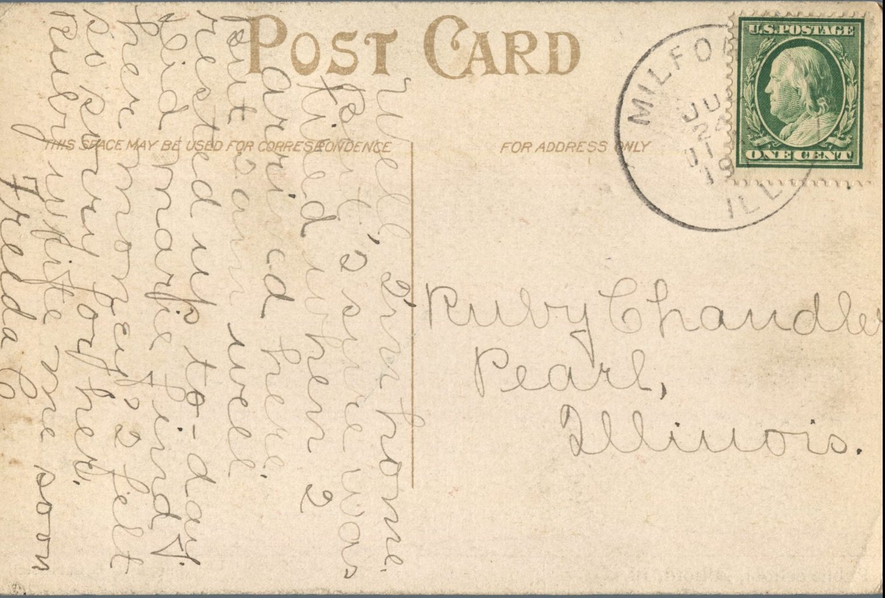

 

From: Freeda C., To: Ruby Chandler  
Mailed From: Milford, Illinois on July 24, 1911  
Picture Info: Public School, Milford, Ill. Pub. by C.C. Campbell

Ruby Chandler  
Pearl, Illinois

Well, I’m home. But I sure was tired when I arrived here. But I am well rested up today. Did Marie find her money? I felt so sorry for her. Ruby write me soon.  
Freeda C.