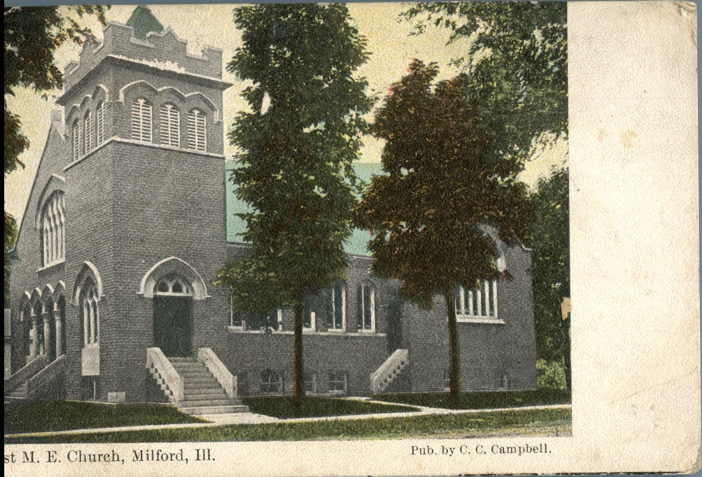
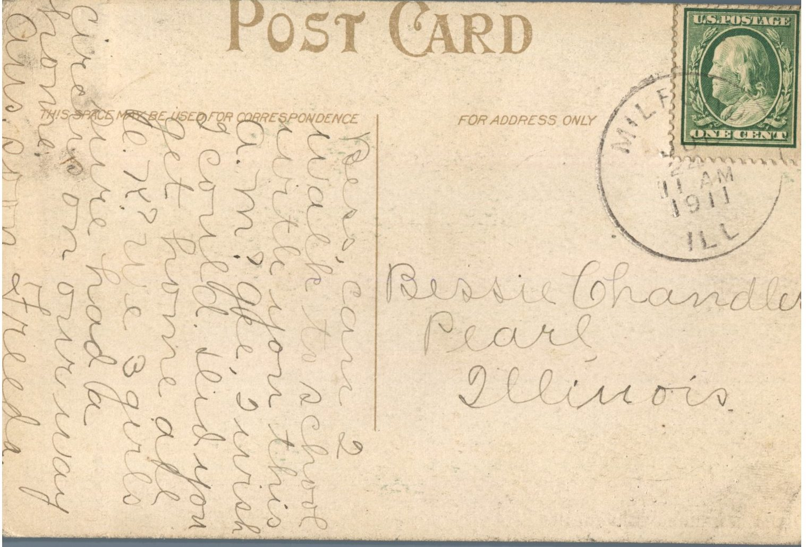

From: Freeda, To: Bess Chandler  
Picture Info: 1st M.E. Church, Milford, Illinois, Pub. by C.C.Campbell  
Mailed From: Milford, Illinois on July 24, 1911

Bessie Chandler  
Pearl, Illinois

Bess,  
Can I walk to school with you this a.m? Gee, I wish I could. Did you get home all O.K.? We 3 girls sure had a circus on our way home. Answer soon.  
Freeda