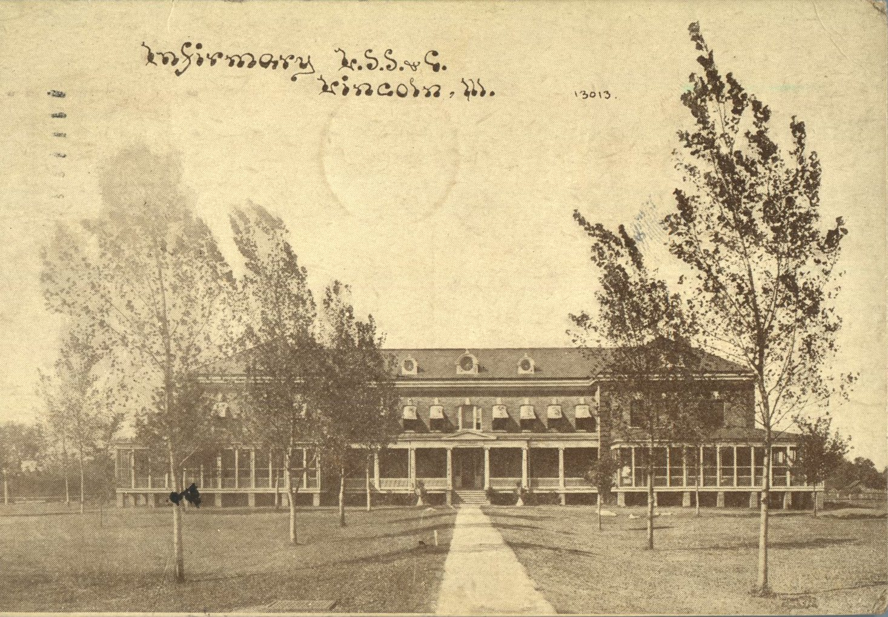
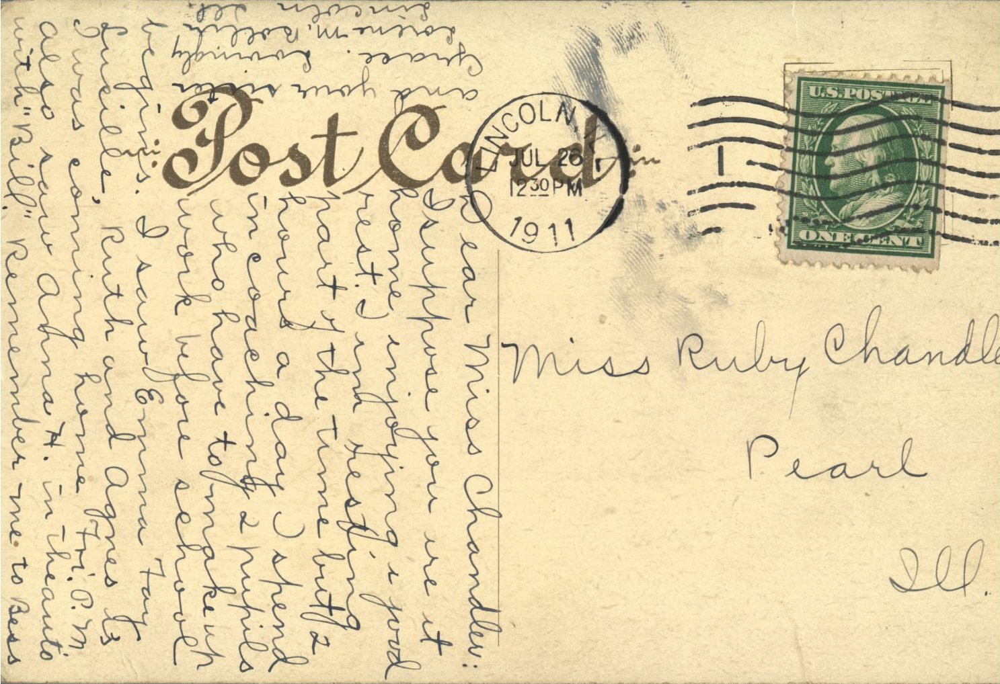

From: Lorene M. Bollin, To: Ruby Chandler  
Mailed From: Lincoln, Illinois on July 26, 1911

Miss Ruby Chandler  
Pearl, Illinois

Miss Ruby Chandler  
Pearl, Illinois

Dear Miss Chandler:  
I suppose you are at home enjoying a good rest. I am resting part of the time but 2 hours a day I spend in coaching 2 pupils who have to make up work before school begins. I saw Emma Fay, Lusille, Ruth and Agnes as I was coming home on Friday. On Monday I also saw Anna H. in the auto with “Bill.” Remember me to Bess and your sister Grace. Lovingly,  
Lorene M. Bollin  
Lincoln, Illinois