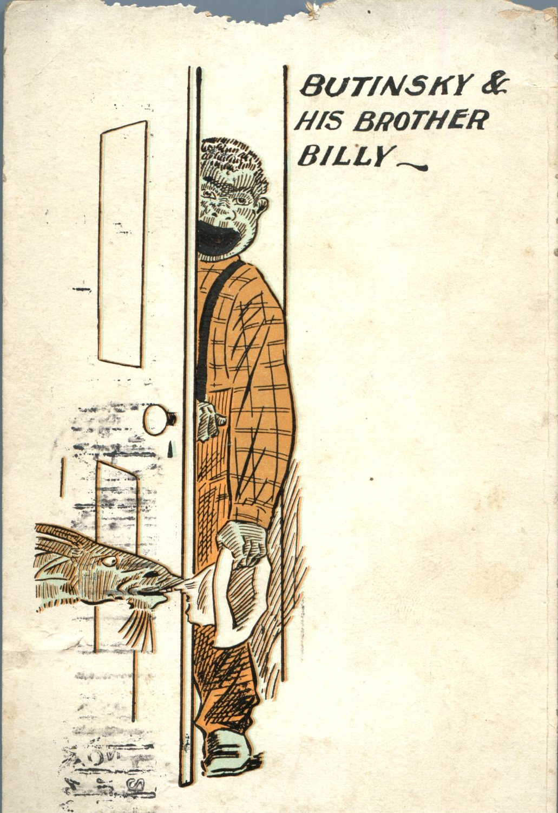
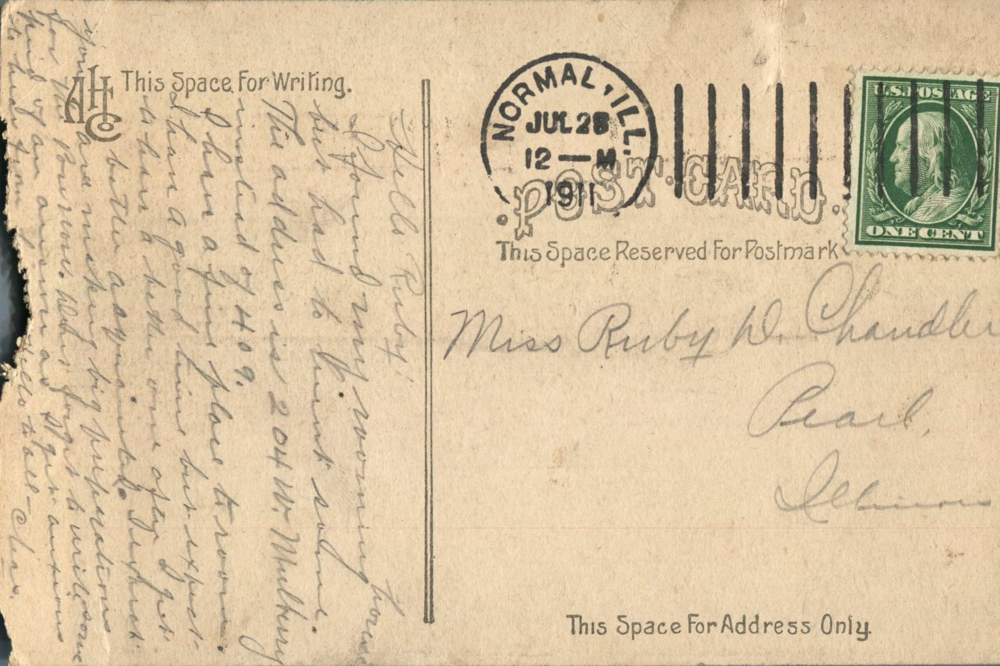

 From: Clias., To: Ruby Chandler  
Mailed From: Normal, Ill. on July 28, 1911

Miss Ruby D. Chandler  
Pearl, Illinois

Hello Ruby,  
I found my rooming house but had to think some. The address is 204 W. Mulberry instead of 409.  
I have a fine place to room. I have a good time but expect to have a better one after I get better adjusted. I expect you are making big preparations for the pow wow. Don’t forget to write soon kind of an answer as I get anxious to hear from you. Hello to all.  
Clias.