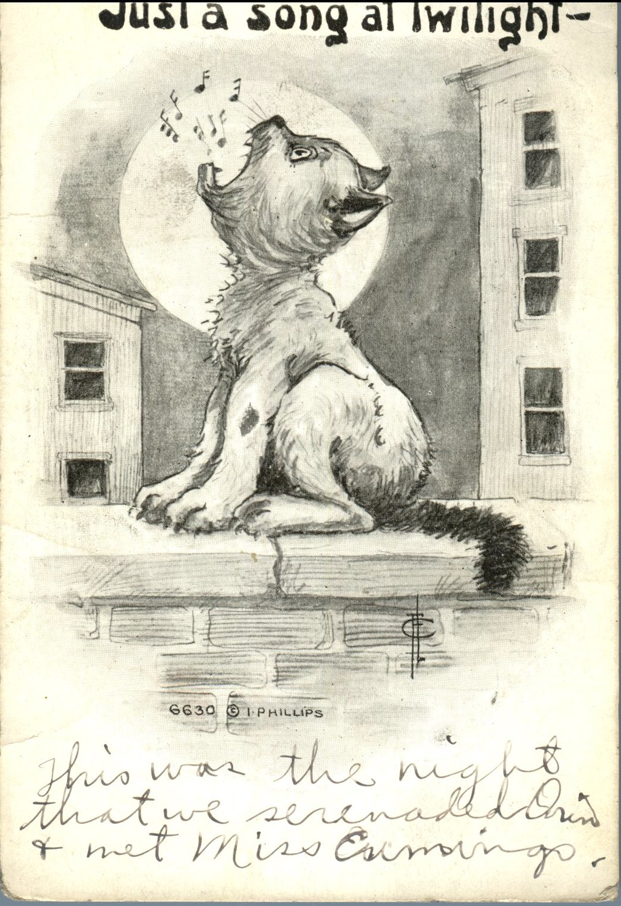
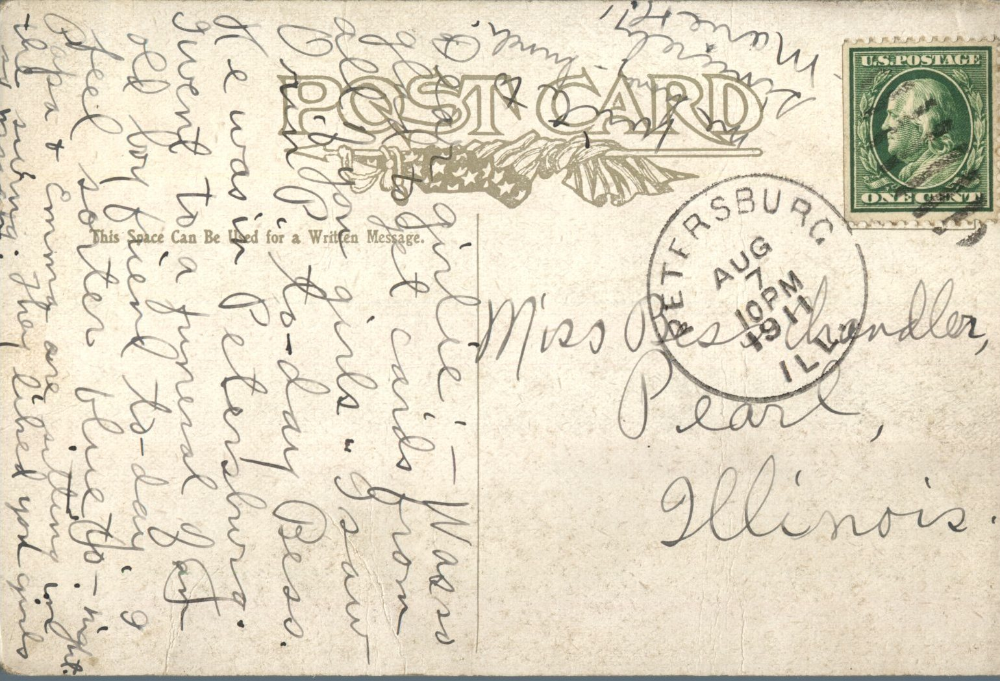

 

From: Marie H., To: Bess Chandler  
Mailed From: Petersburg, Illinois on August 7th, 1911

Miss Bess Chandler  
Pearl, Illinois

Dear girlie,  
Was so glad to get cards from all of you girls. I saw Orin P. today Bess. He was in Petersburg. I went to a funeral of an old boy friend today. I feel sort of blue tonight. Papa and Emma are sitting in the swing. They liked you girls so much. Write to me soon.  
Sincerely,  
Marie H.

Written on the picture side of the postcard:  
This was the night that we serenaded Orin and met Miss Cummings.