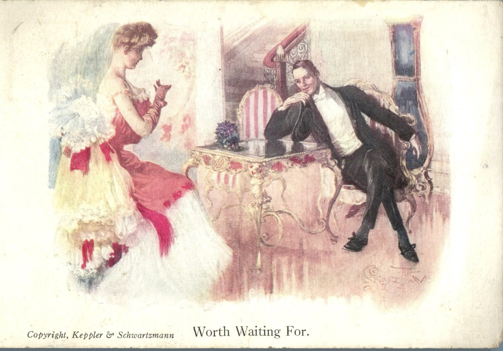
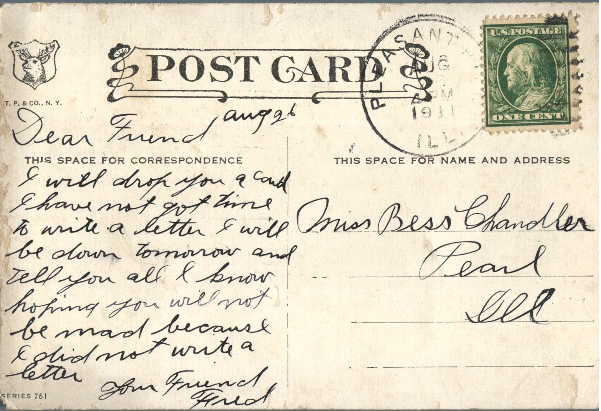

 

From: Fred, To: Bess Chandler  
Mailed From: Pleasantville, Illinois on August 26, 1911

Miss Bess Chandler  
Pearl, Illinois

August 26  
Dear Friend,  
I will drop you a card. I have not got time to write a letter. I will be down tomorrow and tell you all I know. Hoping you will not be mad because I did not write a letter.  
Your Friend,  
Fred