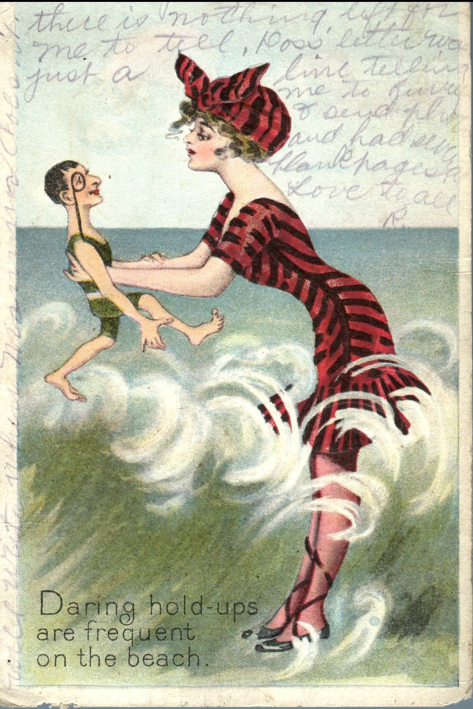
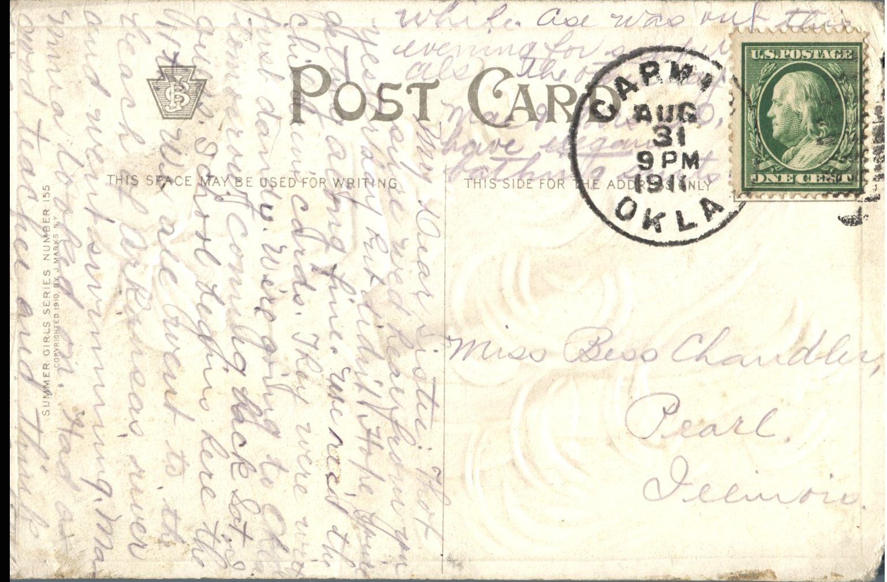

 

From: Ruby Chandler, To: Bess Chandler  
Mailed From: Carmen, Oklahoma on August 31, 1911  
Postcard Info: Summer Girls Series Number 155 Copyrighted 1910, By J. Marks NY

Miss Bess Chandler  
Pearl, Illinois

My Dear Sister:  
Thought for sure we’d hear from you yesterday but didn’t. Hope you’re getting along fine. We read the children’s cards. They were written just dandy. We’re going to Oklahoma tomorrow and coming back on Saturday, I guess. School begins here the 11th. We all went to the beach of Arkansas river and went swimming while Ma looked on. Had a good teacher and think I can learn in a little while. Ase was out this evening for supper also. The other half, Mae and Ma have given us bathing scents. Will write when Mamma doesn’t. She always writes so much there is nothing left for me to tell. Hoss’ letter was just a line telling me to hurry and send plants and had several blank pages.  
Love to all,  
R.