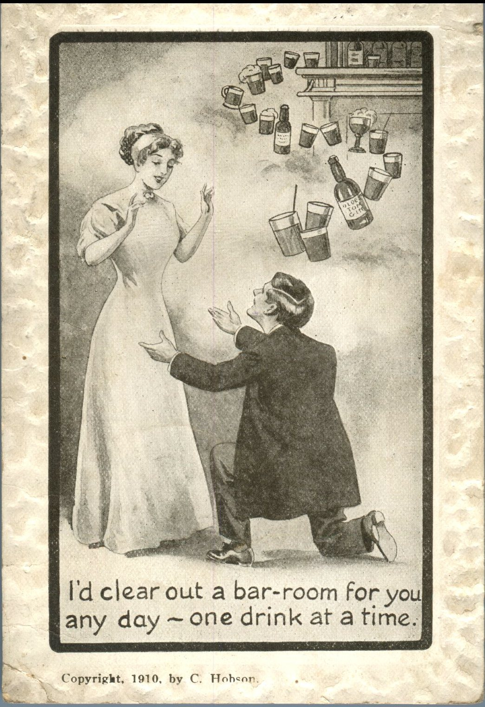
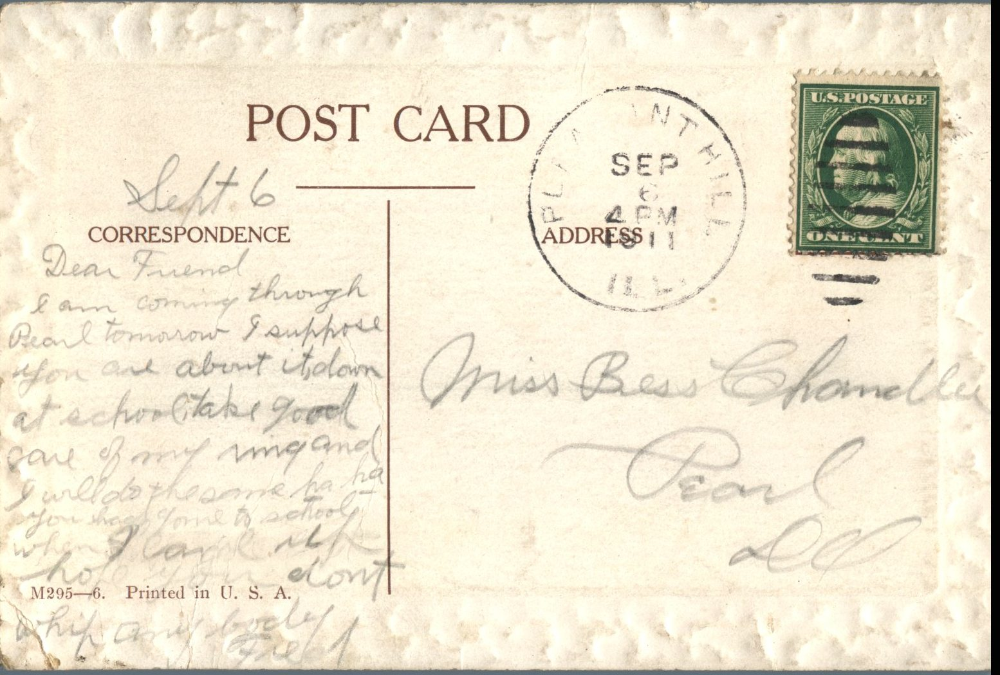

From: Fred, To: Bess Chandler  
Postcard Info: M295-6. Printed in U.S.A.  
Picture Info: Copyright. 1910. by C. Hobson

Miss Bess Chandler  
Pearl, Ill

September 6  
Dear Friend,  
I am coming through Pearl tomorrow. I suppose you are about it, down at school. Take good care of my ring and I will do the same ha ha. You had gone to school when I came up. Hope you don’t whip anybody.  
Fred