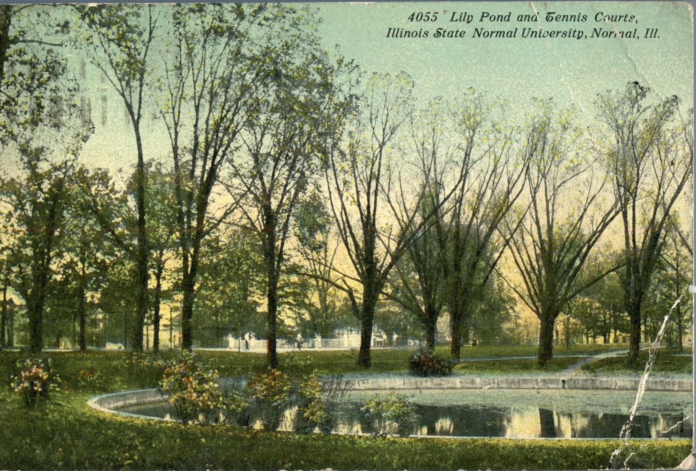
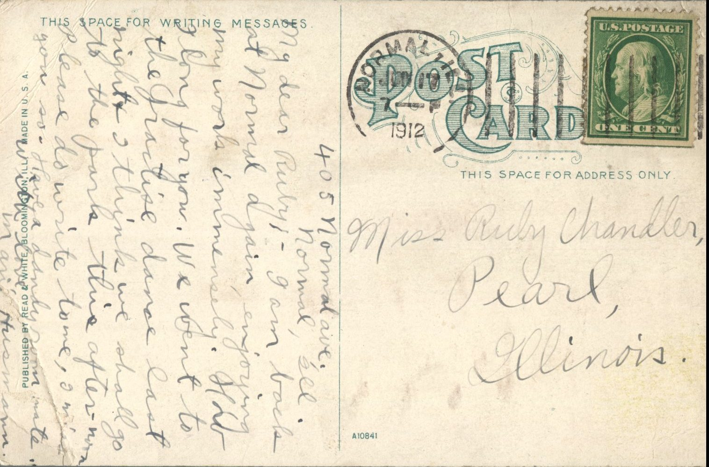

 From: Marie Husmann, To: Ruby Chandler  
Mailed From: Normal, Illinois on June 17, 1912  
Postcard Info: Published by Read &amp; White. Bloomington, Ill. Made in U.S.A.  
Picture Info: 4055 Lily Pond and Tennis Courte, Illinois State Normal University, Normal, Ill.

Miss Ruby Chandler  
Pearl, Illinois

405 Normal Ave.  
Normal, ill.  
My Dear Ruby&lt;  
I am back at Normal again, enjoying my work immensely. How I long for you. We went to the Gractise dance last night and I think we shall go to the park this afternoon. Please to write to me, I miss you so much. Have a dandy roommate.  
With love,  
Marie Husmann