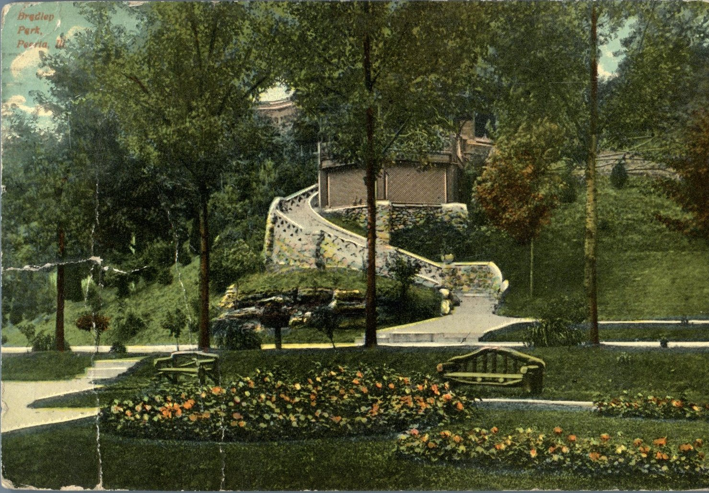
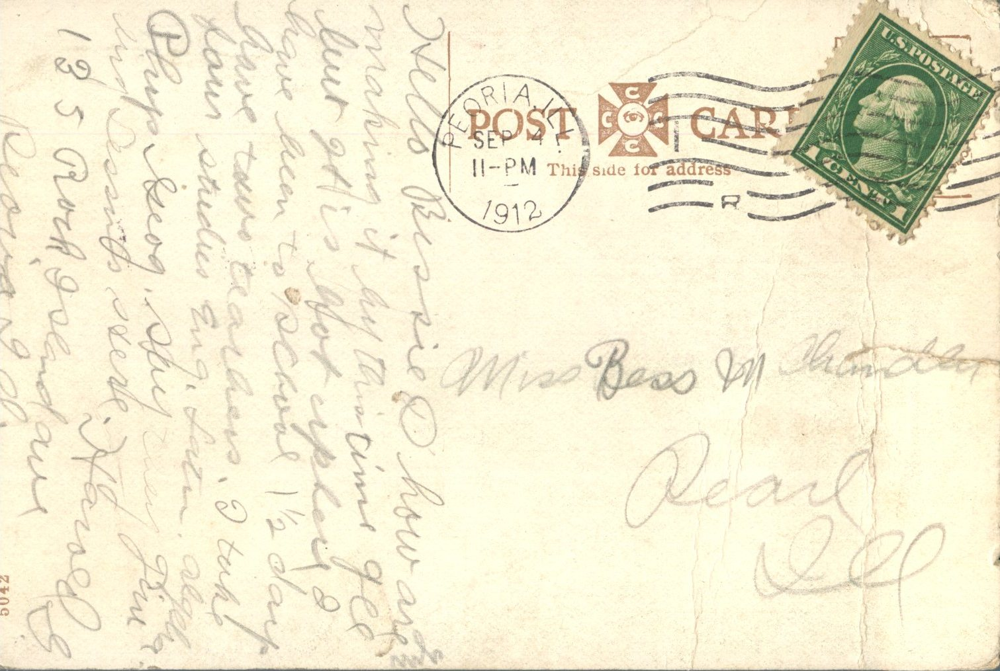

 From: Harold G., To: Bess Chandler  
Mailed From: Peoria, Ill. on September 4, 1912

Miss Bess M. Chandler  
Pearl, Ill.

Hello Bessie  
How are you making it by this time? I have been to school 1 1/2 day. Have two teachers. I take 4 studies. English, Latin, Algebra, and Physics. George says they give lessons here.  
Harold G.  
135 Rock Stand Ave.  
Peoria, Ill.