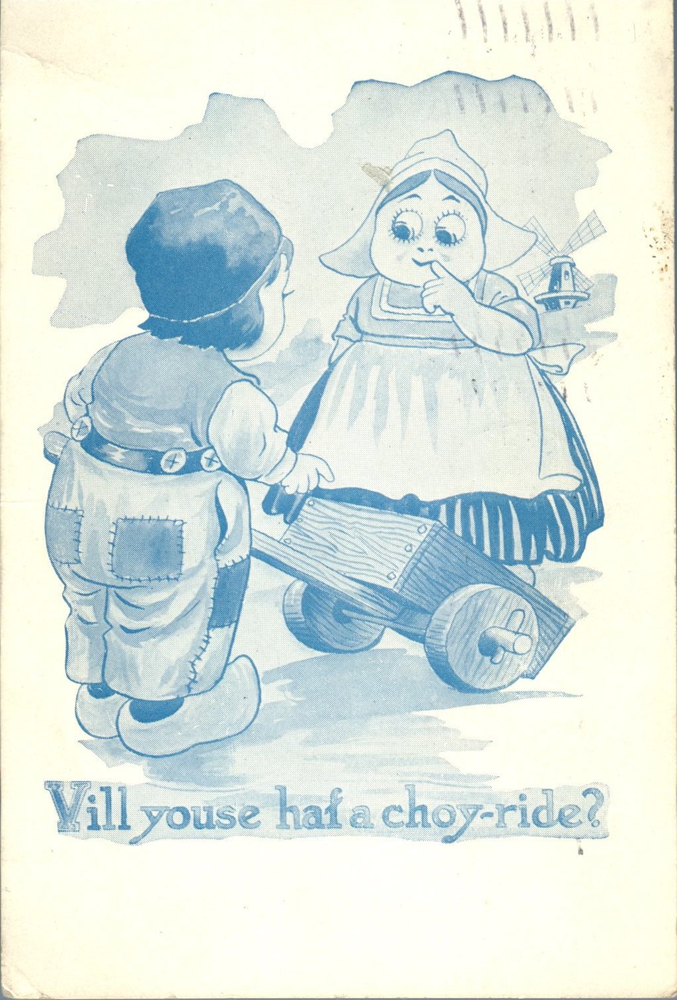
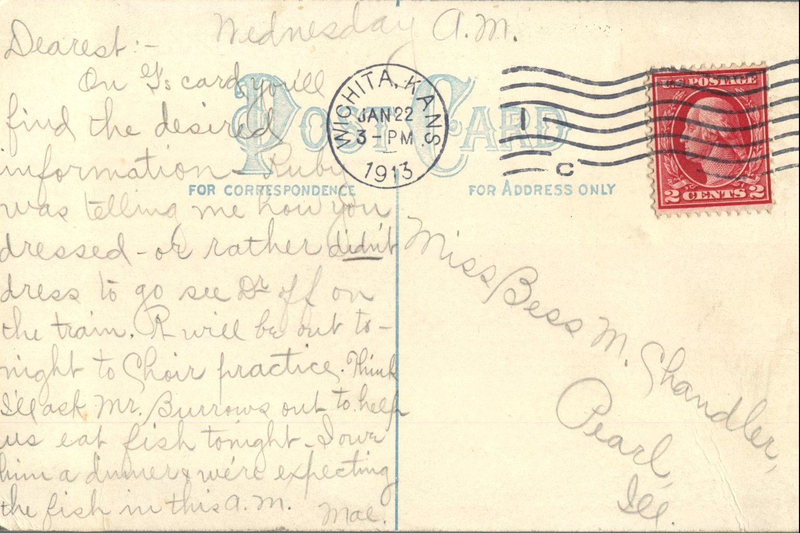

   
From: Mae Chandler, To: Bess Chandler  
Mailed From: Wichita, Kansas on January 22, 1913

Miss Bess M. Chandler  
Pearl, Illinois

Wednesday, a.m.  
Dearest –  
On G’s card you’ll find the desired information. Ruby was telling me how you dressed – or rather didn’t dress to go see Dr. off on the train. R will be out tonight to chair practice. Think I’ll ask Mr. Burrows out to help us eat fish tonight. I owe him a dinner and we’re expecting the fish in this a.m.  
Mae