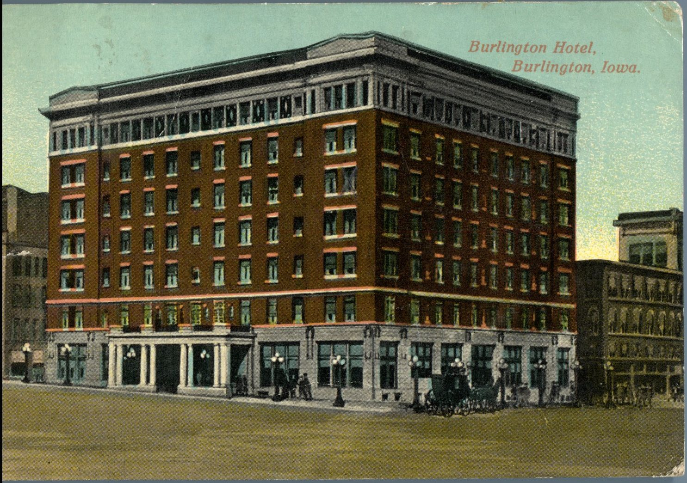
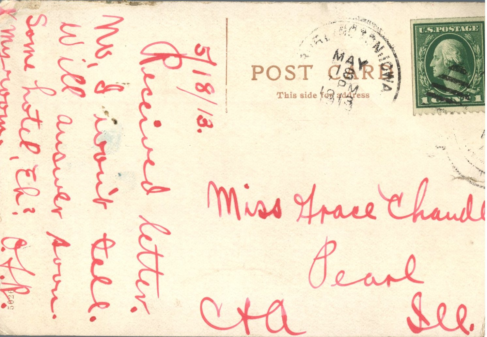

 

From: O.F.R., To: Grace Chandler  
Mailed From: Iowa on May 18, 1913  
Picture Info: Burlington Hotel, Burlington, Iowa

Miss Grace Chandler  
Pearl, Illinois  
CTA

5/18/13  
Received letter. No, I won’t tell. Will answer soon. Some hotel, eh?  
O.F.R.  
x my room (x on the picture marked where the person’s room is)