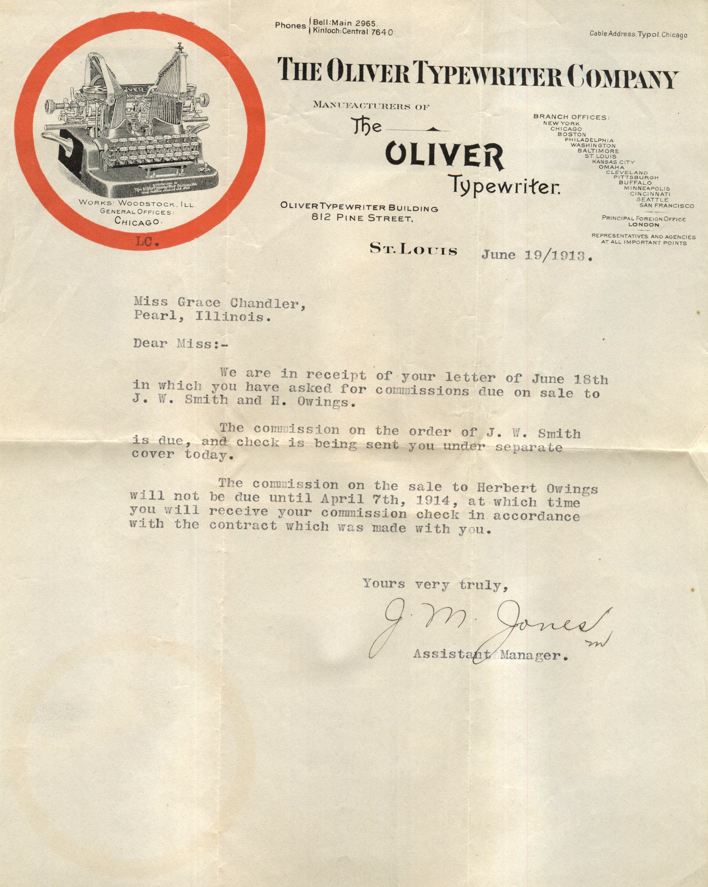

From: J.M. Jones, To: Grace Chandler  
Mailed From: St. Louis on June 19, 1913

Oliver Type Writer Building  
812 Pine Street.  
St. Louis  
June 19/1913

Miss Grace Chandler,  
Pearl, Illinois

Dear Miss:  
We are in receipt f your letter of June 18th in which you have asked for commissions due on sale to J.W. Smith and H. Owings.  
The commission on the order of J.W. Smith is due, and check is being sent you under separate cover today.  
The commission on the sale to Herbert Owings will not be due until April 7th, 1914, at which time you will receive your commission check in accordance with the contract which was made with you.  
Yours very truly,  
J.W. Jones  
Assistant Manager