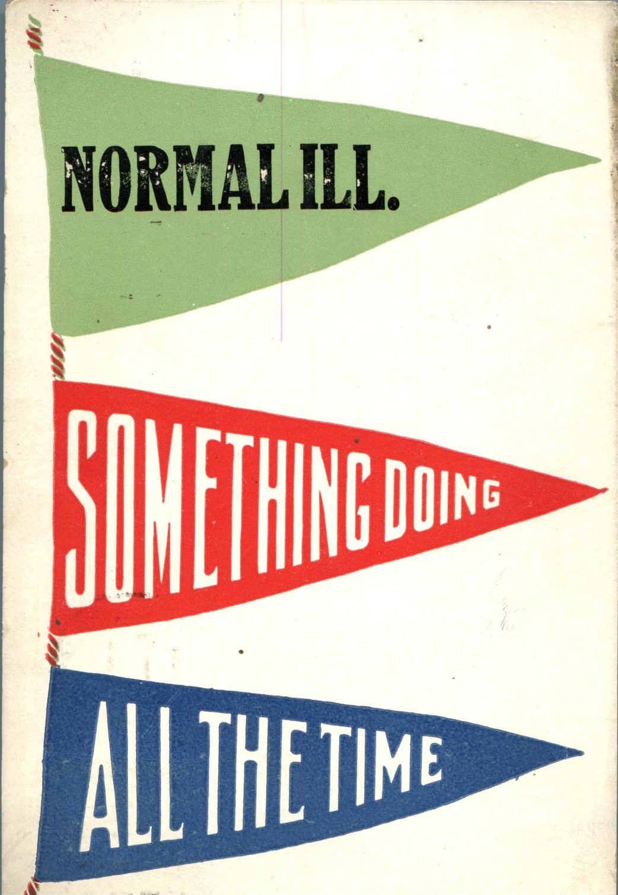
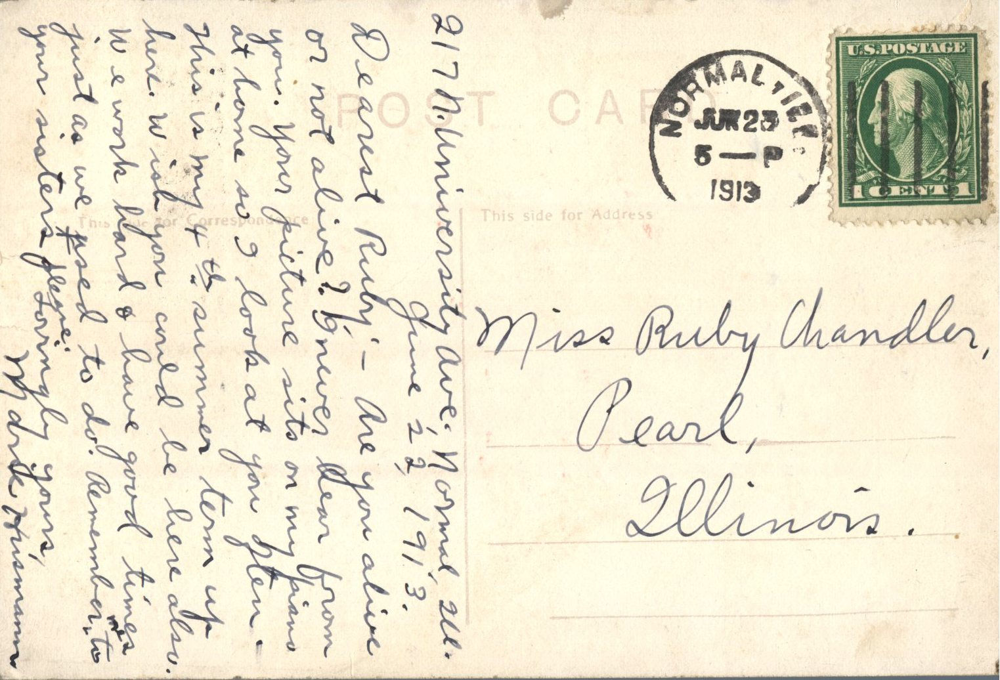

 

From: Marie Husmann, To: Ruby Chandler  
Mailed From: Normal, Illinois on June 25, 1913

Miss Ruby Chandler  
Pearl, Illinois

217 N. University Ave; Normal, Ill.  
June 22, 1913  
Dearest Ruby,  
Are you alive or not alive? I never hear from you. Your picture sits on my piano at home so I look at you often. This is my 4th summer term up here. Wish you could be here also. We work hard and have good times just as we used to do. Remember me to your sisters please.  
Lovingly yours,  
Marie Husmann