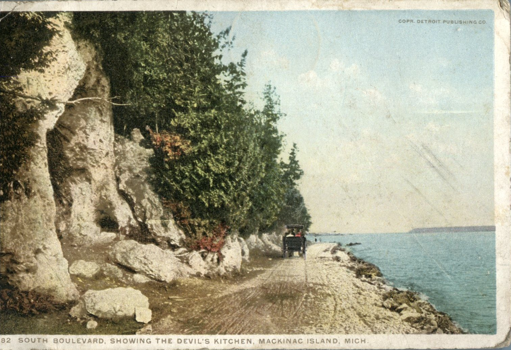
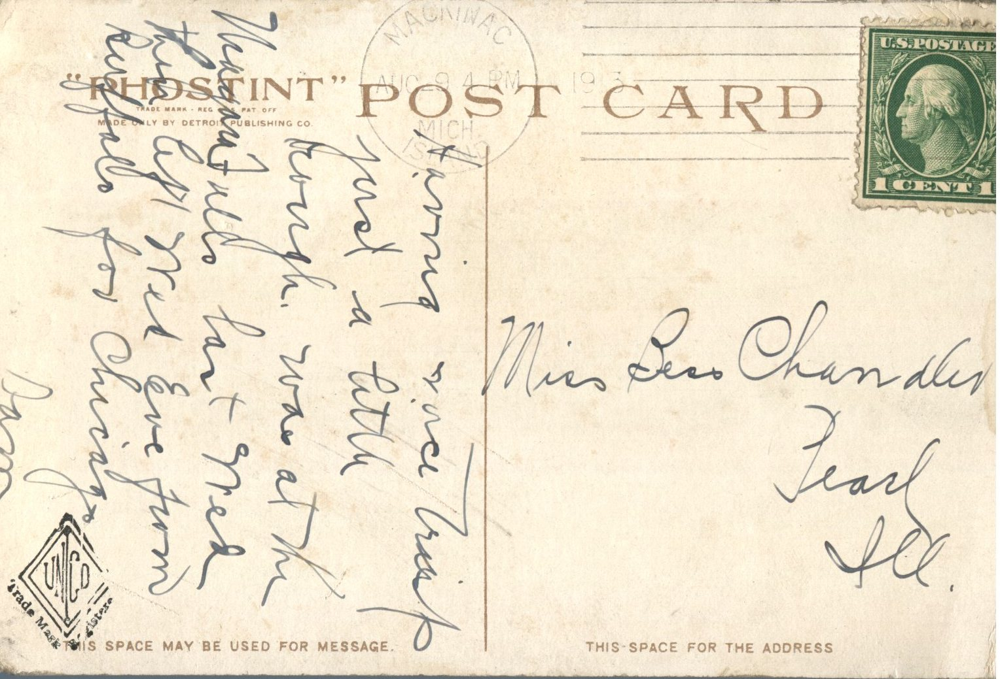

From: Dan, To: Bess Chandler  
Mailed From: Mackinac Island, Michigan on August 9, 1913  
Picture Info: 98882 South Boulevard, Showing the Devil’s Kitchen, Mackinac Island, Michigan.

Miss Bess Chandler  
Pearl, Illinois

Having nice trip, just a little rough. Was at the Niagara Falls last Wednesday. Then left Wednesday Eve from Buffalo for Chicago.  
Dan