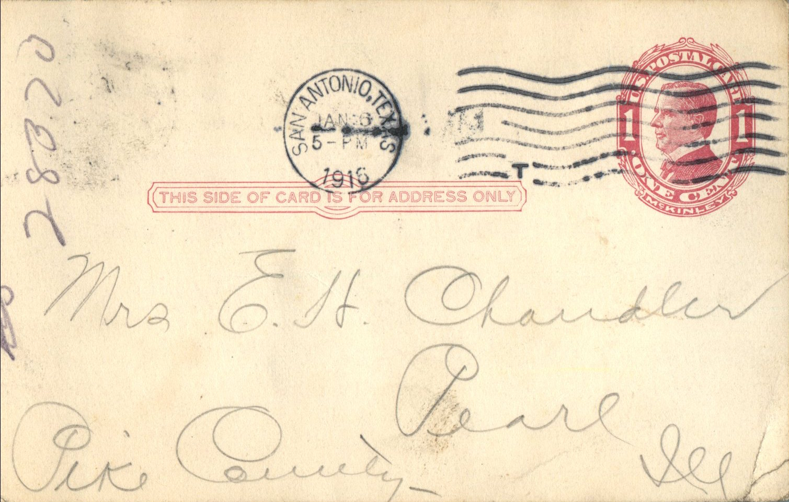
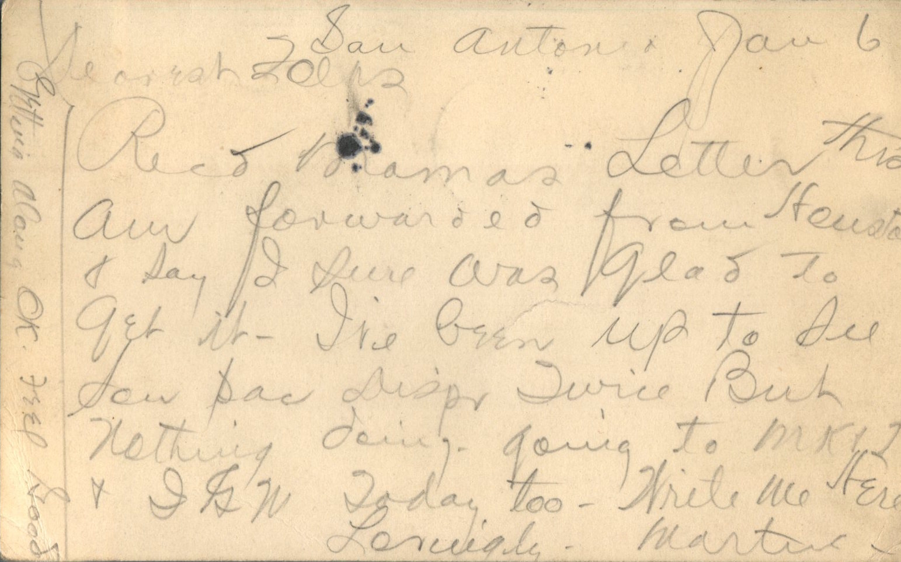

 

From: Martin Chandler, To: Elijah H. Chandler and Family  
Mailed From: San Antonio, Texas on January 6, 1915

Mr. E.H. Chandler  
Pearl, Ill  
Pike County

San Antonio, Jan 6  
Dearest Folks,  
Received mama’s letter this am forwarded from Houston and say I sure was glad to get it. I’ve been up to Del Son Pac Dispr. twice but nothing doing. Going to MKJ and LGM today too. Write me here.  
Lovingly,  
Martin  
Getting along OK. Feel good.