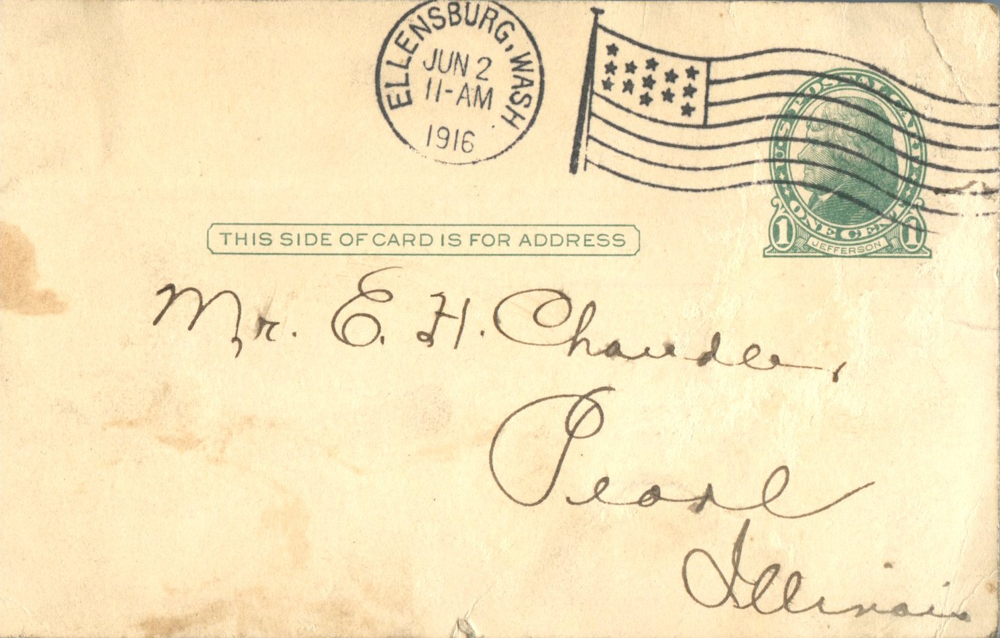
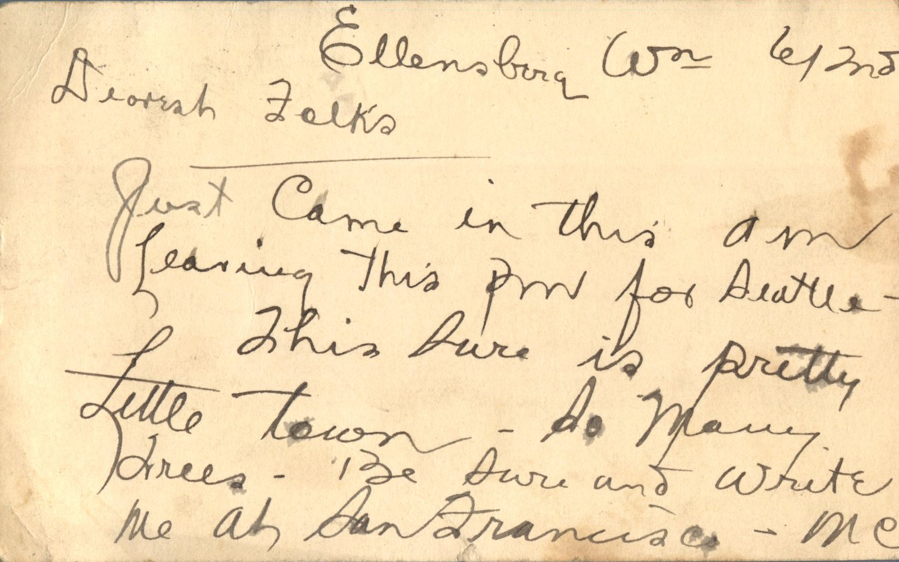

 

From: Martin Chandler, To: Elijah H. Chandler and Family  
Mailed From: Ellensburg, Washingto on June 2, 1916

Mr. E.H. Chandler  
Pearl, Illinois

Ellensburg, Wash. June 2, 1916  
Dearest Folks,  
Just came in this am. Leaving this pm for Seattle. This sure is pretty little town. So many trees. Be sure and write me at San Francisco.  
MC