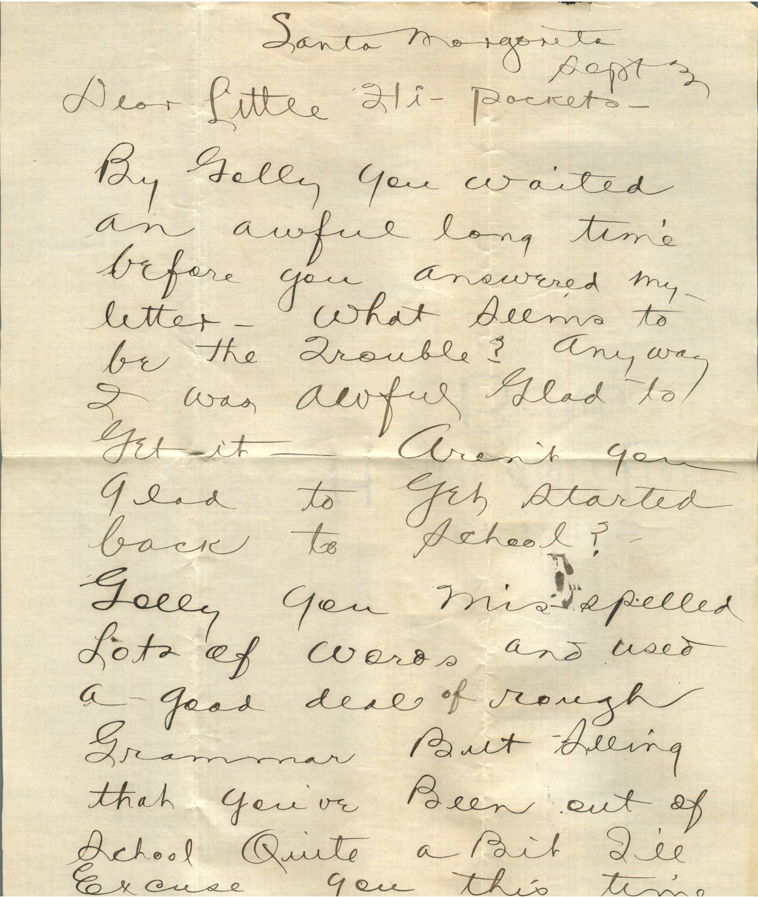
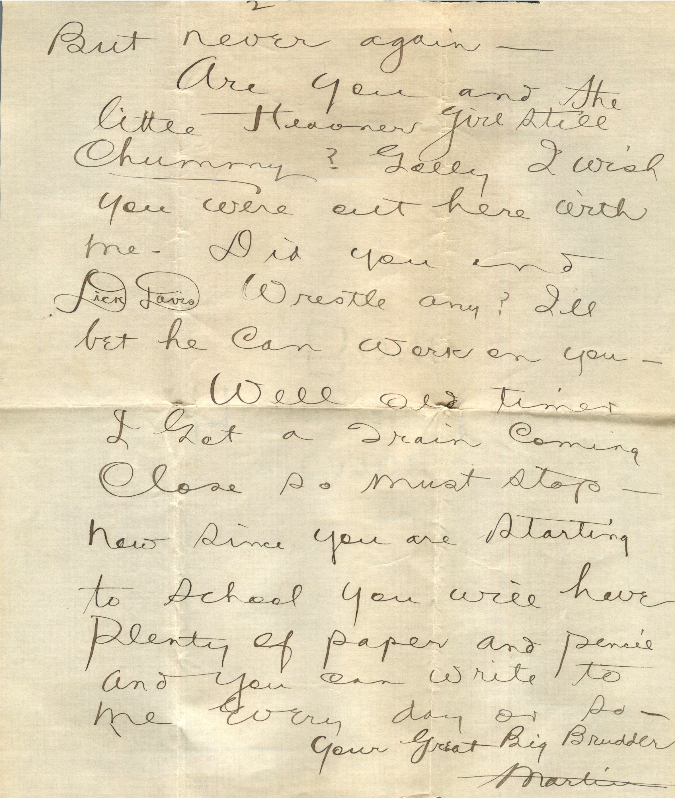
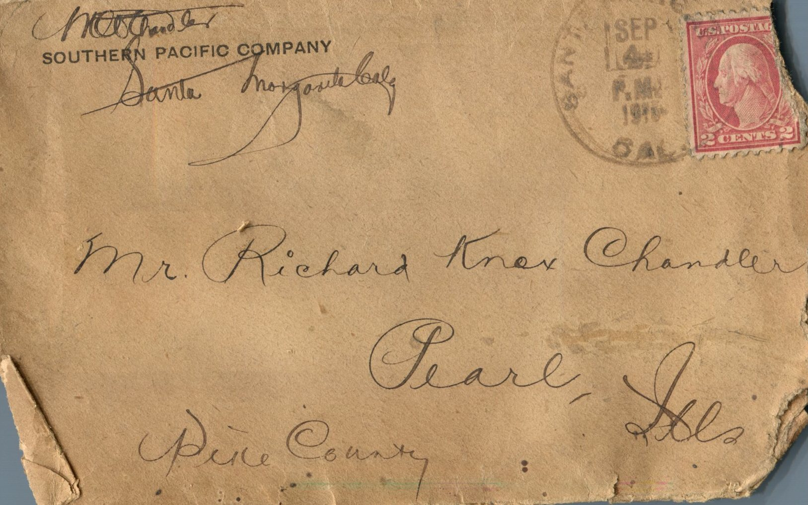

    
From: Martin Chandler, To: Richard Knox Chandler  
Mailed From: Santa Margonita, Cal. on September 3, 1916

Mr. Richard Knox Chandler  
Pearl, Ill.  
Pike County

Santa Margonita  
Sept. 3  
Dear Little Hi-Pockets  
By Golly you waited an awful long time before you answered my letter. What seems to be the trouble? Anyway I was awful glad to get it. Aren’t you glad to get started back to school?  
Golly you misspelled lots of words and used a good deal of rough grammar. But seeing that you’ve been out of school quite a bit I’ll excuse you this time. But never again.  
Are you and the little Hoover girl still chummy? Golly I wish you were out here with me. Did you and Dick Davis wrestle any? i’ll bet he can work on you.  
Well old timer. I got a train close so must stop. Now since you are starting to school you will have plenty of paper and pencils and you can write to me every day or so.  
Your Great Big Brudder,  
Martin