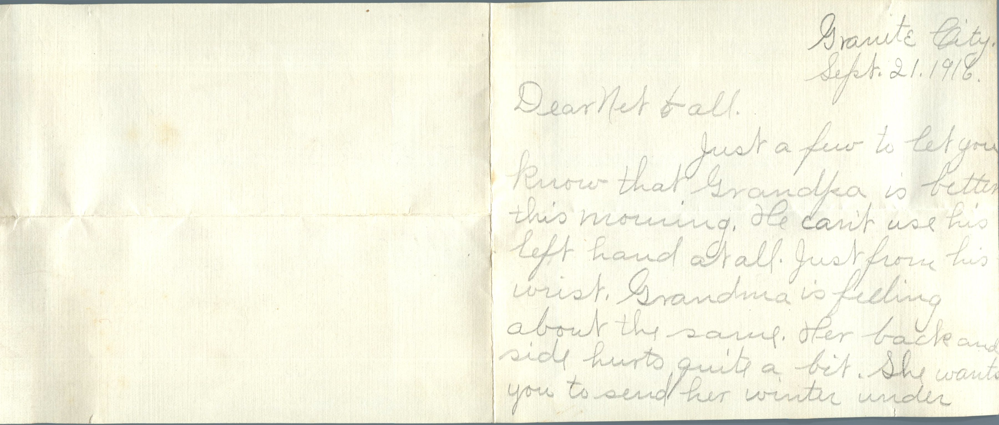
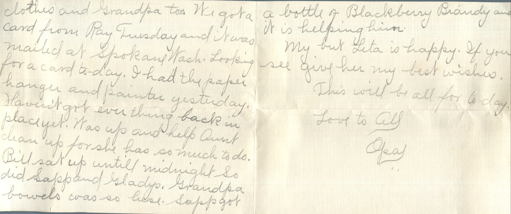
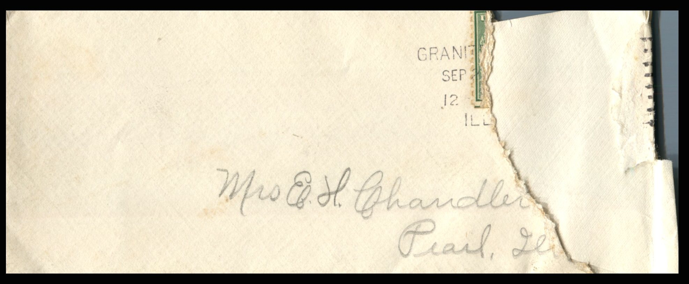

 

From: Opal Chandler, To: Jeanette Knox Chandler and Family  
Mailed From: Granite City, Illinois on September 21, 1916

Mrs. E.H. Chandler  
Pearl, Illinois

Granite City  
September 21, 1916  
Dearest Net and all,  
Just a few to let you know that Grandpa is better this morning. He can’t use his left hand at all. Just from his wrist. Grandma is feeling about the same. Her back and side hurts quite a bit. She wants you to send her winter underclothes and Grandpa too. We got a card from Ray on Tuesday and it was mailed at Spokane Washington. Looking for a card today. I had the paper hanger and painter yesterday. Haven’t got everything back in place yet. Was up and help Aunt clean up for she has so much to do. Bill sat up until midnight so did Sapp and Gladys. Grandpa’s bowels was so loose. Sapp got a bottle of Blackberry Brandy and it is helping him.  
I bet Leta is happy. If you see give her my best wishes.  
This will be all for today.  
Love to all,  
Opal