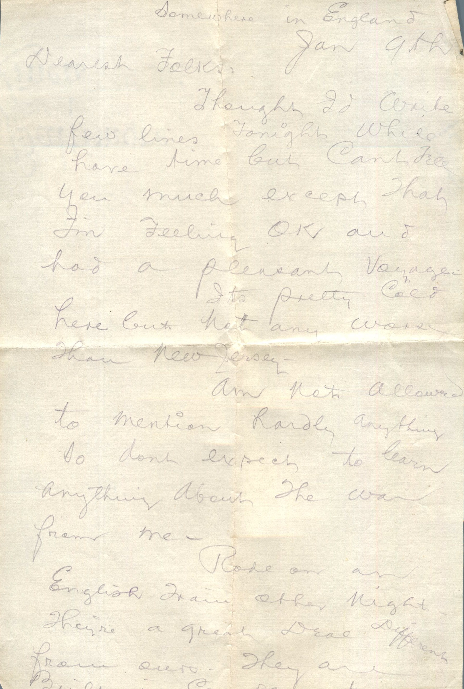
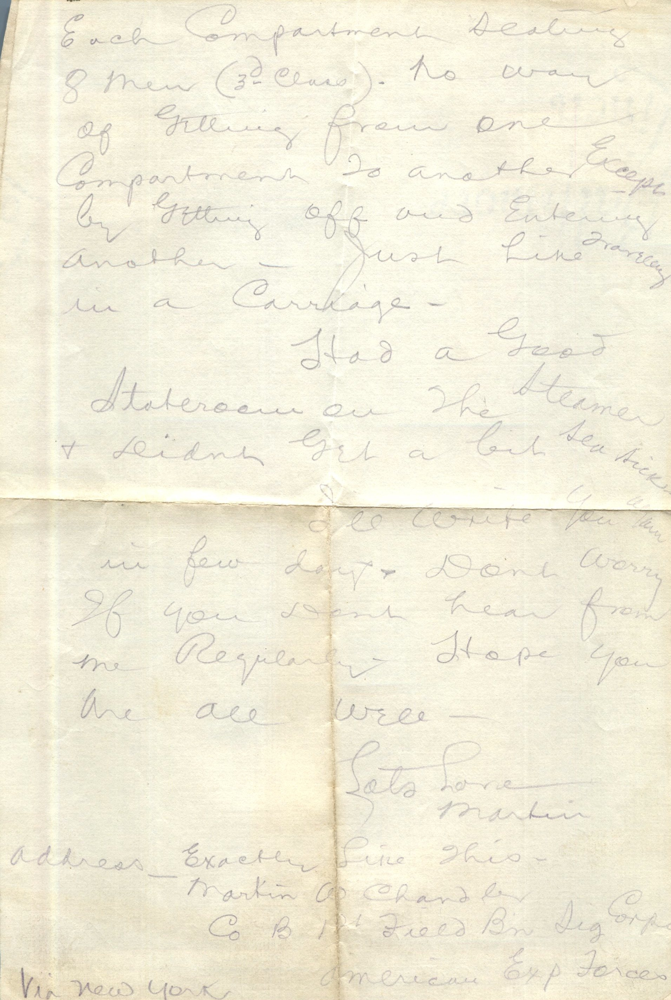

 

From: Martin Chandler, To: Elijah H. Chandler and Family  
Mailed From: England on January 9, 1917

Somewhere in England  
Jan 9th  
Dearest Folks,  
Thought I’d write few lines tonight while have time but can’t tell you much except that I’m feeling OK and had a pleasant voyage.  
It’s pretty cold here but not any worse than New Jersey.  
Am not allowed to mention hardly anything so don’ expect to learn anything about the war from me.  
Rode on an English train other night. They’re a great deal different from ours. They are built in compartments. Each compartment sealing 8 men (3rd class). No way of getting from one compartment to another except by getting off and entering another. Just like traveling in a carriage.  
Had a good stateroom on the steamer and didn’t get a bit seasick.  
I’ll write you again in few days and don’t worry if you don’t hear from me regularly. Hope you are all well-  
Lots Love  
Martin  
Address Exactly Like This:  
Martin W. Chandler  
Co B 126 Field Bin Dig Corps  
American Exp Forces

Via New York