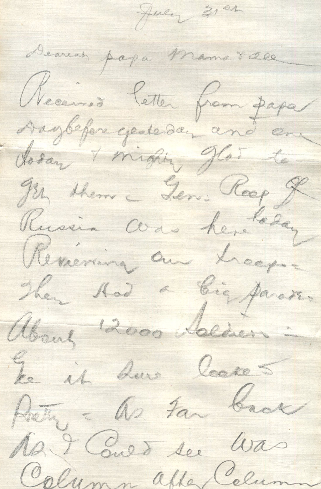
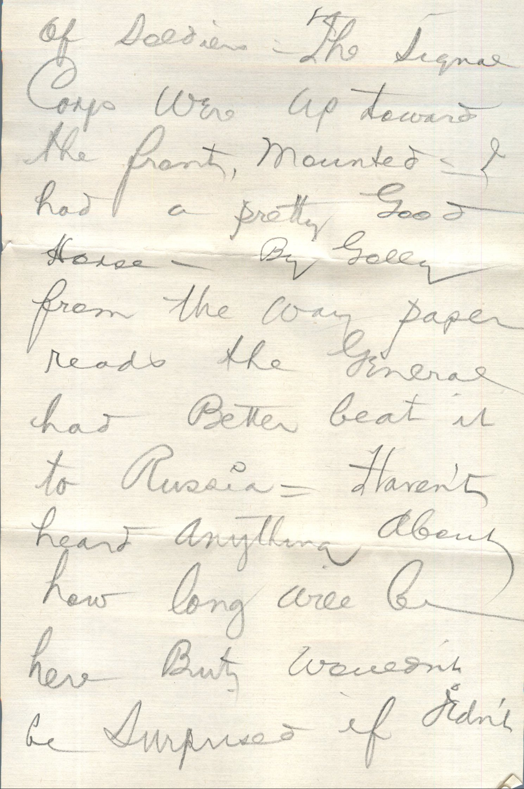
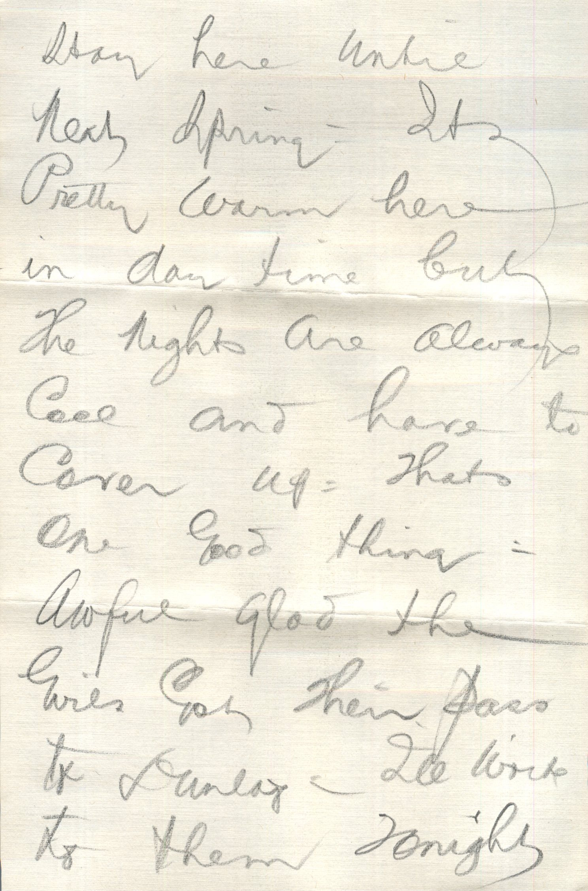
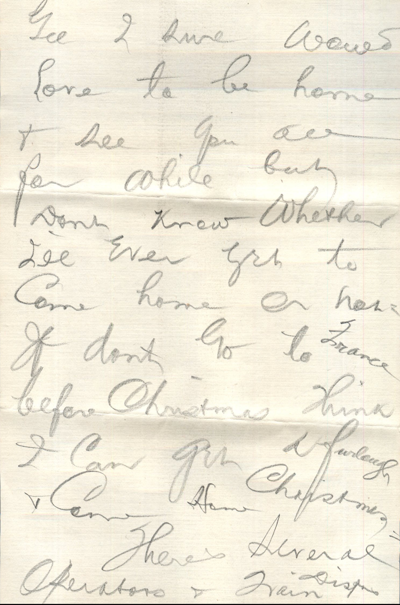
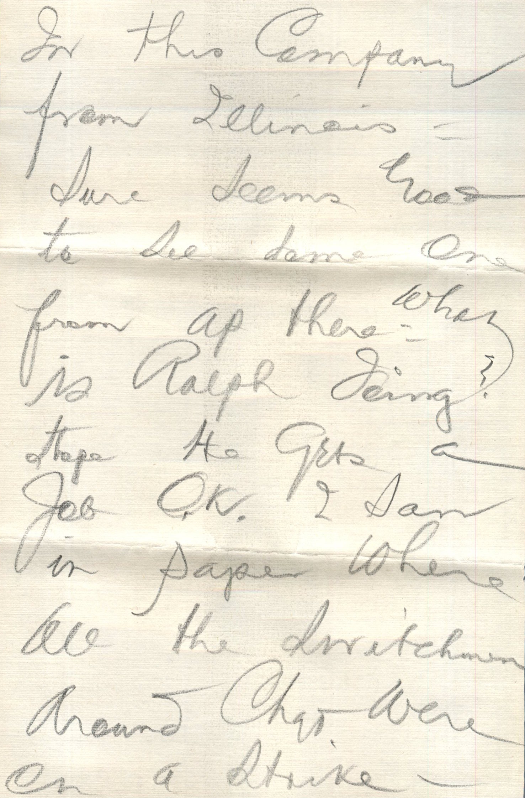
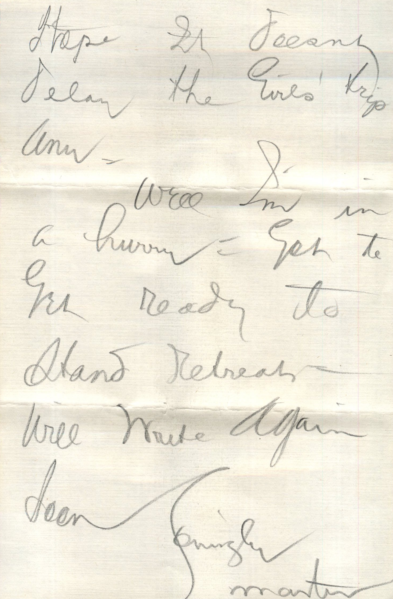
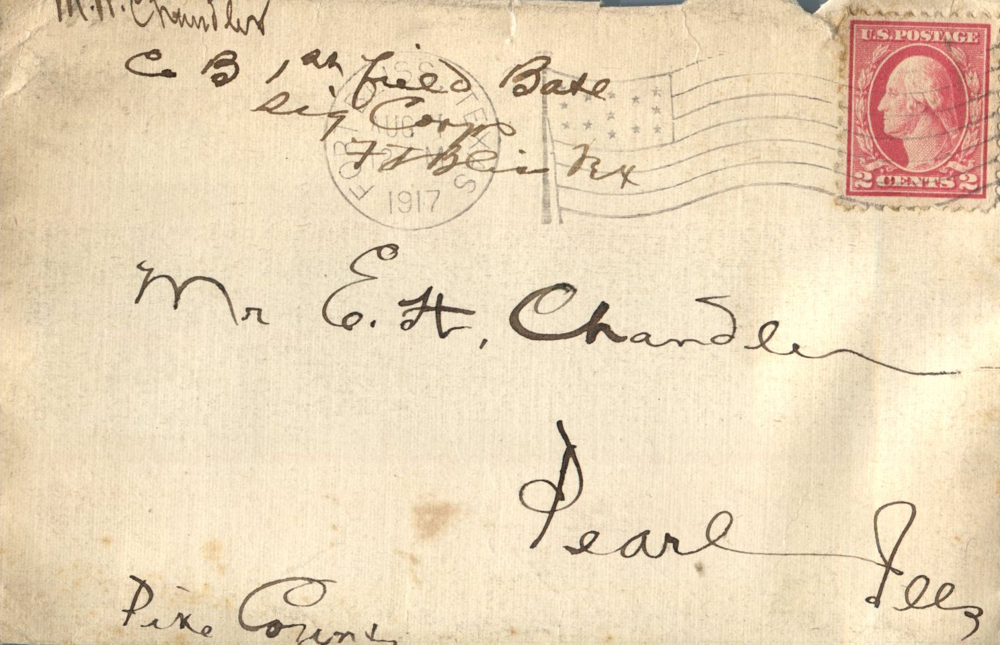

      

From: Martin Chandler, To: Elijah H. Chandler and Family  
Mailed On: July 31, 1917

Mr. E.H. Chandler  
Pearl, Ills  
Pike Co

July 31st  
Dearest Papa, Mama, and all  
Received letter from papa day before yesterday and one today and mighty glad to get them. General Representative of Russia was here today reviewing our troops. They had a big parade, about 12000 soldiers. Gee it sure looked pretty. As far back as I could see was column after column of soldiers. The signal corps was up toward the front, mounted. I had a pretty good house. By golly from the way paper reads the general had better beat it to Russia. Haven’t heard anything about how long will be here but couldn’t be surprised if didn’t stay here until next spring. It’s pretty warm here in day time but the night are always cool and have to cover up. Thane good thing. Awful glad the girls got their pass to Dunlap. I’ll write to them tonight in this company from Illinois. Sure seems good to see dome one from up there. What is Ralph doing? Hope he gets a job OK. I saw in paper where all the switches around Chad were on a strike. Hope it doesn’t delay the girls trip any.  
Well I’m in a hurry. Got to get ready to stand retreat. Will write again soon.  
Lovingly,  
Martin