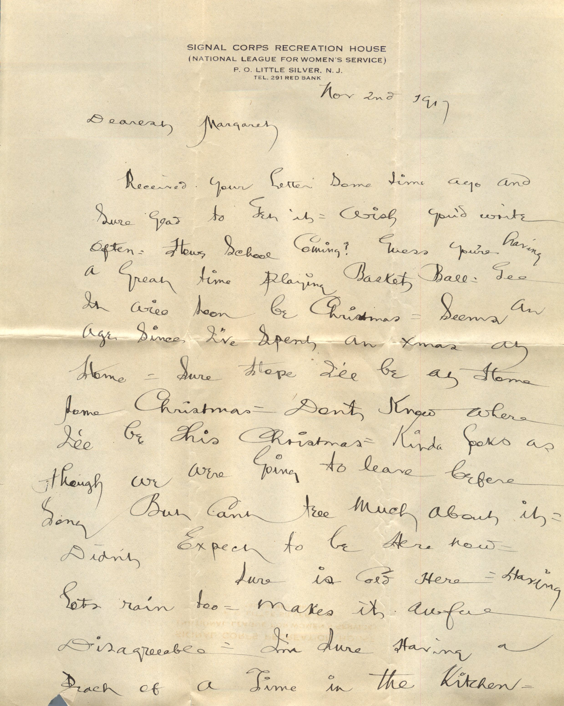
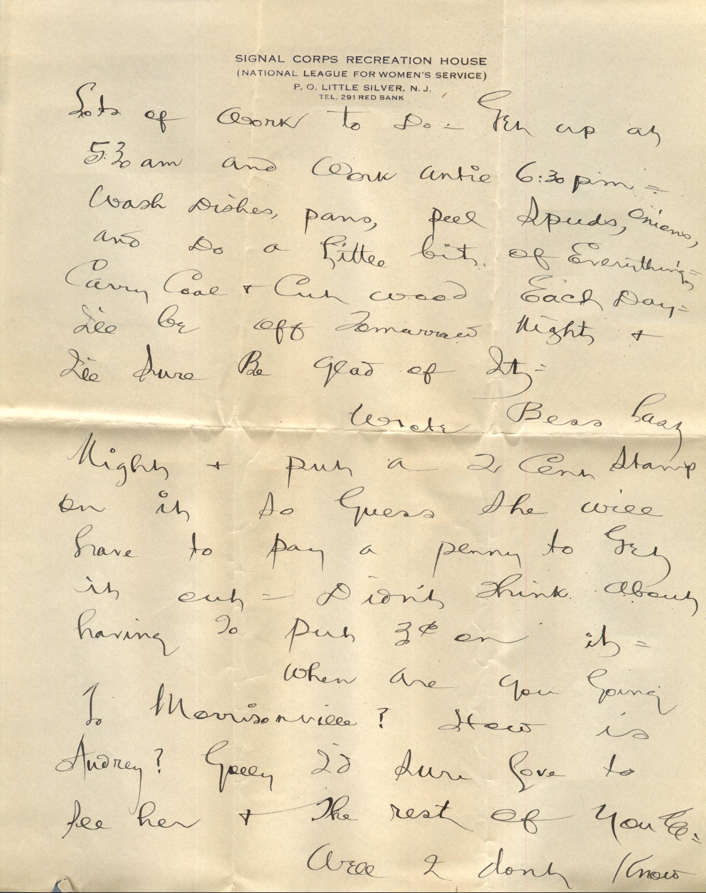
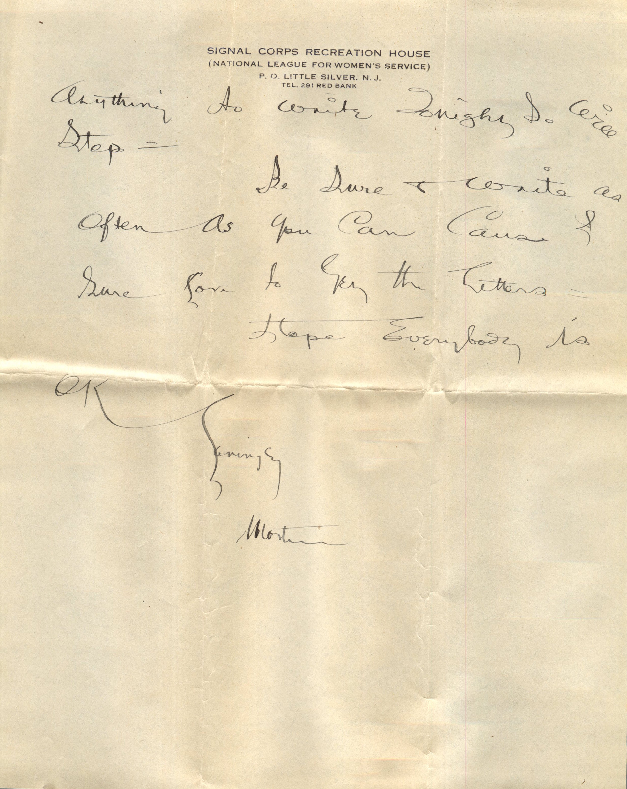
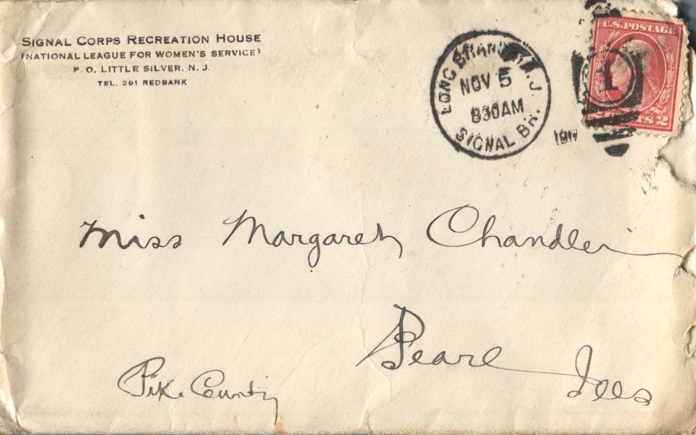

   

From: Martin Chandler, To: Margaret Chandler  
Mailed From: Little Silver, New Jersey on November 2, 1917

Miss Margaret Chandler  
Pearl, Ill  
Pike County

Nov 2nd, 1917  
Dearest Margaret,  
Received your letter some time ago and sure glad to get it. Wish you’d write often. Hows school coming? Guess you’re having a great time playing basket ball. Gee it will soon be Christmas. Seems an age since I’ve spent an Xmas at home. Sure hope I’ll be at home some Christmas. Don’t know where I’ll be this Christmas. Kinda looks as thought we were going to leave before soon. But can’t tell much about it. Didn’t expect to be here now.  
Sure is cold here. Having lots rain too. Makes it awful disagreeable. I’m sure having a peach of a time in the kitchen. Lots of work to do. Get up at 5:30 am and work until 6:30 pm. Wash dishes, pans, peel spuds, onions, and do a little bit of everything. Carry coal and cut wood each day. I’ll be off tomorrow night and I’ll sure be glad of it.  
Wrote Bess last night and put a 2 cent stamp on it so guess she will have to pay a penny to get it out. Didn’t think about having to put 3 cent on it.  
When are you going to Morrisonville? How is Audrey? Golly Id sure love to see her and the rest of you all.  
Well I don’t know anything to write tonight so will stop.  
Be sure and write as often as you can cause I sure love to get the letters.  
Hope everybody is well.  
Lovingly,  
Martin