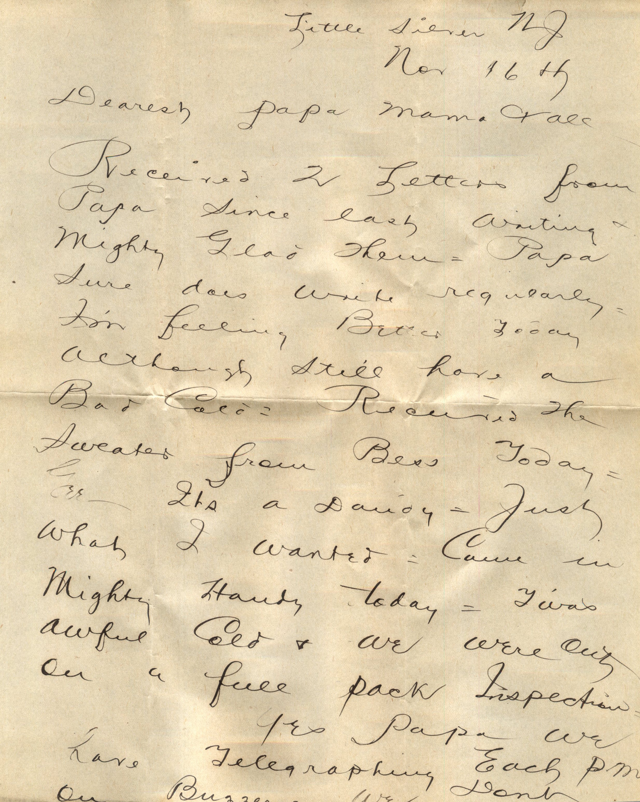
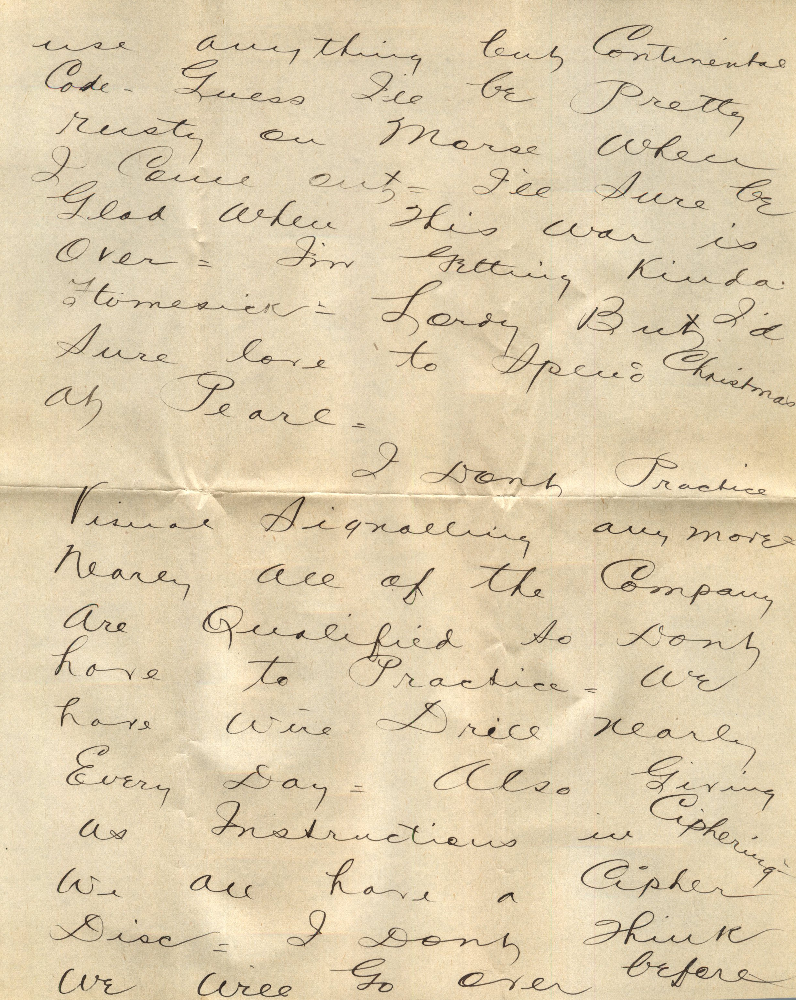
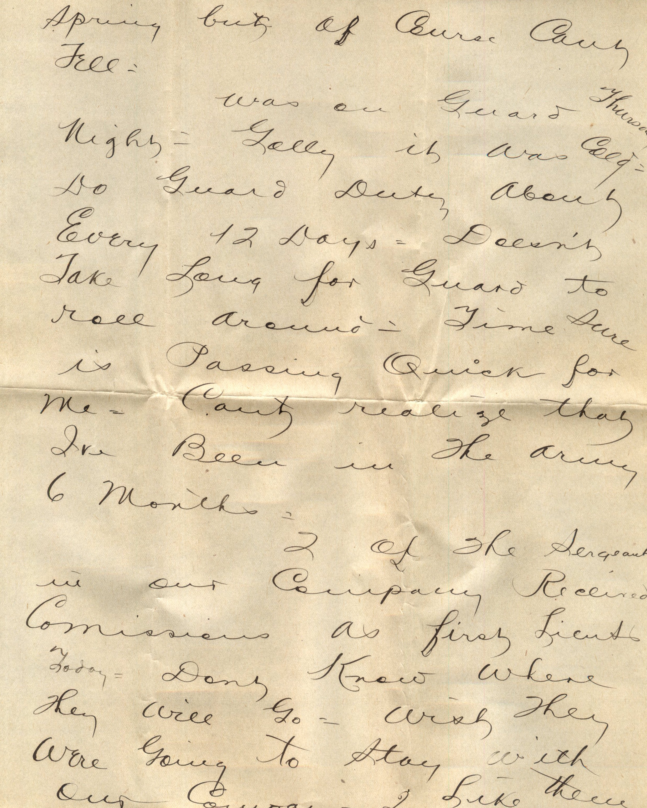
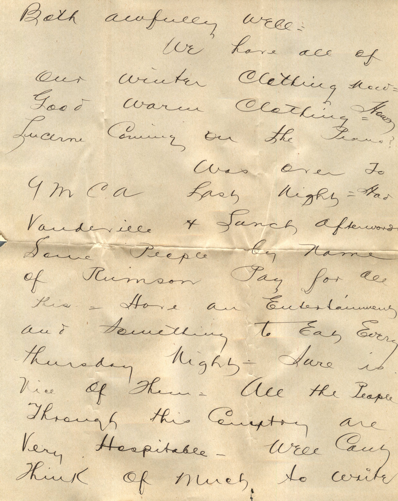
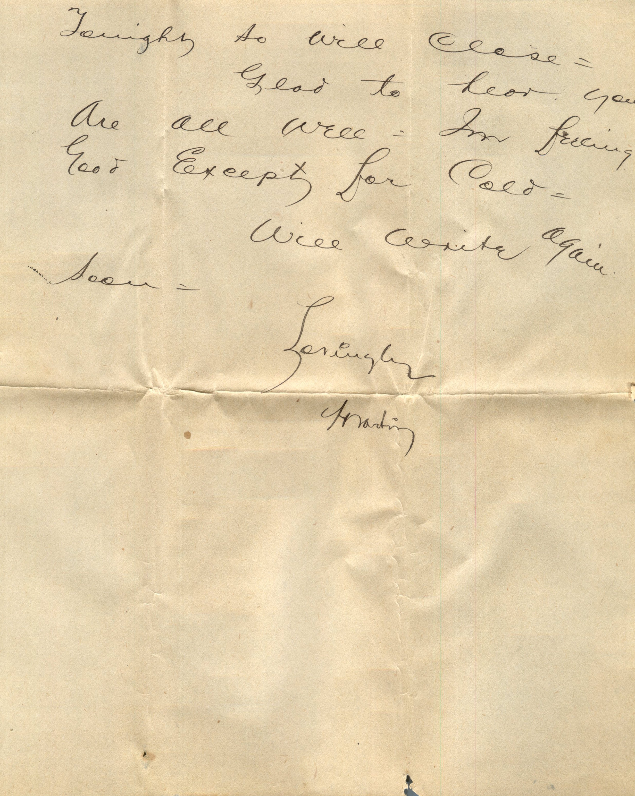
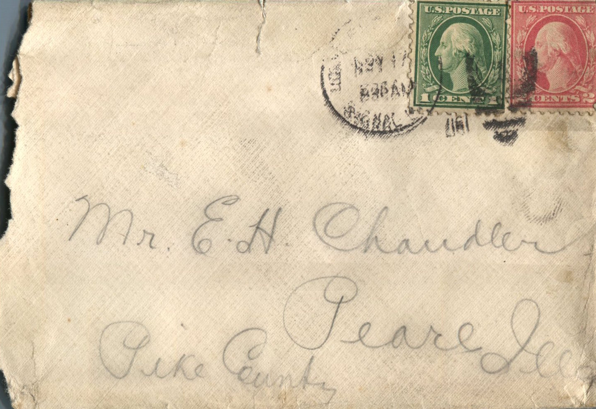
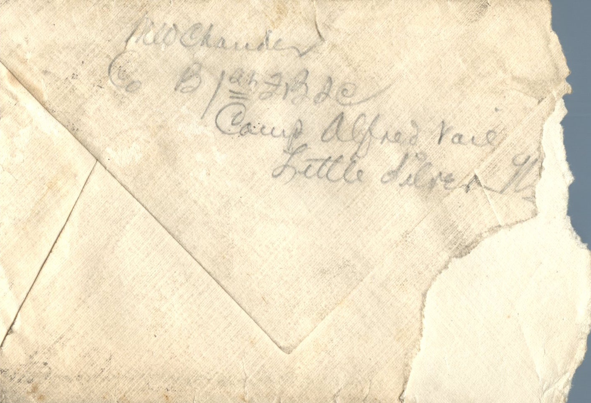

      

From: Martin Chandler, To: Elijah H. Chandler  
Mailed From: Little Silver, New Jersey on November 16, 1917

Mr. E.H. Chandler  
Pearl, Ill  
Pike County

Little Silver, NJ  
Nov 16th  
Dearest Papa, Mama, and all  
Received 2 letters from Papa since last writing and mighty glad to get them. Papa sure does write regularly. I’m feeling better today although still have a bad cold. Received the sweater from Bess today. Gee – It’s a dandy letter. Just what I wanted. Came in mighty handy today. T’was awful cold and we were out on a full pack inspection.  
Yes Papa we have telegraphing each pm on buzzer. We don’t use anything but continental code. Guess I’ll be pretty rusty on Morse when I come out. I’ll sure be glad when this war is over. I’m getting kinda homesick. Lordy but I’d sure love to spend Christmas at Pearl.  
I don’t practice visual signaling any more nearly all of the company are qualified so don’t have to practice. We have wire drill nearly every day. Also giving as instructions in ciphering. We all have a cipher disc. I don’t think we will go over before spring but of course can’t tell.  
Was on guard Thursday night. Golly it was cold. Do guard duty about every 12 days. Doesn’t take long for guard to roll around. Time sure is passing quick for me. Can’t realize that I’ve been in the army 6 months.  
2 of the sergeants in our company received commission as first Lieutenants today. Don’t know where they will go. Wish they were going to stay with out company. I like them both awfully well.  
We have all of our winter clothing now. Good warm clothing. Hows Lucerne coming on the piano?  
Was over to YMCA last night. Had Vaudeville and lunch afterwards. Some people by name of Ruinson pay for all this. Have an entertainment and something to eat every Thursday night. Sure is nice of them. All the people through this country are very hospitable. Well can’t think of much to write tonight so will close.  
Glad to hear you re all well. I’m feeling good expect for cold.  
Will write again soon.  
Lovingly,  
Martin