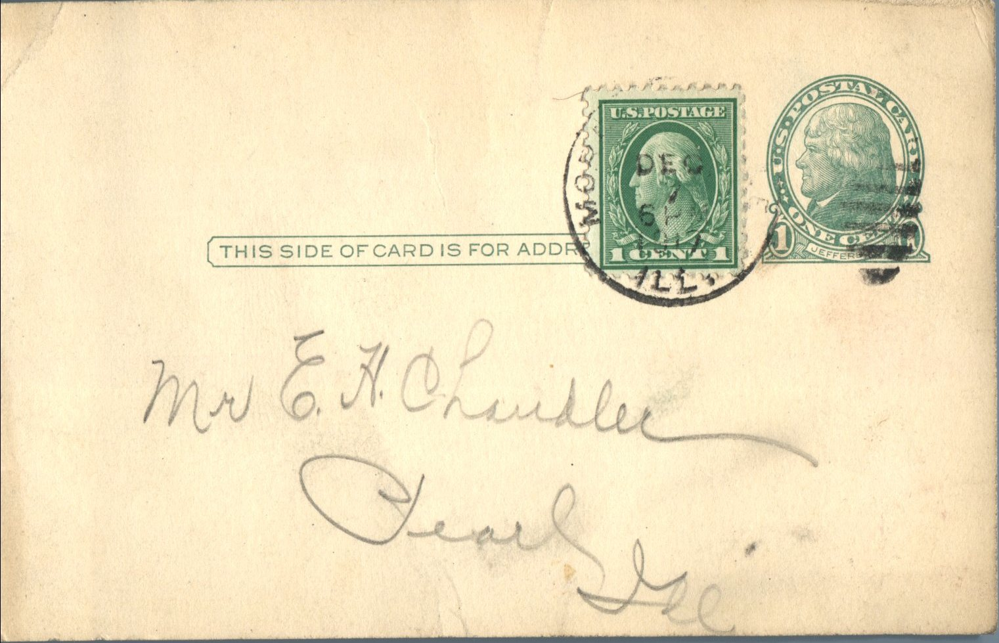
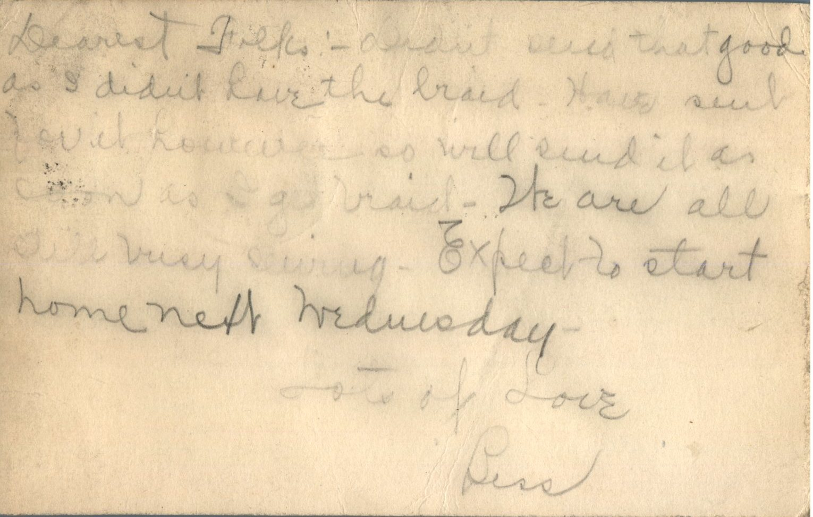

From: Bess Chandler, To: Elijah H. Chandler  
Mailed From: Morrisonville, Illinois on December 7, 1917

Mr. E.H. Chandler  
Pearl, Illinois

Dearest Folks,  
Didn’t send that good as I didnt love the braid. Have sent David Loutcuer, so will send it as soon as I get braid. We are all still busy sewing. Expect to start home next Wednesday.  
Lots of love,  
Bess