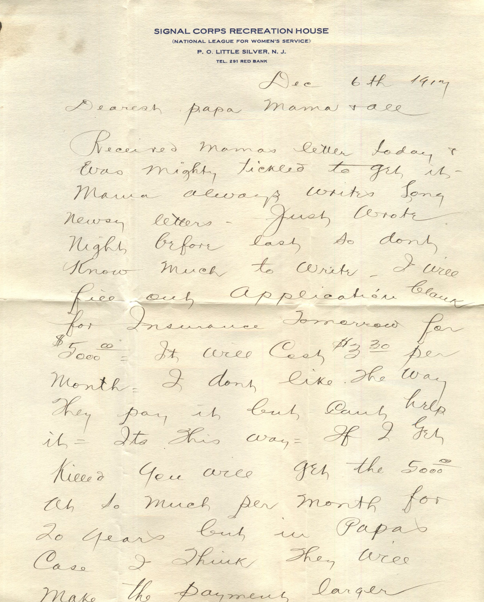
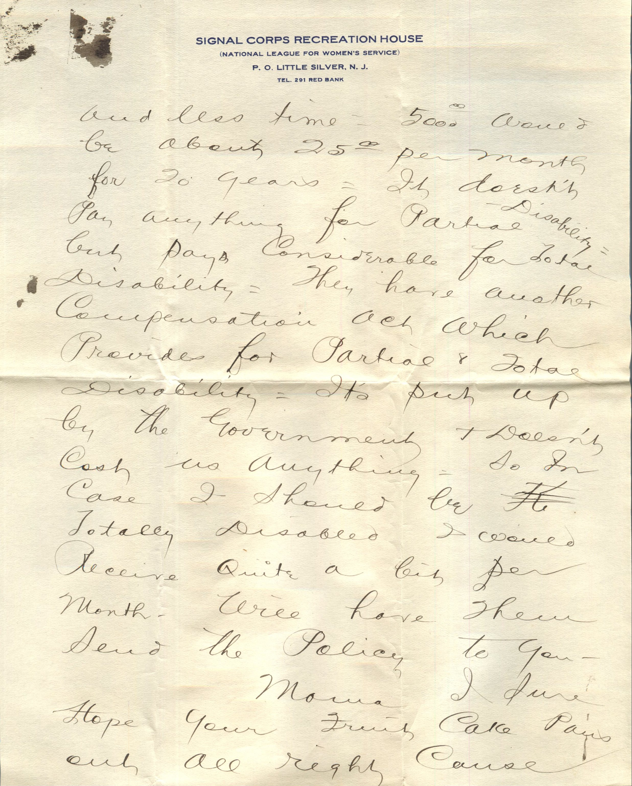
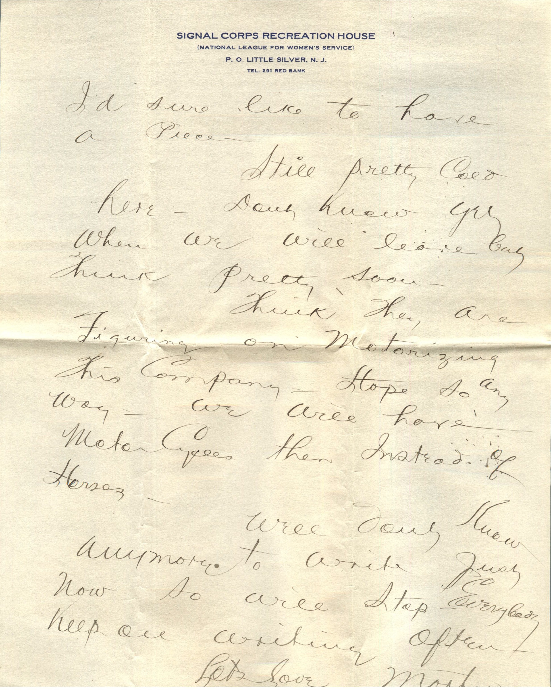
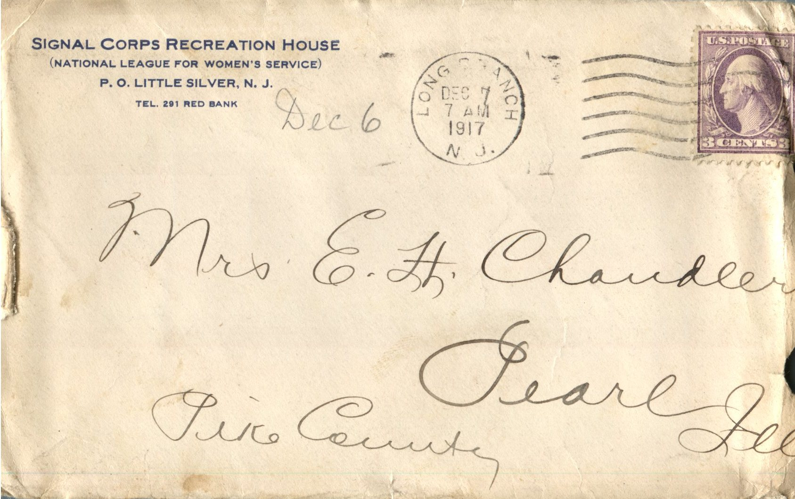

   From: Martin Chandler, To: Elijah H. Chandler  
Mailed From: Long Branch, New Jersey on December 7, 1917

Mrs. E. H. Chandler  
Pearl, Illinois  
Pike County

Dec 6th 1917  
Dearest Papa, Mama, and all  
Received Mama’s letter today and was nightly tickled to get it. Mama always writes long news letters. Just wrote night before last so don’t know much to write. I will fill out appreciation blank for Insurance tomorrow for $5000.00. It will cost $3.30 per month. I don’t like the way they pay it but can’t help it. It’s this way. If I get killed you will get the $5000.00 at so much per month for 20 years but in Papa’s case I think they will make the payments larger and less time. $5000.00 would be about $25.00 per month for 20 years. It doesn’t pay anything for Partial Disability but pays considerable for Total Disability. They have another Compensation Act which provides for Partial and Total Disability. It’s put up by the government and doesn’t cost us anything. So in case I should be totally disabled I would receive quite a bit per month. Will have them send the policy to you.  
Mama I sure hope your fruit cake pans out all right cause I’d sure like to have a piece.  
Still pretty cold here. Don’t know yet when we will leave but think pretty soon.  
Think they are figuring on motorizing this company. Hope so anyway. We will have Motor Cycles then instead of horses.  
Well don’t know anymore to write just now so will stop. Everybody keep on writing often.  
Lots Love,  
Martin