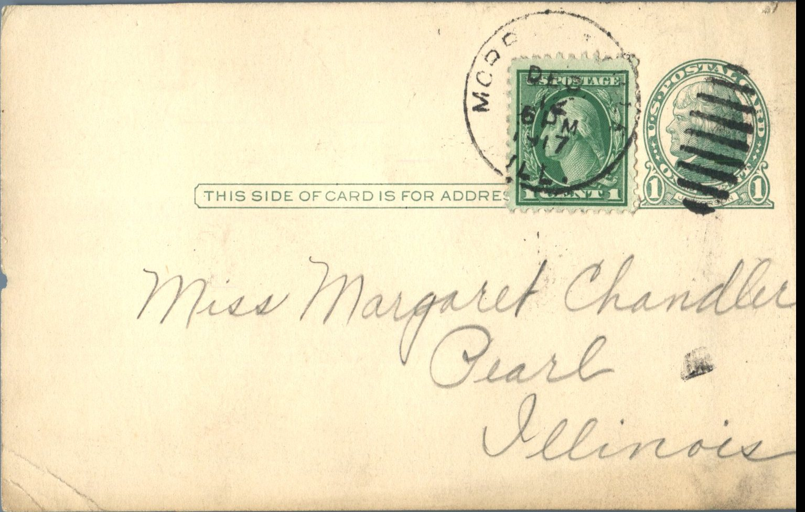
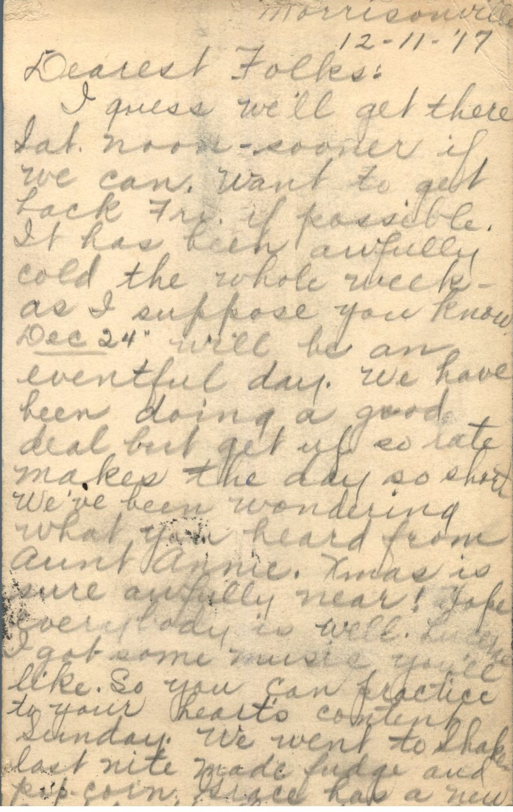

 

From: Ruby Chandler, To: Margaret Chandler  
Mailed From: Morrisonville, Illinois on December 11, 1917

Miss Margaret Chandler  
Pearl, Illinois

Morrisonville  
12-11-’17  
Dearest Folks,  
I guess we’ll get there Saturday noon-sooner if we can. Want to get back Friday if possible. It has been awfully cold the whole week-as I suppose you know. December 24 will be an eventful day. We have been doing a good deal but get up so late Ma keeps the day so short. We’ve been wondering what you heard from Aunt Annie. Christmas is sure awfully near! Hope everybody is well. Lucille, I got some music you’ll like. So you can practice to your heart’s content on Sunday. We went to shake last night. Made fudge and popcorn. Grace has a new coat. Pretty!  
Love to all,  
Ruby