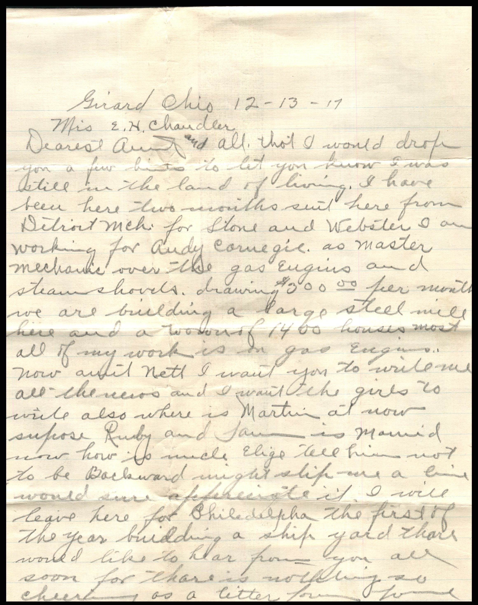
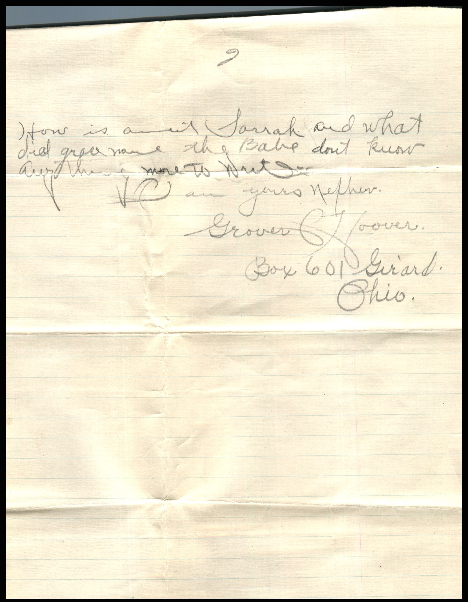
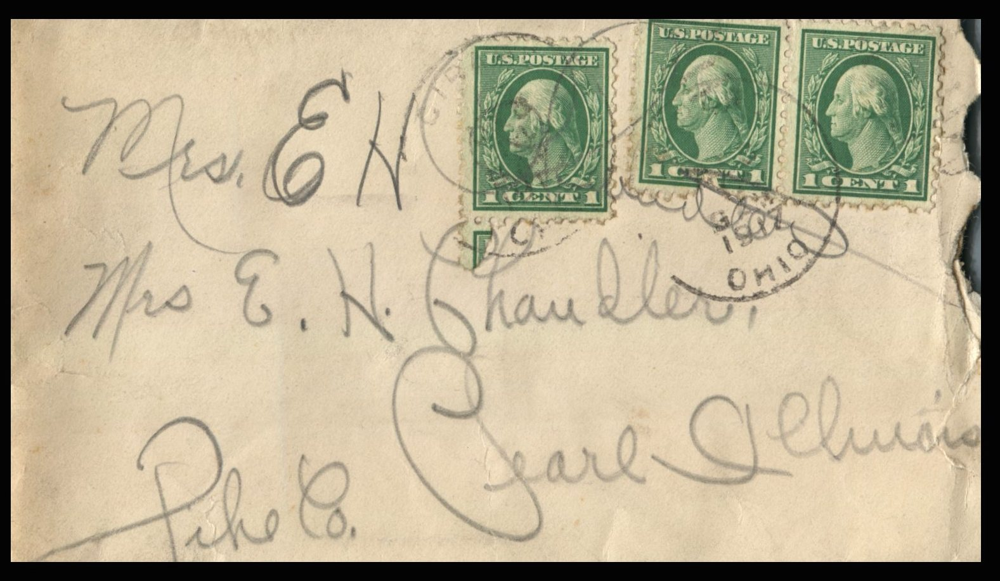
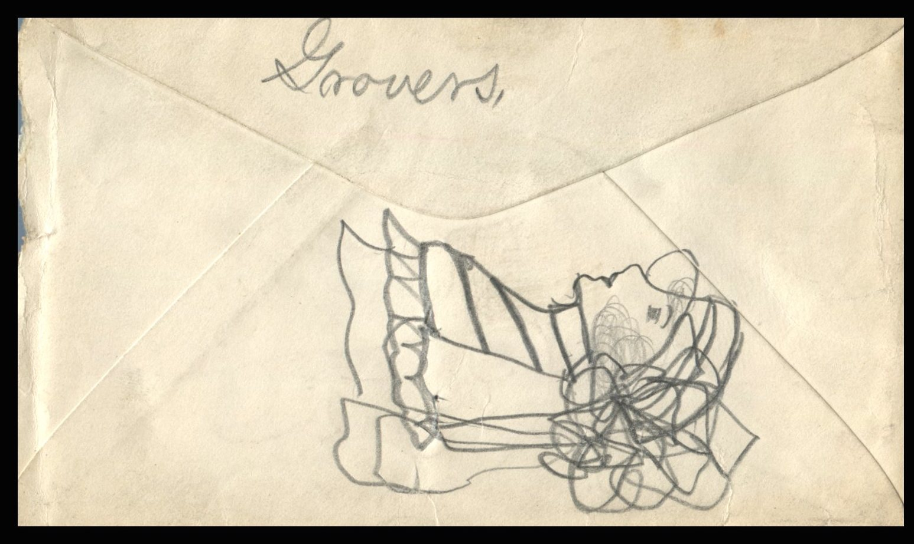

   From: Grover C. Hoover, To: Jeanette Knox Chandler  
Mailed From: Girard, Ohio on December 13, 1917

Mrs. E.H. Chandler  
Pearl, Illinois  
Pike Co.

Girard, Ohio 12-13-17  
Mrs. E.H. Chandler,  
Dearest Aunt and all,  
Thought I would drop you a few lines to let you know I was still in the land of living. I have been here two months. Sent here from Detroit , Mich. for Stone and Webster. I am working for Audy Carnegie as Master Mechanic over the gas engine and sram shovels. Drawing $300.00 per month. We are building a large steel mill here ad a neighborhood of 1400 houses. Most all of my work is in gas engines. Now aunt Nett, I want you to write me all the news and I want the girls to write also. Where is Martin at now? Suppose Ruby and Sam is married. Now how is Uncle Elijah? Tell him not to be backwards. Might ship me a line. Would sure appreciate it. I will leave her for Philadelphia the first of the year, building a ship yard. Though would like to hear from you all soon for there is nothing so cheery as a letter from home. How is Aunt Sarrah and what did Grace name the Babe? Don’t know anything more to write.  
Your Nephew  
Grover C. Hoover  
Box 601  
Girard, Ohio