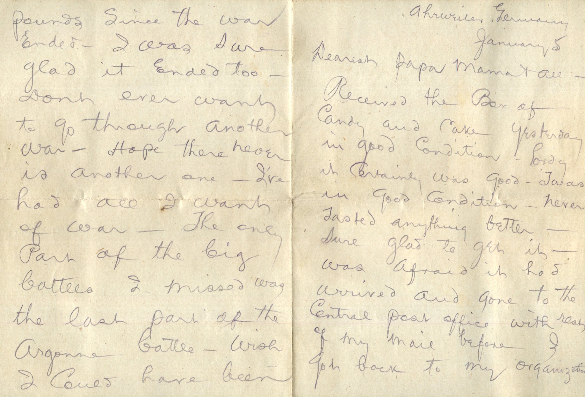
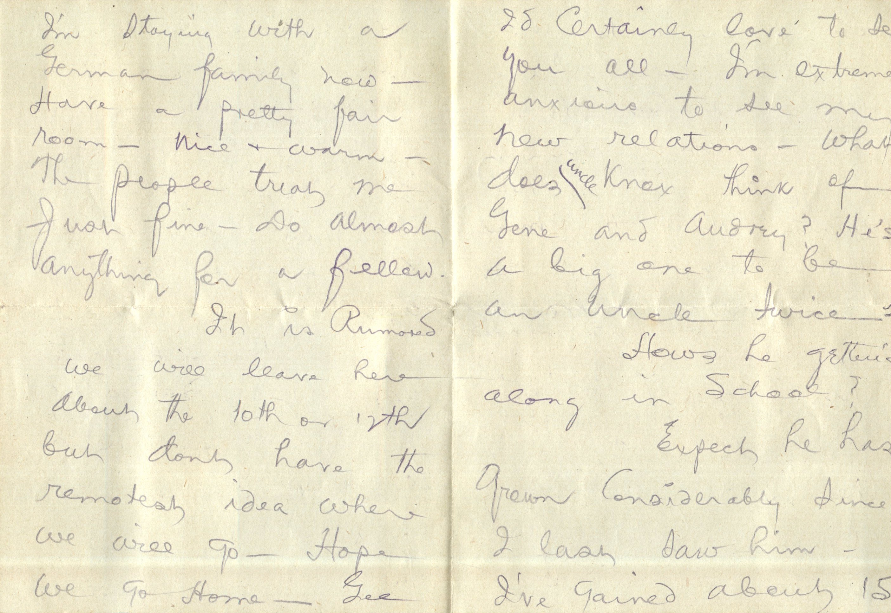
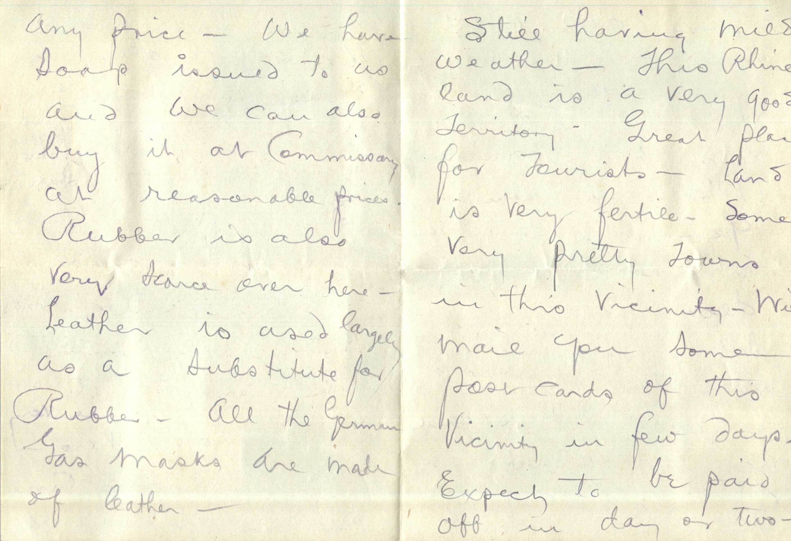
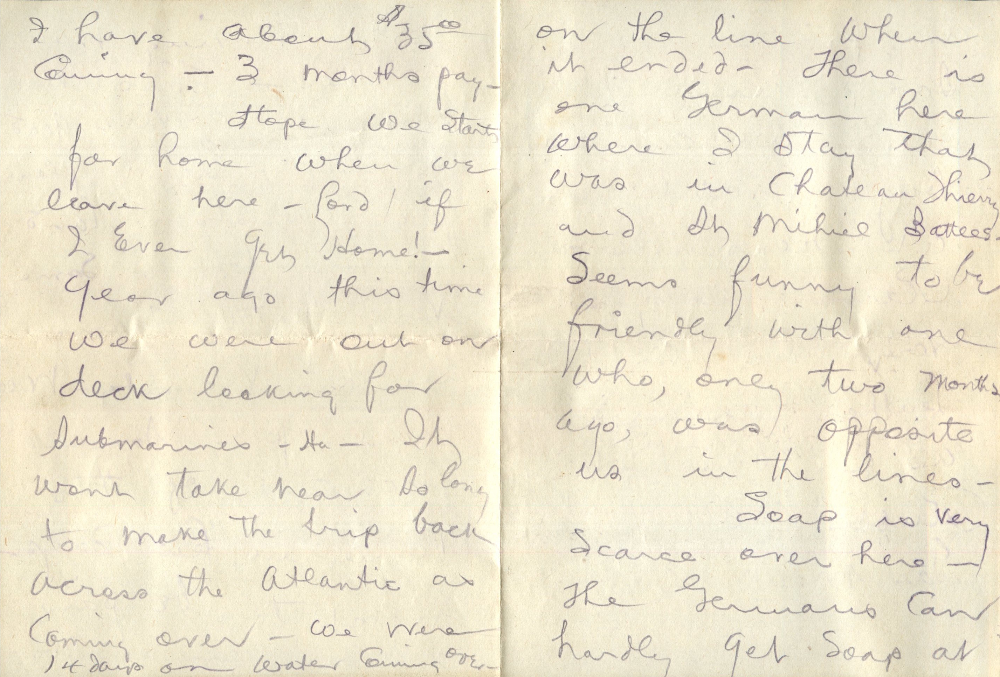
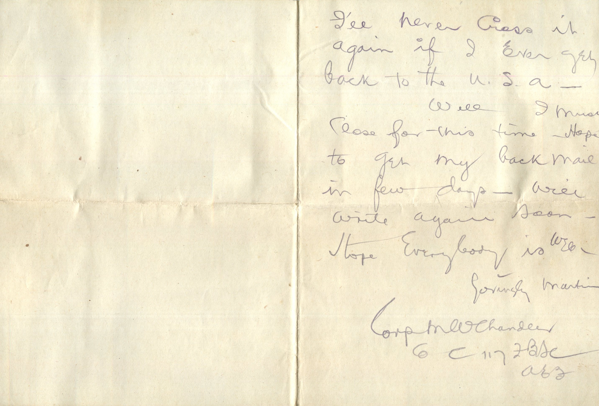

  

From: Martin Chandler, To: Elijah H. Chandler and Family  
Mailed From: Ahrweiler, Germany on January 5, 1918

Ahrweiler, Germany  
January 5  
Dearest Papa, Mama, and all  
Received the box of candy and cake yesterday in good condition. Lordy it certainly was good. Twas in good condition. Nothing tasted anything better. Sure glad to get it. Was afraid it had arrived and gone to central post office with rest of my mail before I got back to my organization. I’m staying with a German family now. Have a pretty fair room. Nice and warm. The people treat me just fine. Do almost anything for a fellow.  
It is rumored we will leave here about the 10th or 12th but dont have the remotest idea where we will go. Hope we go home. Gee I’d certainly love to see you all. I’m extremely anxious to see my new relations. What does Uncle Knox think of Gene and Audrey? He’s a big one to be an uncle twice. Ha.  
How’s he getting along in school?  
Expect he has grown considerably since I last saw him. I’ve gained about 15 pounds since the war ended. I was sure glad it ended too. Don’t ever want to go through another war. Hope there never is another one. I’ve had all I want of war. The only part of the big battles I missed was the last part of the Argonne battle. Wish I could have been on the line when it ended. There is one German here where I stay that was in Chateau Thierry and St. Michiel Battles. Seems funny to be friendly with one who, only two months ago, was opposite us in the lines.  
Soap is very scarce over here. The Germans can hardly get soap at any price. We have soap issued to us and we can also buy it at Commissary at reasonable price. Rubber is also very scarce over here. Leather is used largely as a substitute for rubber. All the German gas masks are made of leather. Still having mild weather. This Rhineland is a very good territory. Great place for tourists. Land is very fertile. Some very pretty towns in this vicinity. Will mail you some postcards of this vicinity in few days. Expect to be paid off in day or two. I have about $35.00 coming. 3 months pay.  
Hope we start for home when we leave here. Lord if I ever get home! Year ago this time we were out on deck looking for submarines. Ha! It wont take near so long to make the trip back across the Atlantic as coming over. We were 14 days on water coming over. I’ll never cross it again if I ever get back to the U.S.A.  
Well I must close for this time. Hope to get my back mail in a few days. Will write again soon.  
Hope everybody is well.  
Lovingly,  
Martin

Corp. M.W. Chandler  
Co “C” 117 FBSC  
A.E.F.