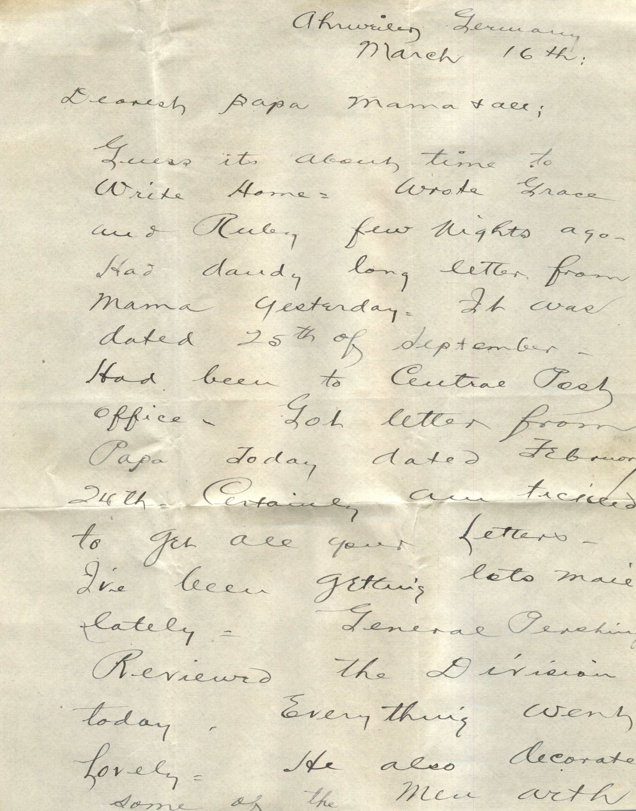
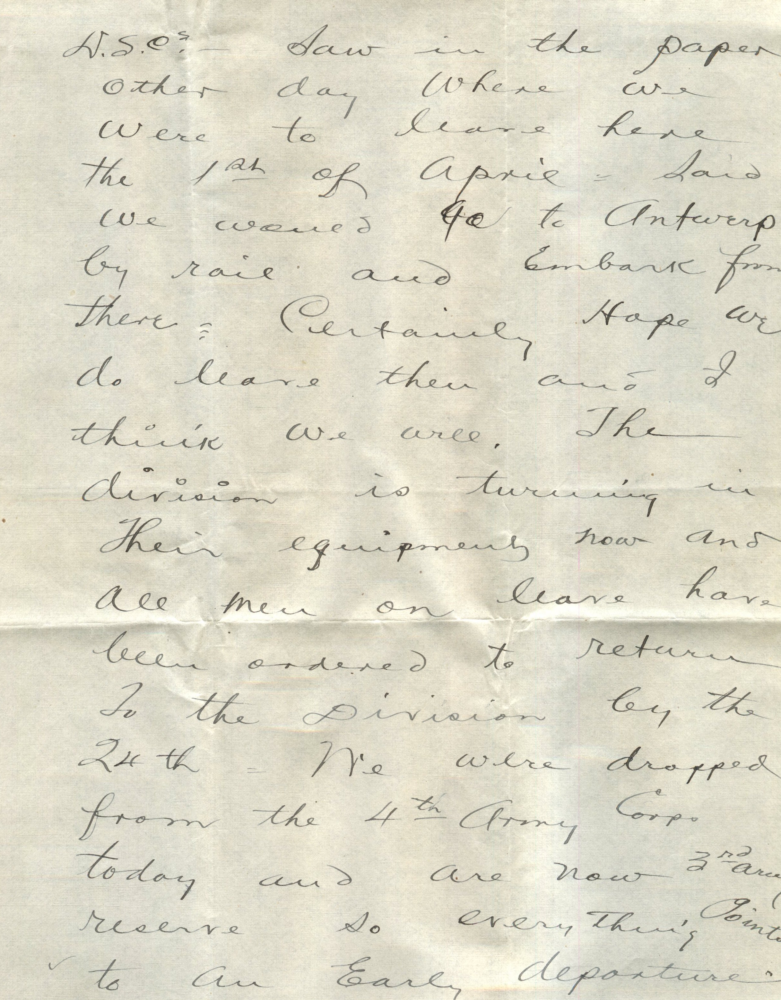
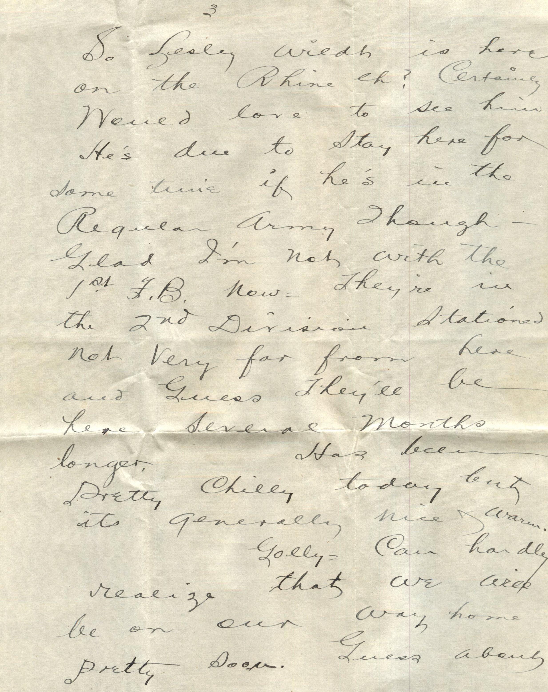
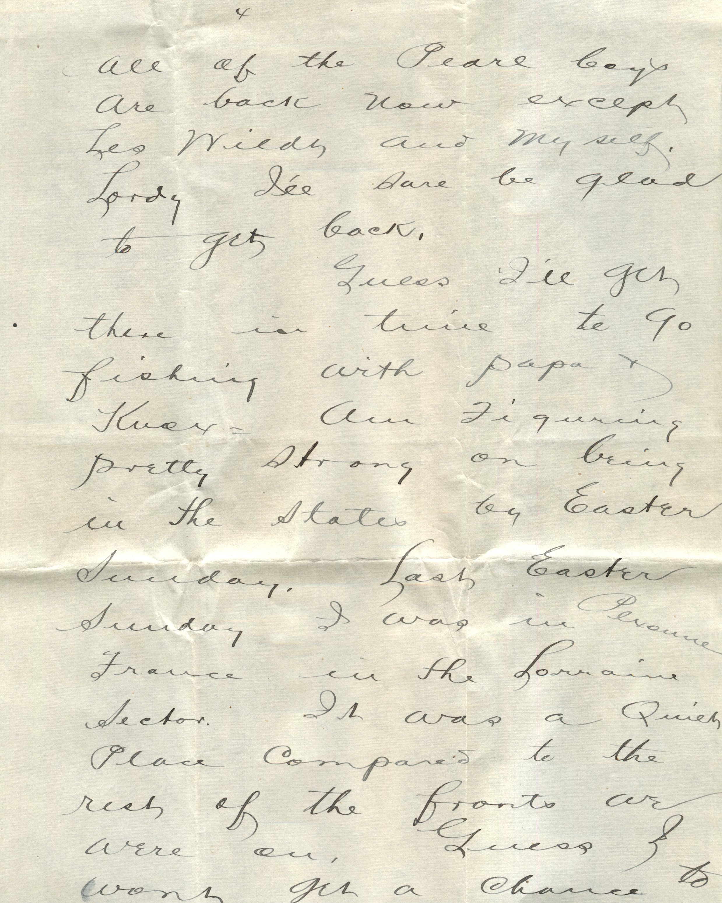
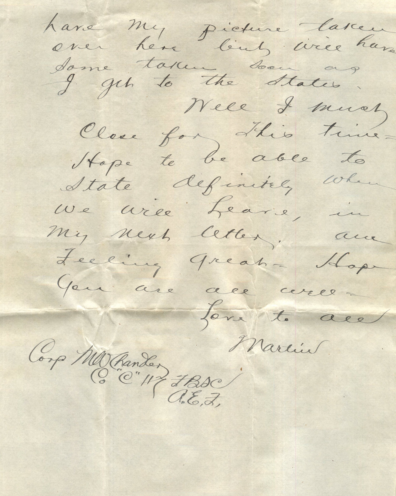

    

From: Martin Chandler, To: Elijah H. Chandler and Family  
Mailed From: Ahrweiler, Germany on March 16, 1918

Mr. E.H. Chandler  
Pearl, Ill  
USA

Corp. M.W. Chandler  
Co “C” 117 F.B.S.C.  
A.E.F.

Ahrweiler, Germany  
March 16th  
Dearest Papa, Mama, and all  
Guess it’s about time to write home. Wrote Grace and Ruby few nights ago. Had dandy long letter from Mama yesterday. It was dated 25th of September. Had been to Central post office. Got letter from Papa today dated February 24th. Certainly am tickled to get all your letters. I’ve been getting lots mail lately. General Pershing reviewed the division today. Everything went lovely. He also decorated some of the men with D.S.C.s. Saw in the paper other day where we were to leave here the 1st of April. Said he would go to Antwerp by rail and embark from there. Certainly hope we do leave then and I think we will. The division is turning in their equipment now and all men on leave have been ordered to return to the division by the 24th. We were dropped from the 4th Army Corps today and are now 3rd army reserve so everything points to an early departure. So Lesley Wildt is here on the Rhine eh? Certainly would love to see him. He’s due to stay here for some time if he’s in the Regular Army though. Glad I’m not with the 1st F.B. now. They’re in the 2nd Division stationed not very far from here and guess they’ll be here several months longer.  
Has been pretty chilly today but it’s generally nice and warm.  
Golly, can hardly realize that we will be on our way home pretty soon. Guess about all of the Pearl boys are back now except Leo Wildt and myself. Lordy I’ll sure be glad to get back.  
Guess I’ll get there in time to go fishing with Papa and Knox. Am figuring pretty strong on being in the sates by Easter Sunday. I was in Pexonne, France in the Lorraine Sector. It was a quiet place compared to the rest of the fronts we were on. Guess I wont get a chance to have my picture taken over here but will have some taken soon as I get to the States.  
Well I must close for this time. Hope to be able to state definitely when we will leave in my next letter. Am feeling great. Hope you are all well.  
Love to all,  
Martin  
Corp. M.W. Chandler  
Co “C” 117 FBSC  
A.E.F.